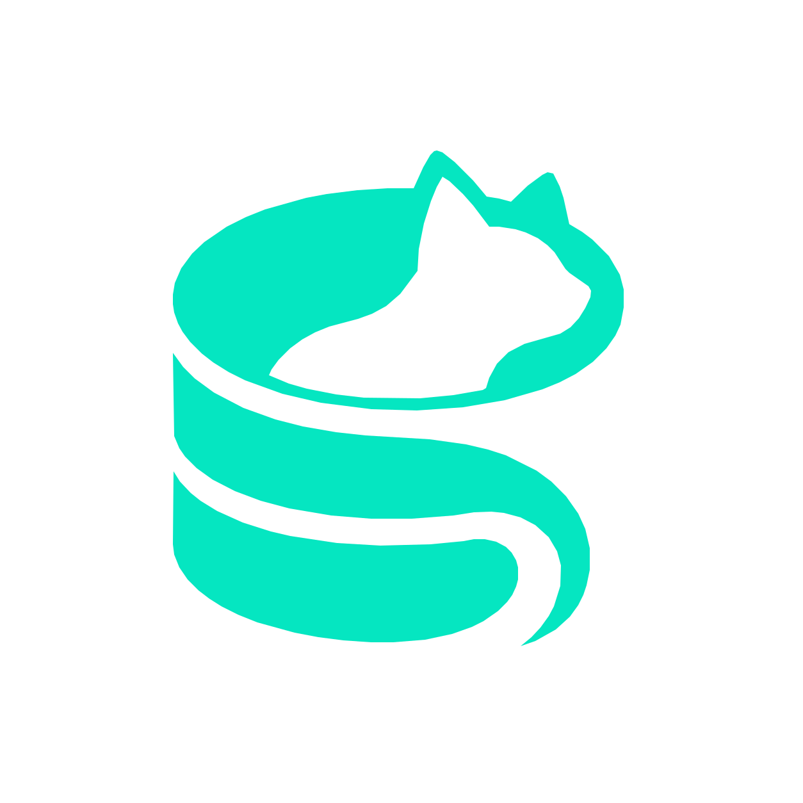
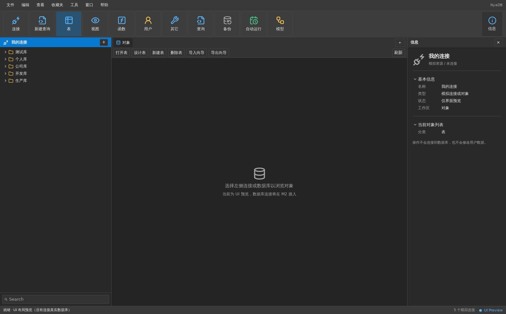

  

NyaDB is a cross-platform, native desktop database workbench built with [Go](https://go.dev/) and the [NyaDB fork of MyGo Native UI](https://github.com/nyakang/mygo). It supports live MySQL, MariaDB, TiDB, OceanBase (MySQL mode), PostgreSQL, CockroachDB, openGauss, GaussDB, KingbaseES, Dameng DM8, SQLite, ClickHouse, Apache Doris, StarRocks, Trino, SQL Server, DuckDB, Oracle, MongoDB, Redis, Elasticsearch, Easysearch, Apache Solr, Apache Cassandra, Apache CouchDB, Meilisearch, Qdrant, Neo4j, etcd v3 and Consul connections, SQL/CQL/Cypher or native MongoDB/Redis/Elasticsearch/Easysearch/Solr/CouchDB/Meilisearch/Qdrant/etcd/Consul requests, and database browsing, with data editing and administration tools for supported engines.

This image is a historical headless UI preview. For recent native-window verification, see the [UI optimization report](docs/ui-global-optimization-2026-11-05.md) and [workbench workflow report](docs/navicat-ux-implementation-2026-11-05.md).

## Features

- Native desktop interface targeting Windows, macOS, and Linux, with shared resizable navigation and inspector panes.
- Consistent Lucide SVG operation icons with a separate set of embedded database brand icons.
- Create, edit, duplicate, delete, group, star, and search connection profiles; import connection URIs and optionally save credentials in the system credential vault.
- A unified navigation tree with lazy database/schema and object loading, favorites, and object search.
- Multi-tab SQL editor with real execution, cancellation, syntax highlighting, completion, formatting, EXPLAIN, multiple results, result snapshots, and export.
- Named queries, SQL files, encrypted workspace recovery, and execution history. Disconnection preserves SQL text and requires explicit session recovery before further execution.
- A shared virtualized data grid with filtering, sorting, paging, column layouts, field previews, and export. MySQL, MariaDB, TiDB, OceanBase (MySQL mode), PostgreSQL, CockroachDB, openGauss, SQLite, SQL Server, DuckDB, and Oracle also support editing, draft undo/redo, transactions, counting, and data analysis where available.
- Table designers, object management, import, backup/restore, and maintenance tools for supported engines, with SQL previews and explicit confirmation for applicable operations.
- MySQL/MariaDB/TiDB/OceanBase SSH tunnels and a NyaDB HTTPS/WebSocket TCP gateway, with host fingerprint trust and optional saved tunnel credentials.
- Optional AI SQL generation, explanation, and optimization through a configurable OpenAI-compatible service, with request previews and suggestions inserted as unexecuted SQL.
- Read-only data dictionaries with Markdown and HTML export.
- Five [color schemes](docs/THEME_SYSTEM.md)—Classic, Ocean, Forest, Rose and Sand—with light, dark and system appearance, live previews, text scaling, and saved preferences.

## Database support

| Engine | Current capabilities | Main limits |
| --- | --- | --- |
| MySQL | SQL, metadata, data editing, table design, object/account management, import/export, backup/restore, maintenance, TLS and SSH/HTTP tunnels | Tools depend on server capabilities, permissions, and object structure. |
| MariaDB | Independent connection profiles and `mariadb://` URIs; SQL, metadata, data editing, table/view design, object management, import/export, backup/restore, maintenance, TLS and SSH/HTTP tunnels | Requires MariaDB 10.11 or later. Account/role management and MySQL-only check enforcement/index visibility are unavailable. Tools retain complete definitions and reject unsupported changes. |
| TiDB | Independent profiles, port 4000 and `tidb://` URIs; SQL, TiDB JSON plans, table/view/sequence browsing, shared-grid editing and transactions, table/view design, accounts/roles/grants, import/export, backup/restore, ANALYZE/ADMIN CHECK, TLS and SSH/HTTP tunnels | Requires TiDB 8.5+. CHECK operations require `tidb_enable_check_constraint=ON`. TiDB executable DDL attributes are preserved; unsupported routines, triggers, events, spatial/fulltext/descending indexes and unsafe attribute edits are rejected. Sequence backups contain definitions and restart values, not allocated/current values. TiDB archives require a TiDB target. See the [TiDB report](docs/tidb-2026-11-06.md). |
| OceanBase (MySQL mode) | Independent `oceanbase://` profiles, tenant usernames and port 2881; SQL, native JSON plans, tables/views/routines/events, reconstructed sequence definitions, shared-grid editing and transactions, import/export, full table copies, owner-preserving view edits, ANALYZE/CHECK, TLS and shared MySQL-family tunnels | Requires OceanBase 4.3.5+. Oracle tenants are rejected. Table design, account management and logical backup/restore are unavailable. View algorithm, definer, SQL SECURITY and CHECK OPTION changes are rejected before execution. Sequence browsing needs tenant metadata privileges. See the [OceanBase report](docs/oceanbase-2026-11-07.md). |
| PostgreSQL | SQL, schema navigation, data editing, table design, ordinary table/view management, import/export, backup/restore and maintenance | Table design supports standard core PostgreSQL 14–18 ordinary tables; unsupported types and definitions are rejected. Backup/restore requires matching `pg_dump`/`pg_restore` tools. SSH/HTTP tunnels are unavailable. |
| CockroachDB | Independent `cockroachdb://` profiles, port 26257 and verified TLS; fixed database/schema navigation, tables/views/sequences/routines, native optimizer plans, shared-grid editing and transactions, bounded serialization retries, count/analysis and import/export | Requires CockroachDB 25.2+. Grid saves retry complete managed batches only after acknowledged `40001`; explicit transactions and SQL are never replayed. Table/view design, object-management dialogs, backup/restore, accounts, maintenance and tunnels are unavailable. See the [CockroachDB report](docs/cockroachdb-2026-11-07.md). |
| openGauss | Independent `opengauss://` profiles, native SHA256/SM3 connector and verified TLS; fixed database/schema navigation, tables/views/sequences/functions/procedures, native routine scripts and SQL files, native JSON plans, ordinary view creation/editing/rename/drop with flag and metadata preservation, transactional RESTRICT table deletion, native table copies and transactional table rename with catalog/storage identity verification, shared-grid editing and transactions, count/analysis and existing/new-table import/export | Requires openGauss 6+ in PG compatibility mode; verified on 6.0.0. SQL/scripts are limited to 8 MiB; packages and local routine declarations are unsupported. Reliable ordinary btree keys are required for editing/keyset paging. Cancellation retires the SQL session and requires explicit recovery. Table design/clear, other object-management dialogs, accounts, backup/restore, maintenance and tunnels are unavailable. Table/view changes require owner/administrator privileges; unsupported objects/options and enabled DDL hooks are rejected. See the [core report](docs/opengauss-2026-11-07.md), [table deletion report](docs/opengauss-table-drop-2026-11-07.md), [table copy report](docs/opengauss-table-copy-2026-11-07.md) and [table rename report](docs/opengauss-table-rename-2026-11-07.md). |
| GaussDB | Independent multi-endpoint `gaussdb://` profiles and Huawei native driver with SHA256/TLS; per-physical product verification, fixed catalog/schema navigation, tables/views/sequences/functions/procedures, SQL/native scripts/files and JSON plans, shared USTORE/ubtree and ASTORE/btree grid editing, transactions, paging/count/analysis/field reads and existing/new-table import/export | Requires native GaussDB Kernel 503.1+ in PG compatibility; verified on 503.1.0 single-node Docker. Reliable ordinary nonnullable unique keys are required for editing/keyset paging. SQL cancellation retires the original physical session and requires explicit recovery. Read-only/standby selections disable grid writing/import. Design/object/account administration, backup/restore, maintenance and tunnels are unavailable. Real HA/failover, distributed/DWS, other authentication and versions remain unverified. See the [core report](docs/gaussdb-2026-11-07.md). |
| KingbaseES | Independent `kingbase://` profiles, native gokb driver with SCRAM-SHA-256/TLS and per-physical product verification; fixed database/schema navigation, tables/views/sequences/functions/procedures, SQL/routine scripts/files and JSON plans, shared-grid precise editing, transactions, paging/count/analysis/field reads and existing/new-table import/export | Verified on KingbaseES V8R6 C9 B14 in PG mode; other versions and compatibility modes are rejected. Ordinary heap tables and reliable immediate btree keys are required for editing/keyset paging. Cancellation retires the original physical SQL session and requires explicit recovery; uncertain commits are never replayed. Design/object/account management, backup/restore, maintenance, tunnels and HA remain unavailable or unverified. See the [core report](docs/kingbase-2026-11-07.md). |
| Dameng DM8 | Independent `dameng://` profiles and caller-installed native DPI clients in private worker processes; server TLS, per-physical product/schema validation, fixed catalog/schema navigation and native read-only object definitions, SQL/procedural scripts/files, shared-grid precise editing, transactions, paging/count/field reads and existing/new-table import, tabular/JSONL and native SQL export, and typed Insert/Update copying | Verified on native DM8 mode 0, UTF-8, case-sensitive, `LENGTH_IN_CHAR=1`, kernel `08134283904-20220804-166351-20005`, with three admitted Linux amd64 clients. Reliable numeric primary keys are required for grid editing/keyset paging; native import matching has its own verified unique-key rules. Full editing is limited to 1 MiB per field. Cancellation requires explicit SQL recovery; uncertain writes are never replayed. New-table import DDL commits independently of its row transaction. SQL execution remains limited to 1 MiB per statement and 8 MiB per source/file; larger SQL exports were verified with original disql START. Plans, analysis, design, administration, backup/restore and tunnels are unavailable. Other kernels, modes, HA and native ABI support on other platforms remain unverified. See the [core report](docs/dameng-2026-11-07.md) and [SQL export report](docs/dameng-native-sql-export-2026-11-07.md). |
| SQLite | SQL, attached databases, data editing, table/view design and management, import/export, online backup/restore and maintenance | Backup/restore operates on one database file at a time. Editing requires a reliable row identity. |
| Apache Doris | Independent `doris://` profiles, FE port 9030 and verified server TLS; per-physical native product checks, internal-catalog/database navigation, table/view definitions, binary SQL results, native Nereids optimized-plan trees with original text, a shared read-only grid, scalar filtering/sorting, count and complete tabular/JSONL exports | Verified on native Doris 4.1.3 FE/BE. Duplicate/aggregate/unique model keys do not grant editable row identities; paging uses offsets. LARGEINT, DECIMAL(76,38), DOUBLE and opaque BITMAP/HLL states retain native values/bytes. SQL requires explicit recovery after cancellation and is never replayed. Fields are limited to 1 MiB for complete reads; previews are bounded and marked. External catalogs, grid editing, SQL transactions, import, SQL export, design, administration, runtime profiling, backup/restore, tunnels and HA remain unavailable or unverified. See the [Doris report](docs/doris-2026-11-07.md) and [plan verification](docs/doris-plans-2026-11-07.md). |
| StarRocks | Independent `starrocks://` profiles, FE port 9030 and verified TLS; per-physical native product checks, default-catalog/database navigation, tables/views and native definitions, binary SQL results, a shared read-only grid, scalar filtering/sorting, count, complete tabular/typed JSONL exports and native COSTS fragment/operator plans | Verified on StarRocks 4.1.7 FE/BE. DUPLICATE/AGGREGATE/UNIQUE/PRIMARY KEY tables remain read-only with offset paging. LARGEINT, DECIMAL(76,38), FLOAT/DOUBLE, VARBINARY and serialized BITMAP/HLL retain values/bytes. Raw SQL state expressions require explicit serialization. Native CPU/Memory optimizer costs stay separate; structural, raw-plan and previous-query results can be switched. Complete fields are limited to 1 MiB with bounded previews. External catalogs, grid writes, SQL transactions, import, design, administration, backup/restore, tunnels and HA remain unavailable or unverified. See the [StarRocks report](docs/starrocks-2026-11-07.md) and [plan verification](docs/starrocks-plans-2026-11-08.md). |
| Trino | Independent `trino://` profiles and verified HTTPS; catalog/schema-qualified navigation, native tables/views and definitions, SQL logical sessions and multi-results, native distributed estimated JSON plans, shared read-only offset grid, scalar filters/sorts, count, complete TXT/CSV/TSV/JSON/XML/HTML and typed JSONL exports | Verified on official Trino 484 with memory, tpch and system catalogs over HTTP (no password) and HTTPS password authentication. BIGINT, DECIMAL(38,18), TIMESTAMP(9), VARBINARY, ARRAY/MAP/ROW and JSON retain precise typed values; previews are bounded. Cancellation retires the logical SQL session and requires explicit recovery without replay. Grid writes, import, SQL export, EXPLAIN ANALYZE, administration, tunnels, OAuth/JWT/mTLS, external connectors and multi-node HA remain unavailable or unverified. SQL writes/transactions follow the native connector's permissions and semantics. See the [core report](docs/trino-core-2026-11-08.md) and [plan verification](docs/trino-plans-2026-11-08.md). |
| ClickHouse | Native connections, SQL, metadata/structure browsing, a shared read-only data grid, filtering, sorting, counting and export | No grid editing, transactions, table designer, import, backup/restore or tunnels. Paging uses offsets. |
| SQL Server | SQL authentication and TLS, fixed database/schema navigation, T-SQL batches, XML estimated plans, shared-grid editing, transactions, filtering, counting, analysis and import/export | Verified on SQL Server 2019 and 2022. Imports append atomically to existing tables. SQL requires explicit schema qualification. Table/view design, object mutations, backup/restore, account management, integrated/Entra authentication and tunnels are unavailable. |
| Oracle | Service name or SID connections, schema/object browsing, SQL and PL/SQL, EXPLAIN PLAN, shared-grid editing, transactions, field previews, counting, analysis and append import/export | Uses a pure Go driver; no Instant Client required. Views, unsupported types and unreliable keys are read-only. LOB editing requires DBMS_CRYPTO. No designer, administration, backup/restore, TNS aliases, wallets or tunnels. |
| DuckDB | Local files or `:memory:`, schema/object browsing, SQL and JSON EXPLAIN, shared-grid editing, snapshot transactions, filtering, counting, analysis and append import/export | Requires the verified official DuckDB 1.4.4 runtime. Views and unsupported column types are read-only for editing. No designer, object-management dialogs, backup/restore or tunnels. |
| MongoDB | Hosts/seeds or SRV, SCRAM and TLS, database/collection/index browsing, native Extended JSON commands, shared-grid document editing, counting and export | Verified on MongoDB 7.0.28 standalone and replica-set fixtures. Complete-document editing preserves BSON types and checks concurrent changes. No SQL/mongosh JavaScript, transaction controls, import wizard, designer, backup/restore or tunnels. See the [MongoDB report](docs/mongodb-2026-11-06.md). |
| Elasticsearch | Independent profiles and `elasticsearch://` URIs; HTTPS Basic/API key or HTTP without authentication; cluster-qualified index/alias/data-stream browsing and full mappings; native REST request sessions; shared-grid document CRUD, original PIT paging, complete fields, count and export | Verified on official Elasticsearch 9.2.0. JSON numbers, routing and original sequence/primary-term tokens are preserved. Lost or incomplete writes retain drafts and cannot be replayed; disconnect requires explicit request-session recovery. No SQL, arbitrary field sorting/filtering, transactions, import/designer or backup tools. See the [public workbench report](docs/elasticsearch-workbench-2026-11-08.md). |
| Easysearch | Independent `easysearch://` profiles, verified HTTPS Basic/native access-token and HTTP no-auth connections; original-cluster index/alias/data-stream navigation and mappings, native REST request sessions, shared-grid document CRUD with routing and both native version tokens, bounded PIT paging, count/field reads and complete frozen Scroll exports | Verified on native Easysearch 2.5.1. Grid filtering supports `_id` and `_routing`; grid sorting is unavailable. Full document editing is limited to 1 MiB and batches to 500 edits/16 MiB. Unknown or incomplete writes retain drafts for explicit read-only verification; session loss requires recovery without replay. Transactions, import, arbitrary field queries/sorts, index design/administration, backup/restore, other versions/auth/mTLS and HA remain unavailable or unverified. See the [workbench report](docs/easysearch-workbench-2026-11-08.md). |
| Apache Solr | Independent `solr://` profiles and service contexts; native HTTP no-auth or Jetty HTTPS Basic connections, qualified Core/collection/alias navigation and schema/config definitions, native REST request sessions, shared-grid document CRUD with original member/shard/key/version protection, live cursor paging, count/field reads and exact JSONL/tabular export | Verified on official Solr 9.9.0 standalone and single-node SolrCloud (RF=1, HTTP/open ZooKeeper). Writes require a reconstructable stored schema and a pure built-in update chain; default schemaless, custom processors and unsupported targets stay read-only. Filtering supports `_key`; sorting, SQL, transactions, import, designer/administration dialogs, backup/restore and HA remain unavailable or unverified. Unknown/partial writes keep drafts for read-only verification; request recovery never replays. See the [workbench report](docs/solr-workbench-2026-11-08.md). |
| Apache Cassandra | Independent `cassandra://` profiles; native v4 none/password and verified TLS connections, qualified Keyspace/table/materialized-view/UDT browsing, original CQL leases with complete BATCH/script dispatch and saved-document dialect recovery, read-only shared-grid paging/count/field reads and exact full export, native key/static roles and definitions | Verified on official Cassandra 5.0.6 single-node Docker with plain none and TLS/password, both under race. Grid writes/filtering/sorting/import, CQL formatting/EXPLAIN/AI SQL, graphical design/administration/backup and HA remain unavailable or unverified. Native CQL writes are explicit; cancellation/recovery never replays. See the [workbench report](docs/cassandra-workbench-2026-11-08.md). |
| Apache CouchDB | Independent `couchdb://` profiles, none/Basic authentication and verified native HTTPS; qualified database/design-document navigation, complete read-only native JSON and per-view definitions, REST request leases with exact HTTP/JSON results and explicit recovery | Verified on official CouchDB 3.5.3 single-node Docker over HTTP and native HTTPS under race. Default database enumeration requires administrator privileges; server permission errors remain explicit. Grid/document browsing, Mango paging, document draft editing, import/export, attachments, replication/conflict management and HA remain unavailable or unverified. Node UUID does not identify a database incarnation; recovery never replays requests. See the [workbench report](docs/couchdb-workbench-2026-11-08.md). |
| Meilisearch | Independent `meilisearch://` profiles; anonymous/Bearer authentication, explicit index scope, native HTTPS and mTLS; qualified index/settings/statistics navigation and the shared document grid; original JSON insert/replacement/deletion with explicit task observation and exact readback; JSON/JSONL import into an existing index with complete replacement or field merge; settings editing/reset, search/filter/sort/facets, qualified/global task browsing and selected UID management; global server dump/snapshot creation with original task observation; index creation, primary-key updates, rename, atomic swap, document clearing and deletion with typed confirmation and explicit metadata/count verification; original API key management with temporary secret reveal/copy; OFFSET paging, bounded fields, counts and native JSONL/tabular export; REST leases and explicit recovery | Verified on official Meilisearch 1.56.1 Docker in four modes under race. Admission does not confirm completion; recovery never replays. JSON/JSONL import submits one task, up to 10000 documents/8 MiB (1 MiB per document), and confirms only after explicit task observation and complete readback. Merge replaces nested objects as whole fields. Live pagination, preflight and index/version observations provide no atomic snapshot or CAS guarantee. Search and filtered exports follow native hit limits; complete JSONL enumerates all documents. Server backup tasks write to configured server directories; HTTP provides no file download, and restore requires offline startup into a new empty data directory. Snapshot replaces the existing server snapshot; archive it first if it must be retained. Same-version Docker dump/snapshot restores are verified. Index creation/rename/swap/deletion require an unscoped profile; configured sole-index profiles support primary-key update and document clearing. Related data/settings/task pages pass leave guards and close before submission. Namespace claims protect only the original local session; metadata/count verification is distinct from native task success and does not compare full contents. Further reference features remain pending. Reproduce index management with the [native fixture verifier](tools/verify_meilisearch_fixture.py) using --namespace-management. See the [server backup report](docs/meilisearch-server-backups-2026-11-09.md), [document write report](docs/meilisearch-data-writes-2026-11-08.md), [document import report](docs/meilisearch-document-import-2026-11-08.md), [API key panel report](docs/meilisearch-keys-panel-2026-11-08.md), [settings report](docs/meilisearch-settings-2026-11-08.md) and [task management report](docs/meilisearch-task-management-2026-11-08.md). |
| Qdrant | Independent `qdrant://` profiles, port 6333, anonymous/API-key authentication, native HTTPS and mTLS; qualified physical-collection/alias metadata and complete read-only native JSON definitions; the shared point grid with exact uint64/UUID IDs, vector/payload/full-point JSON, native ID cursor paging and explicitly applied filter JSON; independent exact count and bounded original-field reads; complete native JSONL and filtered tabular export; REST query results and explicit original-session recovery | Verified on official Qdrant 1.20.0 Docker in four modes under race. ID cursors read live data and provide no atomic snapshot. Count and complete JSONL export cover the entire collection; tabular export uses the current filter. Grid pages contain at most 1000 points, previews and field chunks at most 1024 characters, complete row reads at most 1 MiB and each native response at most 16 MiB. REST query results are bounded to 10000 points, 1024 columns and 1048576 cells. Accepted writes do not confirm completion; recovery never replays. Complete point JSON editing, insertion and deletion use one original native batch followed by explicit point verification; unknown or incomplete outcomes retain drafts and prohibit replay. JSON/JSONL import uses the shared wizard with explicit native insert_only/update_only/upsert modes, at most 10000 complete points and 8 MiB in one batch; all-source readback is explicit and retains bounded original evidence. Graphical collection create/update/delete and alias create/delete/rename/retarget bind immutable previews to the original session, guard its REST and affected data/object documents, retain actual boolean receipts, and require explicit readback. Arbitrary sorting, snapshot management and streaming large snapshot downloads remain pending. Version, operation IDs and configuration observations provide no collection incarnation or CAS guarantee. |
| Redis | Redis 7+ standalone, Cluster and Sentinel; ACL authentication, independently verified Redis/Sentinel TLS, slot routing and master discovery, multi-master SCAN, native command sessions, shared-grid viewing/editing of string/hash/list/set/zset/stream values, TTL, rename, count and export | Cluster uses database 0; multi-key commands, grid renames and transactions require one slot. Failover revokes existing command sessions and requires explicit recovery. Bytes use base64; editing/export is limited to 1 MiB. Pub/Sub, SQL, table design and backup/restore are unavailable. See the [Redis report](docs/redis-2026-11-06.md). |
| Neo4j | Independent native Bolt/routing profiles, URI import, anonymous/basic authentication, verified TLS and mTLS; database-qualified labels, relationship types, indexes, constraints, procedures and complete function signatures; Cypher highlighting/completion, temporary JSON parameters, shared result grids with alias-qualified properties from retained Cypher nodes, exact native node/relationship/path/temporal/spatial JSON and snapshots; graph visualization with search, directed parallel/self-loop relationships, missing-endpoint/conflict notices, original-record links, drag/pan/zoom/pin/hide, independent snapshot layouts and PNG/SVG export; explicit original-session neighbor expansion with separate native records, bounded JSON export and retained-value conflict notices; node/relationship property editing with typed lock-before-compare saves, independent native receipts and explicit readback; shared node/relationship data grids with independent native property columns, record forms and property editing (scalars, bytes, homogeneous scalar and temporal/spatial lists and temporal/spatial scalars), explicitly confirmed node creation, qualified relationship creation with observed source/target nodes, and node/relationship deletion with complete affected-relationship previews, native cursor paging, original field fingerprints, independent count/field reads and complete qualified-range JSONL/tabular export | Verified on official Neo4j 5.26.21 Community Docker in four modes under race. Selected text or the complete source executes as one native query. Cancellation and missing completion require explicit original-session recovery; recovery never replays. Failed/canceled data pages retain their last successful grid until explicit data reopening after executor acknowledgement. Native cursors support previously read pages and the next page. Reads and exports observe live data without an atomic snapshot. JSON parameters and complete fields are limited to 1 MiB; parameters are not persisted. Default retained query results are limited to 1000 rows/16 MiB; JSON display to 256 KiB and Cypher files to 8 MiB. Node expansion uses only retained rows, preserves original source columns and native receipts, and falls back to original nodes above 1024 columns/1,048,576 cells/16 MiB of display estimates/64 KiB of layout descriptors. Pure node source columns are hidden by default and remain available in the column menu. Graph visualization admits 1000 nodes/2000 relationships/8 MiB of owned topology; all original rows and receipts remain available. Explicit neighbor requests read at most 200 rows/4 MiB each, retain separate records/receipts within 8 MiB and do not modify or replay the original query. They preserve old positions/pins/camera, require the original current lease, wait for cancellation acknowledgement and reject parked stale publications. Snapshots own expanded values without issuing live reads. Property saves compare the selected value/type and node labels or relationship type/endpoints after acquiring the target lock, preserve the original query/table and retain complete native receipts separately. Old/new parameter capture shares a 1 MiB limit; receipts/verification records share 8 MiB and snapshot budgets. Uncertain or parked stale writes retain drafts and evidence; explicit recovery/readback never replays. Shared-grid unknown writes offer an explicit original-document close decision after executor acknowledgement; cancel keeps the guard, and close discards local drafts/receipts without confirming or rolling back the native transaction. Complete saved or verified entities establish their own observation order, allowing continued editing after neighbor expansion while preserving later external conflicts and independent snapshots. Node creation omits untouched properties and admits generated identities only after COMMIT confirmation. Node deletion requires an explicit ordinary/detached choice, compares the complete captured entities and relationships under native locks, and rolls back earlier rows on conflict. Relationship creation requires explicit source/target element IDs, complete original endpoint observations and a separate save confirmation; it preserves directed parallel/reverse/self-loop semantics, compares endpoints under locks, and accepts generated identities only after actual COMMIT acknowledgement. Complete typed graph exchange/import uses explicit source-to-destination endpoint mappings, immutable original previews, bounded parameter chunks in one native transaction, and actual COMMIT confirmation before generated identities; full-database live graph exchange publishes only after complete type and endpoint-closure validation. Graph exchange/import also opens directly from the database menu, including completely empty databases, in a qualified namespace document with no fabricated label or grid; restoring a workspace requires explicit reopening and never reconstructs transfer requests. See the [database-level exchange report](docs/neo4j-graph-namespace-2026-11-10.md). Native EXPLAIN/PROFILE trees now use the shared structured plan view with original query/typed parameters, exact recorded runtime metrics, raw JSON copy/export and independent snapshots. PROFILE executes the source query once; plan display/copy/export/recovery never replays it. Complete receipts survive plan bounds failures and parked generation replacement requires explicit recovery. See the [structured plan report](docs/neo4j-structured-plans-2026-11-10.md). Shared graph schema management provides complete catalogs, immutable CREATE/DROP previews, one original native submission and separate verification; DROP requires explicit acknowledgement that a same-name replacement may be removed. CREATE completion remains separate from ONLINE. See the [schema management report](docs/neo4j-schema-management-2026-11-10.md). Full database archives, administration/RBAC and Enterprise/cluster validation remain pending. See the [graph exchange/import report](docs/neo4j-graph-exchange-2026-11-10.md). See the [temporal/spatial list report](docs/neo4j-extended-lists-2026-11-10.md), [relationship creation report](docs/neo4j-public-relationships-2026-11-10.md) and [entity creation/deletion report](docs/neo4j-public-entities-2026-11-09.md). See the [continuous editing report](docs/neo4j-property-observation-order-2026-11-09.md), [property editing report](docs/neo4j-property-writes-2026-11-09.md), [neighbor expansion report](docs/neo4j-neighbors-2026-11-09.md), [graph visualization report](docs/neo4j-graph-view-2026-11-09.md), [Cypher node result report](docs/neo4j-node-results-2026-11-09.md), [property column/form report](docs/neo4j-properties-2026-11-09.md), [graph data report](docs/neo4j-public-data-2026-11-09.md) and [workbench report](docs/neo4j-workbench-2026-11-09.md). |
| etcd v3 | Independent `etcd://` / `etcds://` profiles, exact text/Base64 prefixes, anonymous/basic/TLS/mTLS connections, qualified key browsing, native JSON request documents/files, fixed-MVCC shared-grid paging/count/export, binary editing and atomic insert/update/delete/rename with immutable confirmations and complete original receipts | Verified on official 3.7.3 in four modes and 3.5.35 basic. Full editing is bounded to 1 MiB; field previews to 1024 bytes. Omitted values/leases remain distinct from empty values/lease=0. Conflicts retain drafts; unknown write acknowledgements block further writes without replay. Browsing intersects the original prefix with the authenticated user's read grants; per-row write gates, counts and exports use that captured scope. Read-only and empty scopes remain usable; changed permissions require an explicit document reopen. Original-key Watch and fixed-window history open from the shared grid or native request method selector. Start/Stop/Progress remain explicit; complete records retain original frames separately from the limited preview. Recovery retains receipts without resubscribing. Continuous renewal is a separate LeaseRenewal document method with explicit original-ID authorization, Start/Stop and complete attempt receipts. Unknown one-shot or renewal writes block further writes in that document; recovery retains receipts and never resumes renewal. LeaseBrowse and LeaseDetail use the original request document lease for actual cluster ID windows, observed TTLs and complete attached keys; failed or retired reads retain original receipts and cached pages, and recovery never rereads them. Dedicated lease Grant/Revoke tools retain original observations and native outcomes. AuthManagement offers user/role directories, complete byte permissions and separate native write confirmations with full step receipts; temporary passwords are omitted from preview/export records. Failed or unknown steps stop the sequence, and later reads never confirm a missing write receipt. Compact provides immutable original revision/physical confirmations. Members provides complete original directories, explicitly verified endpoint/version targets and checked Defragment batches; each step observes leadership again, processes followers before the selected leader and stops at the first failure or unknown receipt. Learners remain available for Status inspection. Alarms provides complete original lists, known-type filters and checked exact Disarm batches with immutable confirmation and separate per-step GET/ACK evidence. Snapshot offers bounded original-backend capture, full native journals and separate original-file publication confirmations with preserved old backups; retained files can save after disconnect. Restore, membership changes, broader cluster management and etcd v2 remain pending. See the [public workbench report](docs/etcd-public-workbench-2026-11-10.md) and [event/history report](docs/etcd-public-events-2026-11-10.md). |
| Consul | Independent `consul://` / `consuls://` profiles, anonymous/token authentication, verified TLS/mTLS, exact datacenter/prefix/consistency settings and native HTTP documents in the shared KV workspace | Verified on official 2.0.2 anonymous/token/TLS/mTLS and 1.22.3 token. Supports bounded KV reads/listings/raw bytes, conditional writes and atomic KV transactions, one-shot session/lock operations and read-only agent/catalog/health requests. Writes require an immutable original-method/path confirmation. Complete HTTP records retain original bodies, parsed headers/trailers, exact uint64 indices/flags and session UUIDs. Unknown writes remain separate from later reads and block further writes; cancellation waits for the original executor, and explicit recovery never replays a request. Request files retain text only. SQL, a relational data grid, continuous watch/renewal, ACL administration, service registration, archives, Enterprise namespaces/partitions and HA remain pending. |

Grid editing requires a reliable row identity; views, generated fields, and unsupported objects remain read-only. Availability is checked against the engine, adapter, server permissions, and selected object. Unsupported operations are disabled or rejected explicitly.

Neo4j public graph-grid and workbench acceptance is reproducible with `python3 tools/verify_neo4j_fixture.py --grid --race --mode MODE`, where MODE is `anonymous`, `basic`, `tls` or `mtls`. The four modes require 176 native acceptance groups without skips and record 192 profile-form, 896 Cypher-workbench, 256 graph-grid/retirement/property-editing/close and 32 shell graph-navigation headless images. Tests verify original session generations, saved-profile reopening, exact graph values, complete exports of 1205 nodes, same-name node/relationship identities, failed/canceled refresh and next-page reads, native explicit property transactions and atomic rollback, exact typed write receipts, continued editing, parked/stale generations, withheld COMMIT replies and queued-write poisoning, original close acknowledgement and explicit recovery without replay. Public entity creation/deletion acceptance runs separately with `python3 tools/verify_neo4j_fixture.py --entity-grid --race --mode MODE`; each mode requires 21 native cases and 112 Chinese/English wide/narrow grid images, including actual COMMIT response loss and preview lifecycle cases. Public qualified relationship creation uses `python3 tools/verify_neo4j_fixture.py --relationship-grid --race --mode MODE`; each mode requires 29 native cases and 152 localized wide/narrow images, including endpoint input, complete observations, drafts, previews, actual COMMIT faults and original-document lifecycle. Temporal/spatial property list acceptance uses `python3 tools/verify_neo4j_fixture.py --extended-lists --race --mode MODE`; each mode requires 22 native cases and 248 localized images across Cypher editing and the shared grid. Complete graph exchange/import acceptance uses `python3 tools/verify_neo4j_fixture.py --graph-import --race --mode MODE`; each mode requires 15 native cases and 96 localized wide/narrow shared-grid images. Empty-database graph namespace acceptance uses `python3 tools/verify_neo4j_fixture.py --graph-namespace --race --mode MODE`; each mode requires 19 native cases and 140 localized wide/narrow images, covering database menu entry, empty JSON/JSONL export, typed graph import, independent same-name tabs, explicit workspace reopening and original-generation lifecycle. Native structured plan acceptance uses `python3 tools/verify_neo4j_fixture.py --structured-plans --race --mode MODE`; each mode requires 6 native parents and 32 localized wide/narrow plan/result/snapshot/generation/workbench images. Schema management acceptance uses `python3 tools/verify_neo4j_fixture.py --schema-management --race --mode MODE`; each mode requires 7 native parents and 32 localized wide/narrow images, including actual DDL reply faults and native same-name replacement. Full-database export fixtures run Go packages sequentially. Cross-platform builds verify compilation; real server acceptance runs on Linux. See the [adapter documentation](internal/services/neo4j/README.md).

Qdrant shared point-grid and public REST acceptance is reproducible with [the Qdrant fixture verifier](tools/verify_qdrant_fixture.py), using `--public --data --race` and `--mode anonymous`, `--mode api-key`, `--mode tls` or `--mode mtls`. Each mode verifies the public chooser/URI/storage/navigation and REST recovery together with original data leases, mixed exact point IDs, named/sparse/multi-vectors, signed native cursors, original row fingerprints, independent cancellation, count, filter history and complete exports of 5015 points and a point over 1 MiB. It also verifies one-batch JSON/JSONL import, all-source readback of 5004 points, native mode conflicts, concurrent skips and original-session cancellation without replay. It records 24 profile-form, 16 REST-workbench, 16 shared-grid and 24 import-wizard headless images in Chinese and English at two window sizes. See the [point-grid report](docs/qdrant-data-2026-11-09.md); reports and images remain in ignored local directories.

Qdrant graphical collection/alias acceptance is included in `python3 tools/verify_qdrant_fixture.py --public --race` in all four modes. It requires real collection and alias actions, original REST/data/object leave guards, cancellation of guards, parked reads/writes, replaced public generations, lost responses, interrupted readback and original close without replay. Each mode records 24 management images in Chinese and English at 1280×800 and 720×520, alongside the existing profile and REST evidence.

Qdrant's private native batch foundation also verifies explicit `insert_only`/`update_only`/`upsert` modes, native update filters, mixed point upsert/deletion, exact per-operation receipts and original-executor interruption. A later HTTP failure can follow an earlier applied operation; completion can also skip points under the chosen mode or filter. Shared-grid editing now binds these batches to original signed row snapshots and retains complete HTTP receipts, actual native operation IDs and explicit point-readback evidence. JSON/JSONL import uses the same native receipt ownership and explicit original-point verification; insert/update preflight is a live observation and provides no atomic comparison guarantee. See the [point-import report](docs/qdrant-point-import-2026-11-09.md), [shared-grid writes report](docs/qdrant-point-grid-writes-2026-11-09.md) and the [native point-batch report](docs/qdrant-point-batches-2026-11-09.md).

Qdrant's native collection/alias management foundation preserves exact creation/update configuration, explicit commit timeouts and ordered alias create/delete/rename/retarget requests. Prepared request copies share a one-use attempt state, including across explicitly opened clients. Native true/false boolean receipts remain distinct from desired metadata verification; failed or interrupted responses retain original bytes and cannot be replayed. Official 1.20.0 verifies absent-collection deletion returning false and a failed alias batch leaving the alias registry unchanged. Its original-session management lease adds signed bounded configuration/alias observations, immutable previews, affected physical-collection claims, original boolean receipts and explicit complete readback. Unresolved management excludes original REST documents and affected point documents while permitting unrelated point documents; cancellation and close wait for the original executor. Metadata PATCH merges top-level keys, removes keys set to null and replaces nested objects; the first metadata payload preserves its null keys. Readback never resubmits, and matching metadata without the original receipt remains indeterminate. A neutral optional management provider now binds immutable observation/plan handles to the original published session and translates its lease generation at the runtime boundary. Replacement rejects old reservations and operations while retaining original unresolved boolean evidence; old close leaves replacement leases intact. The graphical collection/alias page is available from a connected Qdrant profile’s context menu or Tools menu. It preserves native configuration JSON, explicit commit timeouts, exact destructive-name confirmation and full-request review for truncated previews. Changed drafts revoke previews; original-profile results remain parked, replacement keeps old receipts without changing new caches, and namespace refresh retains the global management page. Full request, receipt and bounded original evidence can be copied explicitly; uncertain operations prohibit replay. Workspace restoration saves presentation only. Snapshot management remains pending. See the [graphical management report](docs/qdrant-management-ui-2026-11-09.md), [native management report](docs/qdrant-management-native-2026-11-09.md), [original-session management report](docs/qdrant-management-session-2026-11-09.md) and [runtime binding report](docs/qdrant-management-binding-2026-11-09.md).

GaussDB core workbench support has been validated against a disposable native GaussDB Kernel 503.1.0 container. See the [core report](docs/gaussdb-2026-11-07.md).

KingbaseES core workbench support has been validated against a disposable native V8R6 PG-mode container. See the [core report](docs/kingbase-2026-11-07.md) and [transport foundation](docs/kingbase-native-transport-2026-11-07.md).

Elasticsearch public connections and workbench workflows are verified against the official default 9.2.0 Docker fixture. See the [workbench report](docs/elasticsearch-workbench-2026-11-08.md) for the public scope and links to the transport, profile, metadata, read, export and write-recovery verification.

Easysearch public connections and workbench workflows are verified on the unchanged official 2.5.1 server/JDK deployed in an Ubuntu compatibility container. See the [workbench report](docs/easysearch-workbench-2026-11-08.md) for HTTP/HTTPS acceptance and links to the earlier transport, profile, session, document and write-verification reports.

Apache Solr public connections and workbench workflows use an independent native provider. The [workbench report](docs/solr-workbench-2026-11-08.md) records the standalone HTTP/Jetty HTTPS Basic and single-node SolrCloud scope, and links to the earlier private transport, profile, document and write-verification reports.

See the [Oracle report](docs/oracle-2026-11-06.md), [multi-engine delivery report](docs/multi-engine-reliability-2026-11-04.md), [MariaDB report](docs/mariadb-2026-11-06.md), [SQL Server report](docs/sqlserver-2026-11-06.md), [DuckDB report](docs/duckdb-2026-11-06.md), [PostgreSQL designer support boundaries](docs/postgres-designer-save-2026-11-03.md), and [ClickHouse report](docs/clickhouse-native-2026-11-02.md) for detailed limits and verification. Advanced synchronization, modeling, automation, and other planned tools remain in development.

etcd public workbench acceptance is reproducible with `python3 tools/verify_etcd_fixture.py --public --race --mode MODE`, where MODE is `anonymous`, `basic`, `tls` or `mtls`; add `--version 3.5.35 --mode basic` for compatibility. Each full mode requires 42 native cases and 172 Chinese/English wide/narrow images, including chooser/URI/vault/SQLite reopening, original sessionbrowser recovery, request files, atomic shared-grid mutations, conflicts, 1 MiB lease-only updates and actual successful Txn reply loss/cancel/close without replay. `--public-smoke` is a smaller six-case check and does not establish full acceptance. `--access` adds four native permission/identity cases and a restricted-user Shell/grid case with 24 additional localized images; `--access-smoke` runs only the four service cases. See the [public report](docs/etcd-public-workbench-2026-11-10.md), [adapter documentation](internal/services/etcd/README.md), [data adapter report](docs/etcd-data-adapter-2026-11-10.md) and [request workspace report](docs/etcd-request-workspace-2026-11-10.md).

etcd public Watch/history acceptance is reproducible with `GOWORK=off python3 tools/verify_etcd_fixture.py --public-events --race --mode MODE`. The seven mandatory native cases verify original complete keys and read revisions, actual read-grant revocation, native event/history documents, complete archives, shared-grid actions, explicit controls and parked publication recovery. Each mode captures 28 Chinese/English wide/narrow Shell images. Run the four 3.7.3 modes and 3.5.35 basic for the supported matrix. Historical windows require an actual native progress acknowledgement; display limits never imply complete archival coverage.

etcd continuous renewal acceptance is reproducible with `GOWORK=off /usr/bin/python3 tools/verify_etcd_fixture.py --public-renewal --race --mode MODE`. Each mode requires 24 native parents and 80 Chinese/English wide/narrow images, including native/session renewal regression, actual processed first/later reply loss, original confirmation and immutable lease ID, cancellation/Stop/close/parking/publication replacement, complete archives and old public Watch/history regression. Use the four 3.7.3 modes and 3.5.35 basic. Stop allows natural expiration; recovering a document never sends another renewal.

etcd lease browser acceptance is reproducible with `GOWORK=off /usr/bin/python3 tools/verify_etcd_fixture.py --public-lease-browser --race --mode MODE`. Each mode requires 22 native parents and 56 Chinese/English wide/narrow workspace and Shell images, including complete original list/TTL receipts, more than 256 attached keys, exact signed IDs, client windows, actual processed read faults, parked publication recovery and independent one-shot/renewal unknown receipts. Use the four 3.7.3 modes and 3.5.35 basic. See the [lease browser report](docs/etcd-public-lease-browser-2026-11-10.md).

etcd Auth management acceptance is reproducible with `GOWORK=off /usr/bin/python3 tools/verify_etcd_fixture.py --public-auth --race --mode MODE`. Each mode requires 13 native parents and 80 Chinese/English wide/narrow workspace and Shell images. It covers the original 14 native Auth RPCs, actual password and certificate identities, restricted-user denials, immutable multi-step forms, processed partial-write reply faults, full binary permissions, redacted preview files, complete receipts and parked publication recovery without replay. Use the four 3.7.3 modes and 3.5.35 basic. AuthEnable/AuthDisable are outside the public management capability.

The original etcd Compact request and maintenance lease inventory are available as a native foundation. `GOWORK=off /usr/bin/python3 tools/verify_etcd_fixture.py --compaction-native --race --mode MODE` requires 16 native parents covering cluster-wide logical/physical compression, actual processed-reply faults, original session publication/recovery and compacted paging/Watch/history. Use the same five version/transport configurations. The native foundation has a [separate report](docs/etcd-compaction-native-2026-11-11.md). The KV request method selector now includes a Compact form with exact revision text and the native physical option. Explicit Status/Range observation, immutable checked confirmation and a single original request remain separate steps. Complete operation records preserve the original observations and native replies; opening request files or recovering never executes Compact. Missing write acknowledgements remain blocked after later Range/Watch/history reads. Public acceptance uses `--public-compaction --race --mode MODE` under the same five configurations, with genuine workspace/Shell cases and Chinese/English wide/narrow images. See the [public report](docs/etcd-compaction-public-2026-11-11.md). Public member-targeted Defragment is described below. Public Alarms is described below. Snapshot and membership changes remain pending.

Public etcd member batches are reproducible with `GOWORK=off /usr/bin/python3 tools/verify_etcd_member_fixture.py --public-members --race --version VERSION --mode MODE`. Use official 3.7.3 anonymous/basic/TLS/mTLS and 3.5.35 basic; each owned three-voter/one-learner cluster requires nine native parents and 72 Chinese/English wide/narrow workspace and Shell images. The Members request method retains complete original directory/handshake/ordering/Before/ACK evidence and offers text-only request files plus full receipt copies/exports. Confirmation captures original one-use member plans; final native Status must identify a known voter leader, and a follower that became leader stops before dispatch. Partial success is retained, cancellation does not roll back and recovery never replays or settles an unknown ACK. Local acceptance: [public member report](docs/etcd-public-members-2026-11-11.md).

The original etcd Alarm native foundation supports one GET with an optional alarm-type filter and one exact member-ID/type DEACTIVATE request through the original document/session/runtime lease. Complete native headers, unsigned IDs, unknown enum/extension fields and removed-alarm ACKs remain separate from later list observations. An unknown Disarm blocks further original-document writes and survives pure recovery; no implicit disarm-all helper or ACTIVATE is exposed. Reproduce with `GOWORK=off /usr/bin/python3 tools/verify_etcd_fixture.py --alarm-native --race --version VERSION --mode MODE` under the five existing configurations. Public checked Alarm forms are described below; see [native adapter scope](internal/services/etcd/README.md).

The existing KV workspace now also retains private original Alarm observations and immutable checked exact-Disarm batches. Every target gets a fresh full original GET before dispatch; missing or changed targets stop before sending, and failure/unknown/cancel stops the remaining sequence. Complete archives retain per-step before/ACK receipts and independent unknown evidence across text-only files, parking and pure recovery. Reproduce the private batch foundation with `GOWORK=off /usr/bin/python3 tools/verify_etcd_fixture.py --alarm-workspace --race --version VERSION --mode MODE`. The Alarms method now offers actual original-list selection, known-type filtering, immutable batch confirmation, separate native evidence views and complete copy/export. Each step keeps its original GET/Disarm lease; an absent or changed pair stops before writing. Unknown native types can be inspected but cannot authorize a write. Opening request files restores text only, and explicit recovery neither rereads nor executes a request. Public acceptance uses `GOWORK=off /usr/bin/python3 tools/verify_etcd_fixture.py --public-alarms --race --version VERSION --mode MODE`: 27 mandatory native parents and 136 Chinese/English wide/narrow workspace and Shell images per configuration, on 3.7.3 anonymous/basic/TLS/mTLS and 3.5.35 basic. See the [public Alarm report](docs/etcd-alarm-public-2026-11-11.md).

The etcd KV method selector also offers Snapshot with exact finite limits and an explicit whole-backend confirmation. It retains the original complete source, private disk artifact and independent file publication receipts. Backend files and complete failure journals can save after disconnect; replacing an inspected existing file requires a separate confirmation and preserves its old bytes. Original unknown writes and file acknowledgements remain independent, and recovery performs no capture or publication. Reproduce the 34-parent, 156-image native workspace/Shell scope with `GOWORK=off GOFLAGS=-mod=readonly /usr/bin/python3 tools/verify_etcd_fixture.py --public-snapshot --race --version VERSION --mode MODE`, using 3.7.3 anonymous/basic/TLS/mTLS and 3.5.35 basic. Restore and actual Windows/macOS filesystem runtime remain separate scopes. See the [Snapshot workspace report](docs/etcd-snapshot-public-2026-11-11.md).

Consul public profile/editor/runtime/shared-KV-workspace acceptance is reproducible with `GOWORK=off /usr/bin/python3 tools/verify_consul_fixture.py --public --race --mode MODE`, where MODE is `anonymous`, `token`, `tls` or `mtls` on official 2.0.2. Also run `--version 1.22.3 --mode token`. Each configuration requires all 22 original native/document/runtime/public parents and 76 Chinese/English wide/narrow images. Actual processed-reply loss, partial bodies, HTTP 408/5xx, cancellation, parking, original disconnect/replacement/close and explicit recovery are checked without retry or readback promotion. See [adapter scope](internal/services/consul/README.md) and the [local public report](docs/consul-public-2026-11-11.md).
