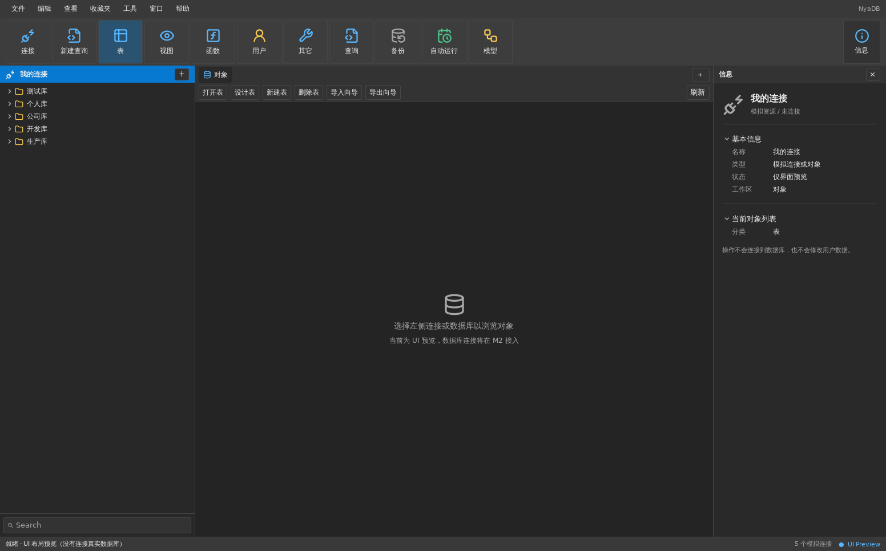

# NyaDB

NyaDB is a cross-platform, native desktop database workbench built with [Go](https://go.dev/) and the [NyaDB fork of MyGo Native UI](https://github.com/nyakang/mygo). It provides connection management, live read-only MySQL browsing, and a SQL editor with explicitly simulated execution.



This image is a historical headless UI preview; it does not show the current live MySQL workspace or establish visual parity with Navicat.

## Features

- Native desktop interface targeting Windows, macOS, and Linux, with shared resizable navigation and inspector panes.
- Consistent Lucide SVG operation icons with a separate set of embedded database brand icons.
- Create, edit, duplicate, delete, group, star, and search connection profiles for MySQL, PostgreSQL, and SQLite.
- Persist non-secret connection settings in a local SQLite configuration database.
- Database chooser icons embedded in the application, with documented third-party artwork provenance.
- Managed MySQL sessions with explicit connect/disconnect, asynchronous cancellation, and verified TLS support.
- A unified native navigation tree with lazy database and table/view metadata loading.
- Read-only MySQL structure and data tabs, with virtualized tables, server-side filtering/sorting, bounded paging, and large-field previews.
- Multi-tab SQL editor with syntax highlighting and clearly labeled simulated results.
- Shared dark/light themes, compact native controls, headless UI tests, and cross-platform Go build checks.

**Current functionality:** MySQL sessions, database objects, table structure, and table/view data use real database reads. PostgreSQL and SQLite support local profile management only. The SQL editor runs a simulation; arbitrary SQL execution, data writes, import/export, and SSH/HTTP tunnels are not implemented. Unimplemented commands remain disabled, and unsupported connection options are rejected before dialing. See the [current implementation status](docs/implementation-status.md) for capability and evidence boundaries.

## Requirements

- Go 1.27.1 or later.
- MyGo Native UI fork `v0.6.3-nyadb.2` (the `go.mod` replacement for upstream `v0.6.3`).
- On Linux, GTK 3 runtime libraries and a graphical desktop session. On Debian/Ubuntu, install `libgtk-3-0`.
- On Windows and macOS, the operating system's native UI libraries.

No Node.js or web frontend toolchain is required.

## Getting started

Clone the repository and run the application:

```bash
git clone https://github.com/nyakang/nyadb.git
cd nyadb
go mod download
go run ./cmd/nyadb
```

For MyGo development tools:

```bash
go tool mygo doctor
go tool mygo dev
```

## Language

NyaDB includes Simplified Chinese (`zh-Hans`) and English (`en`). The app follows the system's preferred language on first launch. To change it, open **View → Language** and choose **简体中文**, **English**, or **Follow System Language**. MyGo saves an explicit selection between launches.

Translations are maintained in `locales/zh-Hans.json` and `locales/en.json`. After editing the ARB catalogs, regenerate and validate the Go accessors:

```bash
go tool mygo generate
go tool mygo i18n check
```

The generated `locales/catalog_gen.go` is committed and checked for drift on all three CI platforms. `.gitattributes` enforces LF line endings for Go files and locale JSON catalogs, even with Windows Git `core.autocrlf=true`, so regeneration does not create line-ending-only changes. After updating translations, commit the JSON catalogs and regenerated Go accessors together. If an older Windows checkout already has CRLF in the generated file, inspect `git diff` first; when the file has no intentional local changes, use `git restore -- locales/catalog_gen.go` before pulling.

Some work-in-progress database screens and runtime diagnostic messages have not yet been translated and may display Chinese text.

## Build and test

```bash
go test ./...
go vet ./...
go tool mygo vet
go build ./cmd/nyadb
python3 -m unittest discover -s tests -v
```

To build an application package with MyGo:

```bash
go tool mygo build
```

The Python visual-tool tests require Pillow. Native packaging requirements vary by operating system. The GitHub Actions workflow runs Go tests, static checks, and builds on Linux, Windows, and macOS. Compilation and headless tests do not establish native GUI behavior or visual parity; see the verification reports for the platforms and states actually observed.

## Configuration and privacy

NyaDB stores connection profiles in `NyaDB/config.sqlite` under the directory returned by Go's `os.UserConfigDir()`. Profiles contain connection names, database types, hosts, ports, database paths or names, usernames, and optional TLS settings.

Passwords, tokens, and credential-bearing connection strings are not stored in the profile database. Creating or selecting a profile does not open a network connection. Explicit MySQL connection testing or Connect starts network access; credentials are held only for the active operation/session and must be reentered for reconnect. On Unix systems, newly created configuration directories and files use restrictive permissions; on Windows, access is governed by filesystem ACLs. Protect existing files, backups, and your user account accordingly.

## Repository structure

```text
cmd/nyadb/                    Desktop application entry point
internal/bootstrap/           Application initialization
internal/assets/lucide/       Embedded Lucide UI icons (ISC license)
internal/assets/connectionicons/ Embedded icon assets and provenance
internal/services/connections/ Connection models, validation, and configuration
internal/services/mysql/       MySQL sessions, queries, metadata, and data operations
internal/storage/localdb/     SQLite configuration storage and migrations
internal/ui/shell/            Native windows, workbench coordination, and data pages
internal/ui/connectioncatalog/ Connection type chooser
internal/ui/connectioneditor/ Connection forms, credentials, and async checks
internal/ui/navigation/       Connection navigator and filtering
internal/ui/sessionbrowser/   Session workspaces and metadata jobs
internal/ui/sqlworkspace/     SQL documents and execution
internal/ui/structureviewer/  Read-only table structure documents
internal/ui/datainspector/    Table/field information and bounded field previews
internal/ui/theme/            Theme, UI icons, and shared bitmap caches
resources/                    Application assets
docs/                         Design and UI documentation
.github/workflows/            Cross-platform CI
```

## Documentation

- [2026-10-25 UI alignment and verification](docs/UI_ALIGNMENT_2026-10-25.md)
- [Current implementation status and historical milestones](docs/implementation-status.md)
- [UI visual evidence and differential gate](docs/UI_VISUAL_GATE_2026-10-25.md)
- [Technical design](docs/NYADB_TECHNICAL_DESIGN.md)
- [UI layout and interactions](docs/UI_LAYOUT.md)
- [Lucide general UI icons](docs/LUCIDE_ICONS.md)
- [Connection icon assets and licenses](docs/ICON_ASSETS.md)

NyaDB is an independent implementation. It does not include Navicat source code, branding, or proprietary assets.
