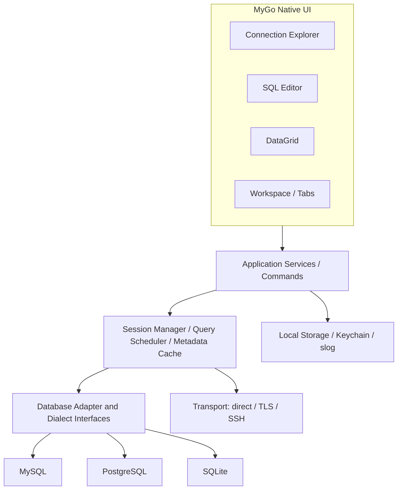

# NyaDB 技术设计方案（MyGo Native UI）

- 状态：Proposal / v1.0
- 日期：2026-10-20
- 应用定位：轻量、现代、跨平台、多数据源数据库管理客户端
- 主要平台：Windows amd64；第二阶段覆盖 Linux amd64、macOS arm64/amd64
- 技术基线：Go 1.27+、MyGo Native UI；MVP MySQL、PostgreSQL、SQLite

## 1. 目标与非目标

### 目标
- 原生 Go 桌面 UI，运行时无前端框架和 WebView；框架依赖须可控。
- 连接/元数据浏览、SQL 编辑与执行、结果集分页和复制、查询取消、连接配置及工作区恢复。
- 数据库内核无 UI 框架依赖，支持增加 Doris、ClickHouse 等 SQL 数据源。
- 默认遵循最小权限、可靠取消、有限内存、可测试、可诊断原则。

### MVP 不包含
- ER 图、对象结构可视化编辑、数据同步、AI SQL、插件市场、Redis 操作界面、完整 SQL 方言语法解析、复杂多语句脚本执行、单元格编辑提交。
- 第一期仅浏览表数据；单元格修改和事务提交放到 v0.2。

## 2. 采用技术

| 职责 | 选择 | 说明 |
|---|---|---|
| 桌面和 UI | github.com/egoist/mygo/ui | 全 Native，无 JS/HTML/WebView |
| SQL 编辑 | github.com/egoist/mygo/ui/editor | 支持 SQL 高亮、可见区渲染和补全钩子 |
| 对象树 | ui.Outline | 懒加载；节点缓存与刷新由 NyaDB 实现 |
| 结果表格 | ui.Table | 自建 DataGrid 模型、分批获取、类型格式化 |
| 主界面 | ui.Split, ui.SplitVerticalPercent, ui.TabsBase | 状态持久化 |
| MySQL | github.com/go-sql-driver/mysql | database/sql、QueryContext/ExecContext |
| PostgreSQL | github.com/jackc/pgx/v5 | pgxpool 或 stdlib，Postgres 特性单独保留 |
| SQLite | modernc.org/sqlite（暂定） | 通过 database/sql 流式扫描；无 cgo，应用存储与用户 SQLite 共用驱动 |
| Doris | MySQL wire protocol + 特定元数据方言 | v0.3 前验证版本兼容性 |
| ClickHouse | github.com/ClickHouse/clickhouse-go/v2 | v0.3，尽量保留 native 查询能力 |
| Redis | github.com/redis/go-redis/v9 | v0.4，使用单独 KV 能力接口 |
| SSH | golang.org/x/crypto/ssh | v0.2；连接隧道与数据库协议分离 |
| Secrets | 系统凭据库 + 不落盘会话模式 | Linux 无 Secret Service 时明确提示 |
| 本地持久化 | SQLite + migration（modernc.org/sqlite） | 配置、工作区、历史；密码只存 secret reference |
| 可观测性 | log/slog | 无密码/完整 SQL/连接串泄漏 |

## 3. 系统架构



约束：`internal/db/**` 和 `internal/app/**` 不得导入 `mygo/ui`；数据库驱动不能反向调用 UI；唯一 UI 更新入口为主线程命令处理及 `Window.Update`。

## 4. 目录组织

```text
nyadb/
├── cmd/nyadb/main.go
├── internal/
│   ├── bootstrap/             # wiring、配置加载、服务注册
│   ├── app/                   # workspace、command bus、事件、生命周期
│   ├── ui/                    # 只存 MyGo View、Widget、UI 状态
│   │   ├── shell/             # window、菜单、布局、tabs
│   │   ├── explorer/          # connection tree / schema tree
│   │   ├── editor/            # SQL 编辑器
│   │   ├── datagrid/          # 表格 UI + cell renderer
│   │   └── dialogs/           # 连接对话框、确认框
│   ├── db/                    # 框架无关接口和实体
│   │   ├── contract/          # Driver, Session, RowStream, Capability
│   │   ├── sqlmodel/          # typed Cell/Column/Row
│   │   ├── mysql/
│   │   ├── postgres/
│   │   └── sqlite/
│   ├── services/
│   │   ├── connections/       # 连接管理与 pool
│   │   ├── metadata/          # 懒加载、缓存、刷新
│   │   ├── query/             # execute/cancel/history/limits
│   │   ├── browser/           # table browsing, cursor/page
│   │   └── workspace/         # 持久化 tab/layout
│   ├── transport/             # direct、TLS、SSH（后续）
│   ├── storage/               # local SQLite + migrations
│   └── security/              # secret vault、脱敏、权限检查
├── resources/                 # icon、主题资源、字体替换规则
├── tests/integration/         # testcontainers/Docker 数据库集成测试
├── .github/workflows/
├── docs/adr/
├── go.mod
├── mygo.json
└── README.md
```

## 5. 核心数据库接口（设计契约，不是 MyGo 的 API）

```go
package contract

import (
    "context"
    "time"
)

type Kind string
const (
    MySQL Kind = "mysql"
    PostgreSQL Kind = "postgresql"
    SQLite Kind = "sqlite"
)

type ConnectOptions struct {
    Kind Kind
    Host string
    Port uint16
    Database string
    Username string
    TLSMode string // disable/verify-ca/verify-full, 按方言规范化
    ConnectTimeout time.Duration
    SecretRef string // 由 secret store 解析，不持久化原文密码
}

type Capabilities struct {
    Schemas bool
    Transactions bool
    Returning bool
    ReadOnlySession bool
    Explain bool
    EditableTables bool
}

type ObjectKind string
const (
    Catalog ObjectKind = "catalog"
    Schema ObjectKind = "schema"
    Table ObjectKind = "table"
    View ObjectKind = "view"
)

type ObjectRef struct {
    Kind ObjectKind
    Catalog, Schema, Name string
}

type ObjectInfo struct {
    Ref ObjectRef
    DisplayName string
    HasChildren bool
}

type CellKind string
const (
    Null CellKind = "null"
    Text CellKind = "text"
    Integer CellKind = "integer"
    Decimal CellKind = "decimal"
    Floating CellKind = "floating"
    Boolean CellKind = "boolean"
    Binary CellKind = "binary"
    DateTime CellKind = "datetime"
    JSON CellKind = "json"
    Other CellKind = "other"
)

type Cell struct {
    Kind CellKind
    Text string // 数字、日期、JSON 均使用无损文本表达；NULL 以 Kind 区分
    Bytes []byte // 只限被允许的小 BLOB；较大字段按需获取
}

type Column struct {
    Name string
    DatabaseType string
    Nullable bool
    PrimaryKey bool
}

type Row []Cell

type RowStream interface {
    Columns() []Column
    Next() bool
    Row() Row
    Err() error
    Close() error
}

type ExecuteResult struct {
    RowsAffected int64
    LastInsertID *int64
    Duration time.Duration
}

type Session interface {
    Ping(ctx context.Context) error
    Capabilities() Capabilities
    ListChildren(ctx context.Context, parent ObjectRef) ([]ObjectInfo, error)
    Describe(ctx context.Context, obj ObjectRef) ([]Column, error)
    Query(ctx context.Context, statement string) (RowStream, error)
    Exec(ctx context.Context, statement string) (ExecuteResult, error)
    Close() error
}

type Driver interface {
    Kind() Kind
    Open(ctx context.Context, cfg ConnectOptions, password string) (Session, error)
}
```

实现注意：
- `ConnectOptions` 是逻辑配置；隧道 Dialer、CA、客户端证书、证书验证设置作为独立依赖经 factory 注入，避免跨包依赖。
- `RowStream` 必须绑定执行 `context.Context`；取消时立即关闭底层 Rows，调用 Close 并回收该会话占有的资源。
- **SQLite 关键约束**：MyGo SQLite 插件的 `Query` 会一次缓冲全部行，无法对任意用户 SQL 先流式读取再截断。MVP 暂选 `modernc.org/sqlite` 用 `database/sql` 的 `Rows.Next` 流式访问用户数据库；为减少重复 SQLite 引擎，应用的 SQLite 配置库也使用相同驱动。MyGo 的 SQLite 插件可在未来评估其新增流式 API 后再考虑。
- MySQL/PostgreSQL 用 `database/sql` 或 `pgx` 实现 `Query`，限制一次 Scan 缓冲和驱动池大小，按类型从 `ColumnTypes`/pgx OID 推导 Cell。
- `Exec` 和 `Query` 分开：MVP UI 用明确的结果型/命令型运行策略；不可靠地按字符串前缀推断会误判 CTE、RETURNING、EXPLAIN。对不能安全分类的语句让用户选定执行方式。
- DB 标识符不能作为普通绑定参数：由已验证的 `ObjectRef` 和方言 `QuoteIdent(parts...)` 生成，值必须使用 SQL 参数绑定。
- 结构能力必须由适配器 `Capabilities` 向 UI 声明，功能不支持时不渲染/禁用。

## 6. UI 模块与主要交互

主界面：

```text
┌ NyaDB ─────────────────────────────────────────────────────────────────┐
│ File  Edit  View  Database  Tools  Help       [+连接]  [▶执行]  [■取消] │
├───────────────┬────────────────────────────────────────────────────────┤
│ Connections   │ [SQL 1 ×] [SQL 2 ×] [table: users ×]                 │
│ ▾ MySQL Local ├────────────────────────────────────────────────────────┤
│   ▾ app_db    │ SELECT * FROM users LIMIT 100;                     │
│     ▾ Tables  │ SQL 编辑器 / 高亮 / 运行选区                         │
│       users   ├────────────────────────────────────────────────────────┤
│       orders  │ Results | Messages                                   │
│ ▾ PostgreSQL  │ id   name          created_at ...                   │
│   ▸ public    │ 1    Alice         2026-10-20 ...                   │
│               │ 2    Bob           2026-10-20 ...                   │
│               │ ...                                                 │
│               │ Prev / Next / Rows 500 / Read-only                  │
├───────────────┴────────────────────────────────────────────────────────┤
│ Connected: MySQL 8.x | 500 rows shown | 12 ms | 0 running tasks     │
└────────────────────────────────────────────────────────────────────────┘
```

- Shell: App lifecycle, native menus、快捷键、空态/异常态；可保存窗口大小、分栏宽度、已打开 tab。
- Connections: Profile CRUD、测试连接、凭据引用、连接状态、断开操作；删除 Profile 不自动删除用户数据库文件。
- Explorer: `ui.Outline`；初始仅加载连接节点，展开再查 schema/table；后台更新 UI，失败可重试，缓存 TTL 60s，显式刷新无视缓存。
- Editor: `ui/editor`；MyGo 内置 SQL tokenizer；MVP 选中 SQL 优先执行，否则以整个编辑器为单条 SQL；不 naive split semicolon；只在 v0.2 之后实现当前语句与多语句安全解析。
- Results: `ui.Table`；列宽/排序状态保存在 workspace；支持行/单元格选择和 TSV 复制；NULL 与空字符串区分；BLOB 截断预览。
- Workspace: 每个 tab 独立 buffer、connection ID、query job ID、result snapshot、cancel、error/status；关闭时取消任务；重开恢复草稿但不自动重新运行 SQL。

MyGo 视图主线程约束：

```go
// 后台协程中读取数据库，之后在 GUI 主线程提交不可变结果。
go func(tabID string, queryID uint64) {
    page, err := service.LoadPage(ctx, tabID)
    win.Update(func() {
        tab := state.FindTab(tabID)
        if tab == nil || tab.QueryID != queryID { return } // 丢弃过时结果
        tab.Page, tab.Err = page, err
    })
}(tab.ID, tab.QueryID)
```

所有 `ui.Element` 仅在某次 view 构建期间存活；长期状态中保存 buffer、ListState、tab model，禁止保存 `ui.Element`、从 goroutine 修改 UI 状态。

## 7. 查询执行和资源限制

采用 Query Job 生命周期：`pending → running → completed | failed | canceled`。

- 交互查询默认 `maxRows=500`（用户可配置 100/500/1000），页面结果总内存软上限建议 16 MiB、单个单元格显示预览上限 8 KiB。上限均应实测可调整。
- 任意 SQL 查询：只读取最多 N+1 行判断是否截断，不自动注入 LIMIT 或擅自改写用户 SQL；下一页仅在持有明确的服务端分页策略时提供。
- 浏览表数据：使用服务端 `ORDER BY` + `LIMIT`，有稳定唯一键时优先 keyset pagination，必要时 `OFFSET` 回退并提示深分页成本。
- 不自动 `SELECT COUNT(*)`；只有用户选择获取精确总行数时另行执行。
- 多任务 QueryID + SessionID 隔离；任务完成后 close RowStream；UI 只持有有上限的快照。
- `context.WithCancel`、Query Job Map、页签关闭取消、应用退出统一取消；底层驱动取消语义要专项测试，MySQL cancel 可能通过丢弃物理连接实现。
- 失败不应丢弃编辑器文本，不应伪装成空结果；展示 SQLState/driver error 的脱敏信息。
- 默认查询超时 120 秒，可按连接设置覆盖；超时与用户取消要区分。

### v0.2 数据编辑安全机制

只在存在可用唯一键的表中允许编辑；保存 `original` 和 `pending`，采用事务 + 参数绑定 + `WHERE primary_key = ...` 与可选乐观并发条件，并确认影响行数 = 1；若 0 行为冲突，>1 行强制回滚、报错。绝不默认自动提交，未提交修改应提示离开/关闭。

## 8. 本地配置与密钥存储

SQLite schema（建议迁移，不直接靠 ORM 自动变更；使用 modernc 驱动）：

```sql
CREATE TABLE connection_profiles (
  id TEXT PRIMARY KEY,
  name TEXT NOT NULL,
  engine TEXT NOT NULL,
  host TEXT,
  port INTEGER,
  database_name TEXT,
  username TEXT,
  tls_mode TEXT NOT NULL DEFAULT 'prefer',
  secret_ref TEXT,
  settings_json TEXT NOT NULL DEFAULT '{}',
  created_at TEXT NOT NULL,
  updated_at TEXT NOT NULL
);
CREATE TABLE query_history (
  id TEXT PRIMARY KEY,
  connection_id TEXT,
  executed_at TEXT NOT NULL,
  duration_ms INTEGER,
  status TEXT NOT NULL,
  sql_text TEXT NOT NULL
);
CREATE TABLE workspace_tabs (
  id TEXT PRIMARY KEY,
  kind TEXT NOT NULL,
  connection_id TEXT,
  title TEXT NOT NULL,
  state_json TEXT NOT NULL,
  sort_index INTEGER NOT NULL
);
CREATE TABLE app_migrations (version INTEGER PRIMARY KEY);
```

- 密码不写入 SQLite、日志或配置文件。SecretRef 由 vault 解析；如无系统密钥库，默认仅内存保留凭据，不悄悄降级明文。
- SQL 历史可能包含用户手写的凭据、PII；默认本地、可关闭和清除，不上云、不上传遥测。
- 连接超时默认 10s，TLS 默认按连接安全策略校验服务端证书；明确展示不安全模式并确认。
- 服务端读写权限以数据库账号为最终控制，UI 的“只读模式”不是安全边界。
- 所有程序生成的 SQL 使用绑定参数；DDL 对象名经驱动方言转义。

## 9. MVP 任务拆解（可按并行模块提交 PR）

| 里程碑 | 开发内容 | 验收标准 |
|---|---|---|
| M0 框架验证 | MyGo pin 版本，Windows/Linux smoke，空壳窗口，CI | 两个平台能启动、关闭、构建；UI 无窗口测试运行 |
| M1 基础框架 | Shell 布局、菜单、Tabs、命令分发、storage+migrations | 3 区布局可调整，重启恢复，创建/删除空连接档案 |
| M2 驱动与连接 | MySQL/PostgreSQL/SQLite driver，连接池、凭据、超时 | 连接成功/失败/断网均反馈；无密码写盘或写日志 |
| M3 元数据 | Outline 懒加载、Schema/Table/Column、错误恢复 | 每展开一级才加载，支持刷新，断开连接不会卡 UI |
| M4 SQL 编辑 | editor SQL 高亮、Run/Cancel、错误提示、历史 | 选区优先执行、取消可生效、执行不中断界面 |
| M5 数据浏览 | DataGrid、数据类型、单页上限、服务端分页、复制 | 100k 行样例交互平稳，内存不随库总行数线性增长 |
| M6 发布 | 多平台构建、portable ZIP、installer、归档、版本信息 | 产物可在干净机器运行；可靠恢复布局/SQL 草稿 |

### MVP 验收脚本

1. 启动，建三个连接，凭据可选保存；重启后配置和 UI 布局恢复。
2. 连接本地 MySQL、PostgreSQL 和 SQLite，展开对象树，查看表列。
3. 在 SQL 编辑器执行 `SELECT`、`EXPLAIN`、被选择的 SQL 片段；错误可阅读、SQL 原文不丢失。
4. 对 100,000 行、50 列的测试表浏览数据，切换页、列调整、复制，多次切换后内存有界。
5. 执行长查询，中途取消、关闭 tab 和断开连接，UI 不冻结、资源得到回收。
6. 模拟断网、密码错误、无数据库权限、SQL 注入样例及超大 BLOB，程序不崩溃不泄密。
7. Windows 11 和 Ubuntu 原生运行；CI 编译与单元测试通过，Release 的 portable ZIP 可解压启动。

## 10. 测试及质量门禁

- 单元测试：Dialect、Cell 类型、NULL/空字符串、identifier escaping、state reducer、metadata tree。
- UI 测试：`ui.NewTester` 测快捷键、对话框、切换页签、查询结果、错误状态，禁止保存元素实例跨构建。
- 集成测试：Docker MySQL 8、PostgreSQL 16+、SQLite；校验取消、连接回收、权限、TLS/SSH（后续），CI 允许版本矩阵。
- 端到端：在真实 Windows/Linux 下运行图形界面；中文输入法、分辨率缩放、字体 fallback、大表格滚动、数据复制。
- 静态分析/发布：`go test ./...`、`go vet ./...`、`go tool mygo vet`、`go tool mygo build`、多平台打包和 smoke test。

## 11. 风险与退出条件

1. **MyGo 版本不稳定**：M0 固定版本、不追随 main；建立 Adapter 层；组件特性不足时保留替换 UI 的可能。
2. **Table 宽表/冻结列/选择体验**：先用 100k×50 真实数据及横向拖拽测试；若不可用，改写自有 DataGrid，而非改变数据库内核。
3. **SQL Editor dialect 完整性**：MVP 仅安全执行选区或一个完整语句；第二阶段再扩展多语句分割/格式化。
4. **取消语义跨驱动差异**：每个适配器有取消集成测试和连接池泄漏测试；取消后决定连接是否可复用。
5. **SQLite 驱动/发行**：现代纯 Go 驱动减少动态库管理，但可能增加二进制体积和编译开销；验证许可证、CPU/内存与查询取消。如果改用 MyGo SQLite 插件，则必须先补齐流式查询能力，不得直接读取无上限用户查询。
6. **Linux 密钥库缺失**：强制无保存模式或告知用户配置安全存储，不回退到明文密码。

**Go/No-Go 门槛**：完成 M0 + M2 + M4 + M5 的端到端垂直切片（一个数据库连接、查询、滚动和取消）后，再投入完整产品化；核心数据库包保持可脱离 MyGo 运行。

## 12. 参考资料（阅读当前版本的源码/文档）

- MyGo README: https://github.com/egoist/mygo
- MyGo architecture: https://github.com/egoist/mygo/blob/main/docs/architecture.md
- MyGo view threading: https://github.com/egoist/mygo/blob/main/docs/ui/views.md
- MyGo editor: https://github.com/egoist/mygo/blob/main/docs/ui/code-editor.md
- MyGo Table: https://github.com/egoist/mygo/blob/main/docs/ui/table.md
- MyGo SQLite（当前仅缓冲结果）：https://github.com/egoist/mygo/blob/main/docs/plugins/sqlite.md
- modernc.org/sqlite: https://pkg.go.dev/modernc.org/sqlite
- Go MySQL driver: https://github.com/go-sql-driver/mysql
- pgx: https://github.com/jackc/pgx
