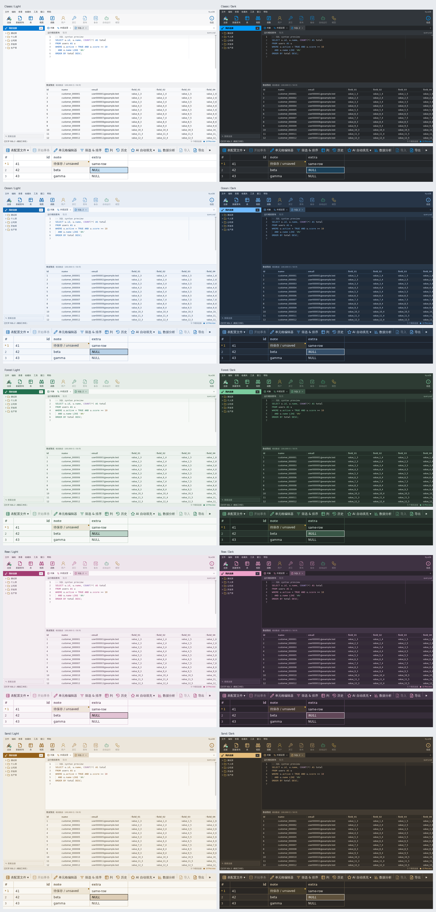
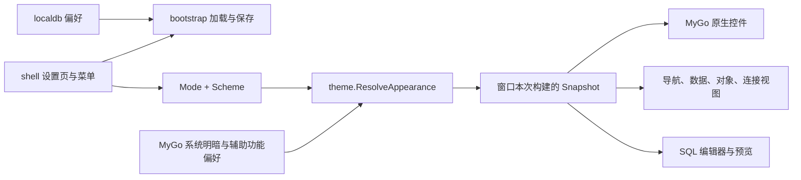

# NyaDB 多配色主题系统

2026-10-31。当前实现以本文件为准，早期主题记录见 [2026-10-27](THEME_REFACTOR_2026-10-27.md)。

## 使用方式

打开 **查看 → 主题 → 主题设置…**，分别选择「明暗模式」和「配色方案」。也可以在 **查看 → 主题 → 配色方案** 中快速切换。

提供经典、海洋、森林、玫瑰、暖沙五个配色家族，每个家族都有独立的浅色和深色版本。「跟随系统」只决定采用哪一版，不改变配色家族。例如「森林 + 跟随系统」会在森林浅色和森林深色之间切换。

配色和行高选择即时生效并自动保存；字号在 Enter 或离开输入框后应用。主窗口、连接窗口、数据与对象视图、设置预览和 SQL 编辑器共用主题；切换只重新绘制，不重建数据库会话、SQL 缓冲区或数据文档。

## 配色设计

默认保持数据库工作台的紧凑尺寸，通过背景层次、文字、强调色、选择状态和语法颜色共同表达风格。四套彩色主题的内容底色在线性 RGB 中向等亮度中性灰混合 45%，导航、工具栏和表头混合 25%；强调色保留家族特征。错误、警告、成功继续保持红、金、绿的语义；数据库品牌图标保留品牌色。

| 配色（持久化 ID） | 风格 | 浅色工作区 / 强调色 | 深色工作区 / 强调色 |
| --- | --- | --- | --- |
| 经典 `classic` | 中性灰阶、经典蓝，兼容原有外观 | `#FFFFFF` / `#0879D1` | `#232629` / `#009DFF` |
| 海洋 `ocean` | 冷白、蓝灰、海水蓝 | `#F7F9FC` / `#1266AD` | `#1E252F` / `#70BAFF` |
| 森林 `forest` | 雾白、松绿、翡翠绿 | `#F7F9F7` / `#22704E` | `#202824` / `#7BCC9E` |
| 玫瑰 `rose` | 柔和灰紫、玫瑰粉 | `#FBF8FA` / `#A23C72` | `#2A242C` / `#EEA2CA` |
| 暖沙 `sand` | 暖白、褐灰、琥珀金 | `#FAF8F3` / `#946019` | `#2A2724` / `#E5BD7B` |

以下为应用实际渲染的 SQL 工作区和数据草稿表格，使用模拟数据；左列浅色，右列深色。每个工作区下方展示待修改值、选中的 NULL 和普通字符串 `NULL`。



## 主题分层与模块边界



- **配色定义**：`internal/ui/theme/schemes.go` 定义稳定的 `Scheme` ID、可翻译的展示名称、浅深两组基础颜色与 SQL 颜色。`Schemes()` 返回元数据副本，业务模块不能修改主题注册表。
- **解析**：`ResolveAppearance(scheme, mode, systemDark, preferences, metrics)` 是纯函数，返回包含 `Palette`、`SQL`、明暗结果、阅读偏好和解析后尺寸的值类型 `Snapshot`。`ResolveScheme` 保留默认阅读参数，不读取全局设置。渲染预览不修改当前偏好。
- **每帧应用**：主窗口和连接窗口在根视图调用 `Apply(c)`，通过 MyGo 根元素的 `ui.Local` 保存本次构建的快照。`Colors(c)`、`SQLThemeFor(c)` 读取同一快照；控件局部 `SetTheme` 或构建中发生的点击不能改变已解析的颜色。下一次根视图构建才整体更新。无全局窗口缓存，也不跨帧保存 `ui.Context`。
- **兼容性**：`Mode`、`SetAppearanceHandler`、`Resolve`、`PaletteFor`、`SQLTheme` 保留原接口；后三者仍表示经典主题的显式解析。`MetricsPreferences`、`CurrentMetrics`/`SetMetrics` 和 `SetMetricsHandler` 接入阅读偏好；`ApplySQLAppearance` 更新编辑器颜色和字号。
- **跨窗口协调**：shell 更新用户选择，通过注入的保存器和通知回调交给 bootstrap。bootstrap 持有 SQLite、设置 MyGo 原生明暗来源并刷新主窗口与连接窗口。theme 和业务 UI 模块不依赖存储或驱动。

## 语义颜色与控件规范

| 角色 | Token / 入口 | 规则 |
| --- | --- | --- |
| 背景层次 | `App / Panel / Sidebar / Menu / Toolbar / Header` | 配色定义不同层次的底色；避免业务视图内写颜色字面量 |
| 文字、图标 | `Text / Muted / Blue / Gold / Green / Purple` | `Blue` 为历史兼容名称，在新配色中表示主要强调图标色 |
| 主操作与焦点 | `Accent / AccentText / AccentHover / AccentPressed / Focus` | 主按钮的正常、悬停、按下文字对比度至少 4.5:1 |
| 表格与导航选择 | `Selection / SelectionText / NavigationSelection / NavigationSelectionText` | 表格使用 `theme.Table`，导航使用 `NavigationOutline`；选中行的 NULL、状态文字使用 `CellText` |
| 网格和输入框 | `GridAlternate / GridNull / InputBorder` | 跟随当前配色；高对比度下输入边界保持可见 |
| 待处理记录 | `Notice / NoticeText` | 从警告语义派生柔和背景，文字保持 4.5:1；应用/放弃仍为原生按钮 |
| 统计图 | `Chart` | 按配色选择，和工作区背景至少 3:1 |
| 草稿状态 | `GridModified / GridModifiedText / GridModifiedMark / GridInsertedMark / GridDeletedMark` | 修改字段使用淡金色和小标记，新增/删除保留行头符号；选区优先，标记仍可见 |
| SQL | `Snapshot.SQL / ApplySQLAppearance` | 统一语法、活动行、选区、搜索匹配及字号；注释保留斜体 |

五套主题（包括经典）的正文、次要文字、NULL、选中文字和 SQL 语法色统一满足至少 4.5:1。焦点及草稿标记至少 3:1。SQL 活动行、活动/非活动选区、搜索匹配和同词出现使用明确的不透明底色，叠加后的最终颜色仍在验证范围内；搜索普通/当前匹配使用深浅不同的金色。

数据文档根据原始字段身份解析草稿状态，支持列重排和隐藏。NULL 使用斜体并保留空值语义，普通字符串 `NULL` 仍为普通文字。内联编辑器保持原生单元格边界；错误和提交不确定继续使用文档级状态，不推测逐单元格错误。

## 阅读设置与预览

| 设置 | 范围 | 默认 | 缩放关系 |
| --- | --- | --- | --- |
| 界面基准字号 | 11–16 整数 | 12 | 原字号 × 所选字号 / 12 × 系统文字缩放 |
| SQL 字号 | 10–24 整数 | 13 | 所选字号 × 系统文字缩放，独立于界面字号 |
| 表格行高 | 紧凑 / 标准 / 宽松 | 紧凑 | 标准/宽松增加 4/8 DIP × 有效界面缩放 |

字号通过有边界的增减按钮或输入框修改，Enter/失焦确认，无效输入恢复原值。各项可单独恢复默认。单表缩放叠加在界面字号上，不改变已有列布局存储。表格用零宽度的最小高度元素增加留白，保留原生单元格父节点、虚拟化与命中区域；较高的分析表头和内容继续按自然尺寸排版。

主窗口和连接窗口的控件随字号扩高；连接窗口底部操作在空间不足时换行，表单独立滚动。原生菜单和标题栏字体仍由平台控制。

每张主题卡同时展示浅色和深色，包含 SQL、普通行、选区、NULL 和待修改值。卡片按 360 DIP × 有效文字缩放决定每行一张或两张，窄卡片内部上下排列明暗预览。卡片只改变配色家族。阅读设置拥有固定 UI 标识，在卡片重排后保留输入焦点和键盘顺序；字号应用后将当前输入框保持在可视区域。

## 系统偏好与原生平台

- **经典**沿用系统强调色（系统提供时）；其他四套配色使用自己设计的强调色，防止桌面强调色覆盖用户选中的颜色家族。
- 所有配色保留系统高对比度与现有文字缩放支持；DPI 和减少动效继续由 MyGo 管理。设置页内容可滚动，控件预览行在小窗口中换行。
- 跟随系统时，设置页显示当前解析为浅色或深色。MyGo 的主题更新通知触发窗口重绘，不写回或覆盖用户的 `Scheme`。
- GTK 原生弹出菜单和系统标题栏沿用平台皮肤并跟随明暗模式；内容区域使用 NyaDB 配色。Linux 保留现有可恢复 GTK 设置逻辑，以及显式 `GTK_THEME` 和桌面高对比度的优先权。

## 存储与失败处理

复用 `app_preferences`，不改变 SQLite schema 和连接档案格式：

| 键 | 值 | 缺失或未知值 |
| --- | --- | --- |
| `appearance` | `dark / light / system` | `dark`，保持原默认行为 |
| `color_scheme` | `classic / ocean / forest / rose / sand` | `classic`，保留已保存的明暗模式 |
| `appearance_metrics` | `{"version":1,"ui_font_size":12,"sql_font_size":13,"table_density":"compact"}` | 缺失/未知版本恢复默认；损坏或越界字段单独回退 |

配色、明暗和阅读偏好独立写入，启动时在创建窗口前全部读取。阅读偏好作为单个 JSON 值写入。保存成功才更新当前选择并通知其他窗口；保存失败时保留旧选择，在设置页和状态栏显示「无法保存主题设置，请重试。」，可以再次点击目标选项重试。不会把未保存的状态标为已保存。

## 添加内置主题

1. 在 `schemes.go` 增加稳定 ID 和 `schemeDefinitions` 条目，提供浅深两组背景、文字、边界、强调色和 SQL 色。
2. 在中英文 JSON 目录中增加名称与描述，然后运行 `go tool mygo generate` 和 `go tool mygo i18n check`。不要直接改生成的 Go 文件。
3. 运行主题对比度、窗口同步、存储恢复测试；扩展主题数量断言及原生验证脚本的预期侧栏颜色。
4. 生成并检查浅深两版设置页、SQL 与表格截图。菜单和设置页自动从注册表生成。

本次提供内置配色，不引入主题文件解析或可执行插件。

## 验证与复现

主题测试覆盖五个家族的浅色、深色和系统解析、快照隔离、桌面偏好优先级、对比度、主窗口/连接窗口同步及 SQL 草稿保留。bootstrap 测试使用临时 SQLite，关闭并重新打开后验证全部 15 个偏好组合，并覆盖旧配置缺失配色键和未知配色值。shell 测试覆盖主题卡片、原生菜单、分别保存及失败后重试。

截图生成：

```bash
NYADB_THEME_CAPTURE="$PWD/temp/theme-optimization" \
  go test ./internal/ui/shell ./internal/ui/dataworkspace -run 'TestThemeGalleryVisualMatrix|TestDataAppearanceVisualMatrix' -count=1
python3 tools/render_theme_comparison.py
```

Linux 真实窗口验证使用临时 `XDG_CONFIG_HOME` 和隔离 Xvfb，不连接数据库：

```bash
go build -o build/theme-optimization/nyadb ./cmd/nyadb
xvfb-run -a -s '-screen 0 1440x960x24' /usr/bin/python3 \
  tools/validate_theme_gui_linux.py --binary build/theme-optimization/nyadb --output temp/theme-optimization/native
```

脚本逐一切换十种明暗配色，同时等待实际窗口像素和 SQLite 偏好吻合，再验证主题卡片、系统模式、GTK 菜单明暗、键盘设置界面字号 16 / SQL 字号 24 / 宽松行高及重启恢复。证据保存在 `temp/theme-optimization/native/verification.json` 及同目录截图中。

Windows/macOS 的原生桌面行为仍需对应平台运行环境；交叉编译只验证构建。布局截图覆盖中英文、840×560/1280×800 主窗口、720×520 连接窗口、最大字号和系统缩放 1.5；复杂数据业务行为继续由模块回归测试验证。

### 本轮验收（2026-10-31）

- Go 1.27.3，保留 `go.mod` 中固定的 MyGo 版本。
- `CGO_ENABLED=0 go test ./...`、`CGO_ENABLED=0 go vet ./...`、`go tool mygo vet` 通过。
- bootstrap、连接/存储/MySQL 服务与 shell、connectioncatalog、connectioneditor、navigation、sessionbrowser、sqlworkspace、dataworkspace、objectworkspace、theme 的 race 检查通过；最终绘制和连接布局修正另跑针对性的 race 回归并通过。
- `go tool mygo generate`、`go tool mygo i18n check` 通过，中英文各 907 条消息；Python 视觉工具的 33 项测试通过。
- 十种配色截图与中英文尺寸矩阵通过。待修改值增加像素回归断言，验证底色不会遮住文本；列重排/隐藏、选区、内联编辑器、单表缩放及三档行高保留草稿和布局。
- Linux Xvfb + Openbox 中运行真实原生窗口，十种配色、系统模式、GTK 菜单、卡片选择、键盘设置 16/24 字号与宽松行高、重启恢复通过；使用隔离的临时配置，不连接真实数据库。
- Windows amd64、macOS arm64 的 `CGO_ENABLED=0` 交叉构建通过；尚未在这两个平台执行原生桌面验收。

复核表格状态与大字号截图时修复了底色遮字、卡片重排丢失输入焦点、连接窗口按钮及示意图文字裁切。主题截图和原生验证记录均在这些修复后重新生成。完整分项截图及源码/二进制 SHA-256 保存在上述 `temp/theme-optimization` 目录，版本库中的对照图由 `render_theme_comparison.py` 从同批渲染结果合成。

本轮 Linux 原生记录的源码 SHA-256 为 `782c1649d26e9fc36dc222322c9ece5b9ea1b767a2502e62f2d2d1078286b512`，二进制 SHA-256 为 `856c6bd58b5ad502fc928c2a0804f2b75eaeb828e70e54469e7a8354ef5ae1eb`。源码摘要按脚本定义涵盖 Go 源码、生成目录和依赖清单，不包含文档和截图。
