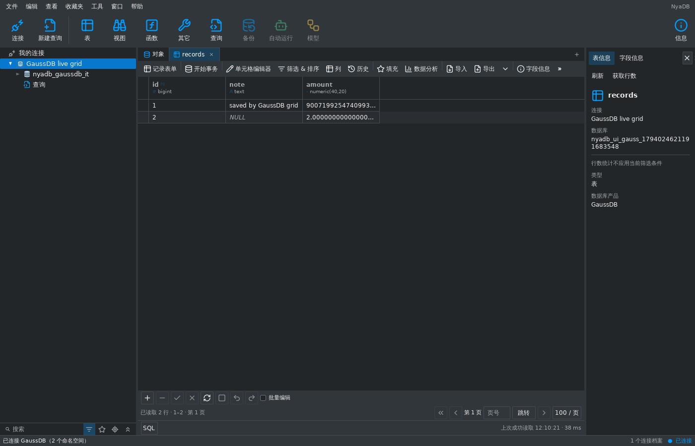
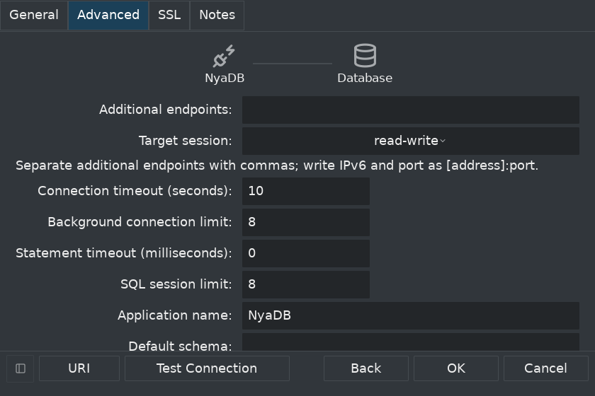
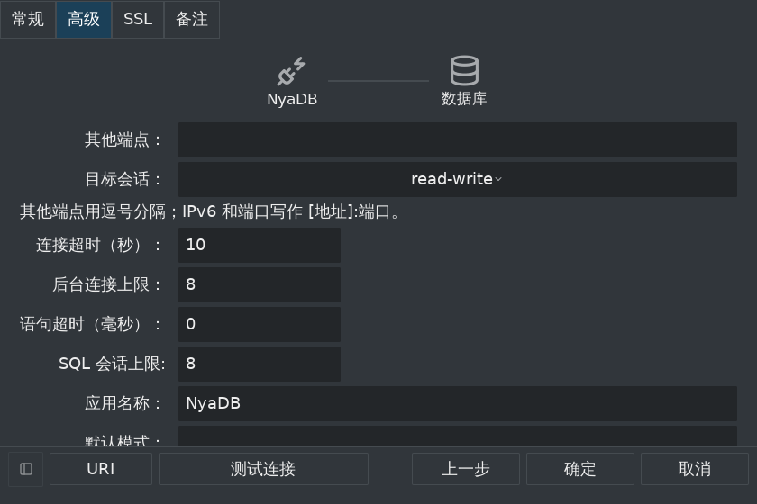

# GaussDB 工作台核心接入 — 2026-11-07

GaussDB 已作为第 15 个独立产品注册工作台。支持原生连接、固定数据库下的
schema/对象浏览、SQL/过程脚本/SQL 文件、共享数据表格、编辑、事务、计划、
分析和导入导出。原生传输基础见 [驱动与镜像依据](gaussdb-native-transport-2026-11-07.md)。
完整 DBX/Navicat 对齐目标、其它产品与管理工具继续保留；本项是核心接入。

## 真实实例与连接配置

Docker 镜像固定摘要，实际 `version()` 为：

```text
gaussdb (GaussDB Kernel 503.1.0 build f53b4ed8) compiled at 2023-03-27 00:43:20 commit 5356 last mr 10743 release
```

夹具用 `gaussdb --single_node` 启动原生内核，`sql_compatibility=PG`。
没有用 openGauss 或 PostgreSQL 冒充 GaussDB。主备切换、分布式和 DWS
没有本项验收证据，不能由单节点结论外推。

`gaussdb://`、连接选择器和原生表单使用独立产品身份。Profile 保存版本化
多端点及目标会话设置，附加端点为规范化文本，保持值快照可比较且没有共享
可变切片。URI 支持多个主机、各自端口、方括号 IPv6 及默认端口；原生密码
只在临时输入和凭据库中，不进入 Profile、URI 错误或配置 SQLite。
保存/凭据库失败回滚、重启、多端点/TLS 保存和旧 PostgreSQL 默认配置均通过。

每个后台和 SQL 物理连接都验证原生产品标记、Kernel 503.1+ 及 PG 兼容模式。
SDK `AfterConnect` 失败不会自行关闭 socket，因此拒绝和取消的握手显式关闭
原句柄并等待清理。真实连接代理仅改写第二条连接的版本响应，验证拒绝后
socket 已关闭，第一条原连接仍可使用。目标节点选择发生在该回调之前；
其原生校验失败或取消也等待被捕获连接的清理，真实握手门闩 race 测试通过。

TLS、显式账户、超时和端点回退由华为原生 Go 驱动执行。工作台默认目标为
`read-write`，支持原生 `any/read-only/primary/standby/prefer-standby`。
只读、备用及备用优先配置关闭表格写入和导入；备用优先回退到主节点也保留
这一界面边界。SQL 保持原生服务器权限和只读规则。本项验证了写入目标、
备用优先回退和只读目标拒绝写入主节点，没有验证真实备用或故障切换。

## 元数据与默认存储

固定 Catalog 与 Schema 分开保存，原始 ProfileID/Catalog/Schema/对象类型
贯穿运行时、导航、数据和程序文档。浏览过滤 schema/object 权限，展示表、
视图、序列、函数和过程；读取完整表定义、生成列、索引、约束、外键和程序源。
程序页沿用有界只读显示。真实对象的产品标签为 GaussDB。

本内核默认表为 **USTORE**，唯一索引为 **ubtree**。核心适配直接验证默认
存储，不强制改为 ASTORE。可靠键要求立即生效、可用且有效的普通唯一索引、
非空且非生成字段、系统默认运算符类及匹配的访问方法。GaussDB 单独允许
ubtree；openGauss 继续保留 btree 范围。实际 ASTORE/btree 也通过测试。
表达式/部分索引、自定义运算符类和不可靠键不用于编辑或键集翻页。

真实 USTORE 测试覆盖精确 NUMERIC(40,20)、大整数、bytea、NULL/空值、Unicode，
键集翻页、1024 字符字段读取、完整行编辑、生成字段拒绝、提交后的值核验和
过期行冲突。现有表导入、原生事务新建表导入、重复键失败回滚、精度保留导出、
计数、字段分析和 JSON 计划均通过。

## 原会话生命周期

SQL 文档使用独立物理会话池和有界租约；临时表、事务与后台元数据池隔离。
原生过程的 slash 分隔符、光标执行和 SQL 文件通过共用的原生语句扫描器。
文件执行保留编辑器原文，脚本不因过程内部的分号被拆分或重放。

原生取消会异步清理。驱动适配保留原句柄并等待 `CleanupDone`；测试人为
阻塞原 socket 的 Close，确认取消结果在释放门闩后才返回。预处理语句、
流式 Rows 和事务接口保留类型元数据与取消清理。运行时和工作台真实测试
确认取消后原 SQL 租约不可继续，恢复要显式建立新物理会话，且不执行现有 SQL。
重新连接增加公开 generation，旧查询/SQL 文件/共享数据绑定被撤销；外来
Profile 的限定对象被拒绝。断开保留 SQL 文本并移除作用域数据文档。

提交回执丢失测试仍实际提交到原生 USTORE，再丢弃成功回执。共享保存返回
未确认且不确定的结果，保留已暂存值和结果；原生新表导入同时保留创建不确定
和逐行不确定状态。独立连接确认数据只提交一次，工作台沿用不确定草稿禁止
重放的处理。没有用重试去掩盖提交结果不确定。

## 工作台证据与验证

中英文连接入口、高级/TLS 页及 840×560、1.5 倍文字的表单均检查关键控件
和页脚边界。真实工作台流程覆盖连接、schema 导航、共享表格编辑保存、序列
定义、过程脚本/光标/文件执行、取消、显式恢复和断开。





可复现脚本创建唯一 nonce 标记的容器、临时证书和普通 SHA256 账户，仅通过
已核实标签及不可变容器 ID 清理本次资源。过程创建需要内核以 omm 发起本机
自主会话，夹具添加 omm 的 loopback IPv4/IPv6 HBA；远程普通账户仍用 SHA256。

```sh
python3 tools/verify_gaussdb_fixture.py
python3 tools/verify_gaussdb_fixture.py --plain
NYADB_GAUSSDB_RACE=1 python3 tools/verify_gaussdb_fixture.py
```

真实 TLS 和明文核心验收、`CGO_ENABLED=0 go test ./...`、`go vet ./...`、
MyGo vet/i18n 检查、82 项 Python 测试，以及 Linux amd64、Windows amd64、
macOS arm64 的 CGO=0 构建已通过。共享目录读取在真实 openGauss 6.0.0
实例上完成回归。原生驱动、配置/存储、runtime、工作台及共享模块的 race 验证均通过。
整套 Shell race 首次触及五分钟绘图限时；延长限时后 581.440 秒完整通过。本地日志和其它截图保留在忽略的 `build/gaussdb/`。

## 继续保留的范围

表/视图设计及管理、账户管理、备份恢复、维护、监控、SSH/HTTP 隧道、
结构/数据比较同步、传输/建模/血缘及其它完整参考能力仍未完成。
本项不开放从 PostgreSQL/openGauss 继承的管理执行器。SM3、双向 TLS、
其它认证方式/版本、真实主备集群、分布式部署和 DWS 仍待独立验证。
