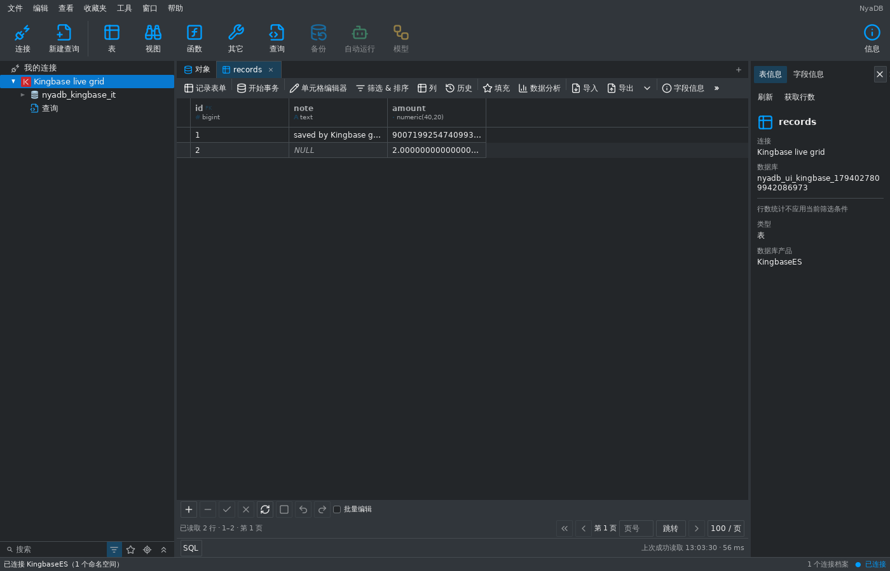
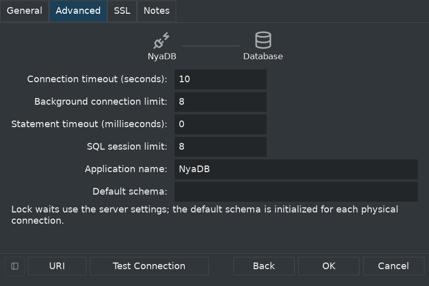
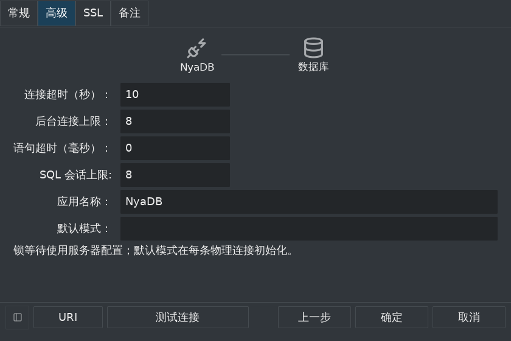

# KingbaseES 工作台核心接入 — 2026-11-07

KingbaseES 已作为第 16 个独立产品接入工作台。原生连接、固定数据库下的
schema/对象浏览、SQL/过程脚本/SQL 文件、共享数据表格、编辑、事务、JSON
计划、分析和导入导出已完成真实实例验证。完整 Navicat/DBX 对齐目标仍保留；
本项交付核心能力。驱动来源、镜像摘要、许可证限制和传输边界见
[原生传输基础](kingbase-native-transport-2026-11-07.md)。

## 原生产品与配置

实际服务器为 KingbaseES V008R006C009B0014，`database_mode=pg`。
使用固定摘要的真正金仓内核和原生 gokb 驱动，没有用 PostgreSQL/openGauss
服务器或驱动替代。每个后台和 SQL 物理连接都读取并检查原生版本与模式；
V8R2、其它未经验证的构建/版本及 Oracle/MySQL 模式被拒绝。
门控测试让第二个物理连接返回外来产品身份，确认关闭该原句柄而保留首个
真实原生套接字；并对未验证产品、版本和模式进行拒绝回归。

默认端口 54321、用户 system、数据库 test、TLS verify-full。金仓没有默认
postgres 数据库，URI 要求显式用户名和数据库，不能把省略的设置自动解释为
PostgreSQL 默认值。密码仅进入临时输入和凭据库；公开配置、URI 错误、Profile
及配置 SQLite 不含密码。TLS/运行参数保存与重启、凭据库失败回滚和旧
PostgreSQL 配置兼容通过验证。独立选择器、厂商品牌入口、导航过滤和中英文
原生表单复用现有连接基础设施，新增 K 图标由 NyaDB 独立绘制。

## 元数据与共享数据

Catalog 与 Schema 保持分离，限定的 ProfileID/Catalog/Schema/对象身份贯穿
导航、程序文档、表格和运行时。屏蔽 pg_/sys_catalog 等系统命名空间，按原生
schema、relation、sequence、routine 权限过滤对象。V8R6 PG 模式中实际核对的
pg_catalog 字段、索引、约束、外键、序列和程序目录用于共用只读目录策略，
产品标签保持 KingbaseES；不由协议相似性推断其它兼容模式的目录语义。

字段、生成表达式、约束和索引定义、外键成员、序列参数、函数/过程源完整
保留；程序文档仍采用有界只读显示。表格写入限于普通 heap 表；分区/继承
关系和不可靠键不用于编辑。可靠身份要求立即生效、有效、ready/live 的普通
btree 唯一索引、非空且非生成键字段、系统默认运算符类。真实测试涵盖普通
主键、INCLUDE 索引、可空/延迟/表达式/生成键及 text_pattern_ops 拒绝规则。
原生驱动的 text[] 参数显式通过其 Array 编码器传入，保持键列边界和顺序。

所有数据文档继续使用唯一的 dataworkspace 和成熟共享网格。真实测试保留
超过 2^53 的整数、NUMERIC(40,20) 完整精度、原始 bytea、Unicode，以及
NULL/空文本/空二进制的差异。键集分页、1024 字符字段读取、完整行编辑、
生成列拒绝、提交后核验、过期行冲突、计数/字段分析及精确导出均通过。
现有表导入、事务中新建表导入、重复键失败回滚和未确认创建状态通过验证。

## SQL 与原会话生命周期

SQL 文档使用独立物理连接池和有界租约，临时表、事务及后台元数据互相隔离。
PG 模式的原生 dollar-quoted 函数/过程保持内部分号，选择/光标/有界文件执行
沿用已验证扫描器；文件执行不改写编辑器原文。SQLSTATE、detail/hint 和源
位置由金仓原生错误映射到中立诊断，JSON EXPLAIN 在真实实例验证。

原生取消等待所属驱动确认，退休原 SQL 租约；下一次执行不能默默换连接，
需要显式恢复且不重放编辑器内 SQL。断开保留 SQL 文本并关闭作用域数据文档。
重连提高公开 generation，旧 SQL/文件/数据绑定被撤销，外来 Profile 的对象
身份被拒绝。底层未确认写入也使原 SQL 租约失效。

真实原生 COMMIT 完成后丢弃成功回执，共享保存仍保留暂存结果并报告不确定；
新表导入保留创建和逐行不确定状态。独立原生连接确认提交一次，没有自动
重放。传输层对真正丢失套接字回执的禁止重放证明继续保留。

## 工作台证据与复现

真实工作台流程覆盖连接、schema 导航、共享表格编辑保存、序列定义、SQL
脚本/光标/文件、取消、显式恢复及断开。中英文表单和 840×560、1.5 倍文字
检查关键控件与固定页脚边界。





```sh
python3 tools/verify_kingbase_fixture.py
python3 tools/verify_kingbase_fixture.py --plain
NYADB_KINGBASE_RACE=1 python3 tools/verify_kingbase_fixture.py
```

夹具保留唯一 nonce、随机 loopback 端口和临时凭据/证书，仅清理已核实标签的
不可变容器 ID。本镜像许可证允许 10 个连接，服务器自身还有 collector；
核心测试显式把后台/SQL 池分别限为 2，并串行运行包，验证 SQL 名额用满时
后台读取仍可完成。应用允许用户按真实实例容量配置连接上限。

TLS、明文和真实 race 核心验收、Go 全量测试、相关生命周期 race、Go/MyGo
vet、i18n、84 项 Python 工具测试及 Linux amd64/Windows amd64/macOS arm64
CGO=0 构建通过。整套 Shell race 用时 581.053 秒。完整 race 首次触及
新增厂商入口对应的旧选择器断言；更新后该包专项 race 重跑 18.103 秒通过，
其余生命周期包通过。最终继承关系/可靠身份规则也完成真实专项 race。
共用只读目录策略在真实 PostgreSQL 17 实例完成程序浏览/关闭/有界快照回归。
可检查日志和其它截图保留在忽略的 `build/kingbase/`。

## 继续保留的范围

表/视图设计与管理、账户/角色和数据库管理、备份恢复、维护监控、SSH/HTTP
隧道、结构/数据比较同步、传输、建模/血缘及其它完整参考能力仍未完成。
未继承 PostgreSQL 的管理执行器。其它构建/版本、Oracle/MySQL 模式、真实
HA/故障切换、双向 TLS 和其它认证方式仍需独立证据。完整清单中的 88 个
连接类型、110 个产品配置和现有产品缺口继续保留。
