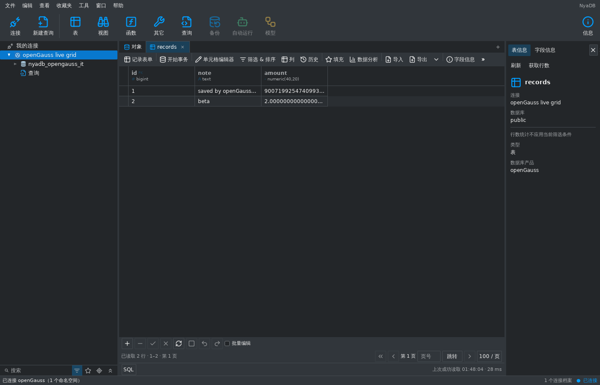
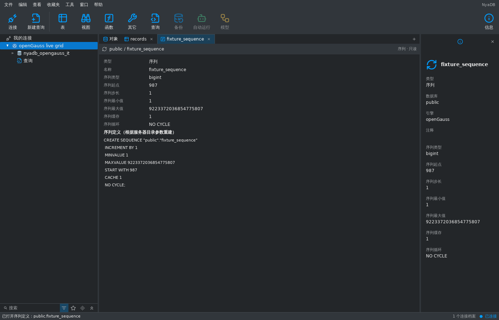

# openGauss 核心接入与验证 — 2026-11-07

本项增加独立 openGauss 产品连接，接通原生认证、对象浏览、SQL、共享数据
网格编辑及导入导出。状态为 `implemented_with_gaps`；整体 Navicat/DBX
对齐目标继续保留，设计和管理能力仍需后续交付。原生过程脚本及有界
SQL 文件已在后续独立项中补齐，见 [脚本验证](opengauss-native-scripts-2026-11-07.md)。
普通视图创建、编辑、重命名和删除也已补齐，见 [视图验证](opengauss-views-2026-11-07.md)。

## 配置与认证

- 独立 `opengauss` 类型和 `opengauss://` URI，默认 localhost:5432、
  数据库 `postgres`、用户 `gaussdb`、TLS `verify-full`。
- 固定数据库下浏览 schema，身份保持 ProfileID/Catalog/Schema。
  独立连接选择项、原生连接窗口图标、导航过滤和中英文表单均可用。
- 显式密码及证书配置传入原生连接器，不发现环境密码或用户目录证书。
  凭据保存在临时编辑器/密钥环，配置持久化与重启不写入密码。
  保存失败时回滚密钥环；旧 PostgreSQL 配置解码保持兼容。
- 共用 PostgreSQL 家族的 TLS、默认 schema、application name、语句超时
  和后台/SQL 池上限配置，但使用原生传输与产品专属元数据策略。
  普通用户无权设置 `lockwait_timeout`，不注入 PG 的 `lock_timeout`；
  非零连接锁等待选项会被拒绝，表单不显示该选项。隧道暂不支持。

原生连接器为官方 `gitcode.com/opengauss/openGauss-connector-go-pq`
v1.0.9，上游提交 `1b2ca1e407de54157316fcb4a808d8a87e007dac`，
保留 MIT 许可和来源哈希。其启动/取消修复已独立提交为 `6abf548`，详见
[补丁说明](../third_party/opengauss_pq/NYADB_PATCHES.md) 和
[来源清单](../third_party/opengauss_pq/UPSTREAM.json)。连接器实现原生
SHA256/SM3 认证；本次实际服务器使用 SHA256，并未独立验证 SM3 配置。

## 原生元数据与操作语义

真实版本为 openGauss 6.0.0 build aee4abd5，PG compatibility。
连接时校验产品、主版本至少 6 和 `sql_compatibility=PG`；其它兼容模式
被明确拒绝，6.0.0 以外版本尚未单独验证。

- schema 列表按 USAGE 权限过滤；浏览表、视图、物化视图、外部表、
  有 SELECT 权限的序列及独立函数/过程，结果数量和定义字节数有上限。
- 生成字段读取 `pg_attrdef.adgencol`，不查询不存在的 PG `attgenerated`。
  外键/索引属性数组在适配器解析，避免依赖 PG 的 LATERAL/ORDINALITY。
- 表结构采用原生 `pg_get_tabledef`，函数/过程采用
  `(pg_get_functiondef(oid)).definition`，保留完整服务器定义。
  程序浏览保持只读，按既有对象模块限制最多展示 500 行。
- 无 PG `pg_sequence`，从限定序列读取 start/increment/min/max/cache/cycle，
  重建定义并明确标注来源；`DefinitionFromServer=false`，不声称该文本
  是服务器原始 DDL 或包含当前已分配值。
- 编辑/keyset 身份要求唯一、valid/ready/usable/immediate 的普通 btree，
  使用默认 pg_catalog opclass，不含部分条件、表达式、NULL 或生成键。
  键字段最多 16 个，INCLUDE 字段不属于键。UBtree 被保守拒绝用于身份。
- 沿用唯一的共享 State/Document/grid：过滤、排序、翻页、计数、分析、
  字段读取、草稿编辑、并发指纹验证、事务及导出。使用稳定键和原表关系
  标识验证；读事务锁定关系身份，导入锁保护现有表元数据。
- 验证 Astore 普通行表上的 bigint、numeric(40,20)、bytea、Unicode、
  NULL/空值及生成字段；numeric 不经过浮点转换。视图和无可靠键对象
  保持只读。列存、分区、其它存储/复杂类型语义仍需单独验收。
- 现有表和新表导入沿用中立类型验证与原子事务；重复键失败回滚整批。
  EXPLAIN 使用并解析原生 `EXPLAIN (FORMAT JSON)`。

原生错误在引擎边界保留原 cause，并转换 SQLSTATE、detail/hint 与 Unicode
位置。SQL 文档独占物理租约，后台池独立。取消等待连接器确认并退役该 SQL
连接，后续操作要求显式恢复；会话替换撤销旧代次绑定，不自动重放 SQL 或
不确定写入。FATAL/PANIC/08/40003 写入错误按不确定结果处理。

## 真实验证与界面证据

临时服务器使用社区镜像 `enmotech/opengauss:6.0.0`（并非官方发行镜像），
本次 manifest digest 为
`sha256:9bd81380273944e5a02a2139c90954d4f46813b71810f7b23fe8f738014d03b5`，
amd64 digest 为
`sha256:6ce3ec3d591e721882c611fa26de1e56ad35ca63304c789267ed52cc6cbca70d`。
测试脚本使用该版本 tag；该 digest 记录本次验证来源。

可复现入口：

```sh
python3 tools/verify_opengauss_fixture.py
NYADB_OPENGAUSS_RACE=1 python3 tools/verify_opengauss_fixture.py
```

默认创建 verify-full TLS fixture；`--plain` 是显式明文测试选项。仅绑定
127.0.0.1 临时端口，随机凭据留在私有临时目录，日志脱敏。容器资源需要
4 GiB 内存、512 MiB shm 和用于 MOT 的 SYS_NICE。证书复制/授权在所属
容器内完成，无需宿主机 chown。初始化 SQL 有超时，bootstrap 有期限；
清理前验证产品及随机 nonce 标签，再用不可变容器 ID 删除自身 fixture。

真实明文和 verify-full TLS 集成已通过，覆盖对象完整定义、生成列、
高精度数据、字段分块、分页/计数/分析/导出、确认保存、陈旧草稿冲突、
无键/部分键拒绝、现有/新表导入与原子回滚、原生计划、池隔离、取消确认、
旧代次撤销和不可信证书拒绝。运行时与 shell 测试证明共享网格可保存，
原始 profile/generation 结果归属正确，断开保留 SQL 文本。

以下截图是连接真实服务器的 MyGo **无桌面测试捕获**，用于检查布局和
流程，不是原生桌面或 Navicat 对比证据。





完成检查：Go 1.27.3，`go test ./...`、`go vet ./...`、
`go tool mygo vet`、`go tool mygo i18n check`（2007 条双语消息），
系统 Python 的视觉/工具测试 80 项通过；CGO_ENABLED=0 的 Linux amd64、
Windows amd64 和 macOS arm64 构建通过。真实 TLS 集成的 engines、dbruntime
和 shell 包已通过 `-race`；AGENTS.md 列出的完整聚焦包列表也通过并发回归。
嵌套原生驱动模块单独运行 race/vet 和三平台
构建，不能由根模块 `go test ./...` 代替。

## 保留缺口

- 原生过程脚本、原生 `RETURN` 函数、光标/选中执行及 SQL 文件已补齐。
  普通 SQL/scripts/file 输入最多 8 MiB；packages、局部子程序声明及其它
  未验收的程序语法仍不支持。程序浏览继续使用只读对象模块。
- 普通视图的完整定义编辑、创建、重命名和删除已补齐，保留支持的选项、
  所有者、ACL、注释及依赖；物化视图、其它选项、所有者/权限编辑及启用
  DDL event trigger 的环境仍不支持。
- 无表设计、其它对象管理弹窗、账户管理、备份恢复、维护或隧道；产品
  能力和运行时入口均拒绝不支持操作，不落入 SQLite/PG 的不适用实现。
- 表复制已接通仅结构/结构和数据、原生 SQL 预览、独立普通/LARGE 序列、
  完整行值和目录核验；具体支持范围、真实发现的数组/表达式差异及保留
  边界见 [表复制记录](opengauss-table-copy-2026-11-07.md)。
- A/B/MySQL 兼容模式、packages、其它存储类型、分区、SM3 独立服务器、
  集群/代理和更高版本未验收；GaussDB 仍是独立未接入目标。
- 数据传输、结构/数据对比与同步、ER/血缘、自动运行和跨产品管理仍在
  [完整对齐清单](database-middleware-alignment-2026-11-07.md) 中。
