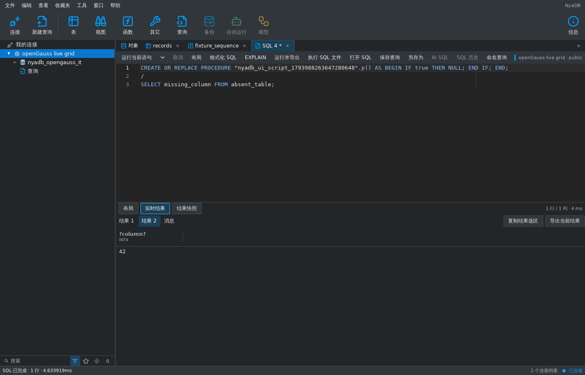

# openGauss 原生过程与 SQL 文件 — 2026-11-07

核心接入 `de63932` 使用通用 PG 脚本切分，未加引号的 native procedure
正文会被内部分号拆开。本项增加纯 `sqltext` 扫描器，统一执行、光标语句
和格式化行为，并在原有 QueryLease 上提供有界 SQL 文件入口。

## 可执行语法与限制

支持 `CREATE [OR REPLACE] PROCEDURE ... AS/IS ... BEGIN ... END;`，以及
openGauss 原生 `CREATE FUNCTION ... RETURN type AS ... BEGIN ... END;`。
普通声明、嵌套 BEGIN、IF/ELSIF/ELSE、LOOP 与 CASE 保留内部所有分号；
最后的 `END;` 分号保留给服务器。PG 的 dollar string、E escape string、
双引号标识符和嵌套注释保持不透明。

程序之后独占一行的 `/` 仅是客户端分隔符，不发送、不重放上一条程序。
普通 SELECT 中的除号保持运算语义。完整程序的末尾分号可直接结束语句，
无需 slash 才能执行单个光标选中的完整程序。光标位于声明/正文任意位置
时仍取整个定义；显式选择保留现有优先级。格式化含原生程序的文本时保留
正文及布局，避免重写用户程序。

SQL/脚本及整个文件最多 8 MiB、1024 个顶层语句；程序内部的分号不计为
顶层语句。文件支持 UTF-8 BOM。先读完并验证有界文件，再发送其中 SQL；
读错误、过大输入、后部不完整程序或未闭合引号不会执行前面的 INSERT。
运行时 SQL 错误仍可能发生在先前语句成功后，结果保留已执行步骤；不将
任意文件隐式包进事务，也不自动回滚用户已经明确提交的语句。

packages 和局部函数/过程声明明确拒绝。匿名块、标签等其它程序语法
尚未验收，不属于此次支持范围；本项没有增加程序设计器或管理弹窗。

## 会话和工作台

仅 openGauss 原始 QueryLease 实现 QueryFileLease，其他 engines 的文件
能力不变。复用文档原 profile/generation、schema 和物理 SQL 租约；文件
执行不替换编辑器文本，结果显示在现有多结果标签。代次替换撤销旧文件
绑定。驱动取消确认后退役物理连接，继续执行要求显式恢复，不重放文件。

沿用 `sqlworkspace` 的异步文件、loading/cancel 和私有结果通道；shell
仅按原 profile 选择纯扫描/格式化函数。未引入驱动依赖到 UI 工作区，未
复制 SQL 文档、数据文档或网格状态。

## 验证

真实 openGauss 6.0.0 PG compatibility、verify-full TLS：

- 从一个文件创建表、带声明/IF/LOOP 的原生过程、RETURN 形式函数，
  CALL 写入两行并查询函数结果；文件前后 `pg_backend_pid()` 一致。
- 不完整文件在前部 INSERT 前被拒绝；单程序无需 slash 即可执行。
  流式结果的整型值保留类型，原生定义仍能从对象浏览中读取。
- 文件内 BEGIN/INSERT/pg_sleep 被取消后确认会话丢失，取消事务和后续
  语句都未落库；旧租约后续文件执行不能自动重连。公共 generation 替换
  也拒绝原文件绑定。
- 工作台真实连接下，显式选择执行三语句脚本；光标位于 IF 正文时只执行
  完整程序，不执行后面故意写错的 SELECT；点击“执行 SQL 文件”运行
  CALL/SELECT 42，第二结果页显示 42，编辑器原文本不变。

截图是连接真实 TLS 服务器的 MyGo 无桌面测试捕获。编辑器保留光标测试
中的原文本，下方显示外部文件的第二个结果；不作为原生桌面或 Navicat
功能对齐证据。

纯回归覆盖程序内部 1100 个分号、引号/注释/dollar body、除号、错误块、
输入上限、文件读错和预取消，以及文件能力不泄漏给其它 engines。真实
测试纳入 `tools/verify_opengauss_fixture.py` 的 `TestOpenGauss` 集成入口。
本项验证相关五包 Go 回归、真实 TLS 的聚焦 `-race`（含既有 SQL 文件
取消/回执测试）、Go/MyGo vet 与 CGO_ENABLED=0 三平台构建。

设计、账户、备份恢复、维护、集群/代理和其它程序语法仍保留在
[完整对齐清单](database-middleware-alignment-2026-11-07.md)。
