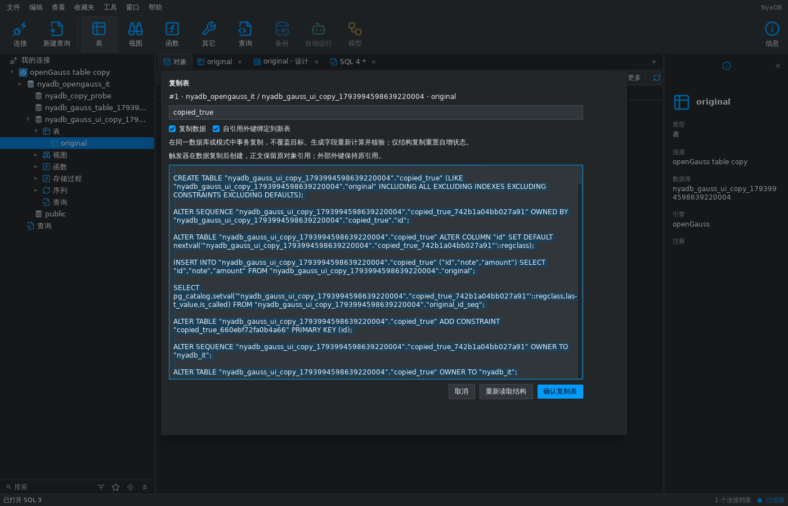

# openGauss 原生表复制 — 2026-11-07

## 行为与实现

连接 openGauss 后，表菜单的“复制表 / 仅结构、结构和数据”接通原生
快照、目标名称、SQL 预览和明确确认。源表的数据和结构标签保留，成功
回执只刷新原连接的目标命名空间；隐藏 rowid 选项仅属于 SQLite。
实现继续使用 objectworkspace、dbruntime 的中立结构契约和同一个工作台。

后台以 SHARE 锁阻止源表写入/改表，取得锁后用新的 READ COMMITTED
语句核对原始完整目录修订；目标已存在或新序列/索引名称冲突时不覆盖。
创建、复制和验证在一个事务中执行。原生 `LIKE INCLUDING ALL` 保留
生成列、存储和分区声明；排除默认值、索引和约束，然后显式创建独立
序列、默认值、约束、索引和程序对象，保留对应注释、所有者和状态。

生成列在插入时重新计算。完整行值通过原生 record_send、类型标识、NULL
标记及包含重复次数的流式多重集摘要核验，使用显式字段列表，不使用
网格预览、分页或文本强制转换。每个验证行最多 16 MiB，超限失败并回滚。
行存、unlogged、列存和原生 range 分区表已有真实覆盖；数组及枚举使用
原生二进制值。未知目录属性仍参与目标结构或原表修订比较。

触发器和规则在数据插入后安装，保留程序正文的原对象引用及启用状态。
自引用外键按选项指向新表或原表，外部外键保留原引用。指向原表的复制
外键会产生新的内部参照触发器；只允许属于已验证目标约束的这些新增
触发器及依赖，其余源表目录变化均导致回滚。

普通及 LARGE 拥有序列保留起点、步长、上下界、缓存、循环、所有权和
注释。128 位参数/值通过十进制整数字符串保留，不经过 float64 或 int64。
结构和数据复制保留捕获的 last_value/is_called，仅结构复制从原 START
重新开始。只调整新序列；源序列状态再次读取并核对，绝不向源序列写回。

## 真实服务器发现的差异

- 原生 6.0.0 的生成列表达式可能没有完整 pg_depend 函数边，所以检查
  捕获的原生表达式树和真实 pg_proc 实现；未验证的函数/隐式分派在复制
  DDL 前拒绝。原生 CONST 的空 cursor_data 字段仅由 native 路径接受，
  PostgreSQL 的严格字段检查保持原行为。
- 原生 LIKE 丢失数组声明的 attndims。在尚为空的目标表中显式恢复类型
  的声明维数，然后核对完整属性；没有通过忽略该字段掩盖差异。
- 列存表不接受普通列的 SET STORAGE，使用原生 INCLUDING STORAGE。
- LARGE 序列使用 ALTER/COMMENT ON LARGE SEQUENCE，setval 的值显式绑定为 numeric。
- indcheckxmin 是索引物理 HOT/MVCC 可用性状态，新索引可不同；完整
  deparse 定义和其它索引标志仍比较。物理存储标识、统计及 attinitdefval
  不作为新表逻辑结构身份，完整实际值另行核验。

## 验证

使用自有社区镜像 openGauss 6.0.0 PG 兼容模式及 verify-full TLS fixture。
可复现入口仍为：

```sh
python3 tools/verify_opengauss_fixture.py
NYADB_OPENGAUSS_RACE=1 python3 tools/verify_opengauss_fixture.py
```

新增服务测试覆盖四种存储形态、注释/统计、精确数值/二进制/NULL/生成列、
超过预览上限的 1,201 行及长文本、一/二维数组和枚举、普通和 128 位序列、引用
选项、触发器/规则、带引号的目标身份、权限/陈旧修订/已存在目标、锁等待
期间替换、取消/代次撤销和提交回执丢失；注入目标值损坏后证明核验失败
回滚整个目标并保留源值。运行时测试覆盖公开代次翻译及
连接替换后旧 Copy 绑定撤销。真实 shell 测试覆盖两个复制菜单、未执行
SQL 预览、窄窗口确认、精确网格值、原标签/SQL 文本保留及导航刷新。



该截图是连接真实服务器的 MyGo 无桌面测试捕获，不代表原生桌面或
Navicat 差分证据。

最终检查通过 `CGO_ENABLED=0 go test ./...`、`go vet ./...`、MyGo vet、
i18n check（2,007 条消息）和 Python 全部 80 项测试；Linux、Windows、
macOS 均完成 CGO=0 编译。AGENTS.md 的完整聚焦 race 包列表加 schemaddl
中，除 shell 外全部首次通过；shell 首次触及 600 秒整包总时限，未报告
断言失败或数据竞争。随后使用同一真实 TLS fixture 单独重跑完整 shell
包，设置 `-count=1 -v -timeout=1200s`，全部通过（754.744 秒）。另行
补充的数组、LARGE 序列、注释及目标值损坏验证也通过 race 检查。

本项验证日志保存在忽略目录 `build/opengauss/table-copy/`；没有启用的
其它产品服务器 fixture 测试仍按其环境条件跳过，不计入本项真实验证。

## 保留边界

继承/typed/temp/system 表、RLS 策略、显式表/字段/拥有序列 ACL、publication
和安全标签尚不支持复制；无完整蓝图、启用 DDL event trigger、非核心
表达式函数、未验证的隐式分派、domain/composite 或自定义 send 函数会
明确拒绝。未验证的其它存储、分区种类和索引属性不能由本次覆盖推断。
多个规则动作等尚不支持的原生 SQL 片段也会拒绝，而不会省略定义。

取消等待数据库操作返回和回滚确认。丢失提交回执或无法确认回滚时返回
uncertain，关闭捕获的原会话，保留复制状态供显式恢复核对，不自动重放。
表设计、改名/清空、其它对象/账户管理、备份恢复、维护和跨产品工具仍在
[完整对齐清单](database-middleware-alignment-2026-11-07.md) 中。
