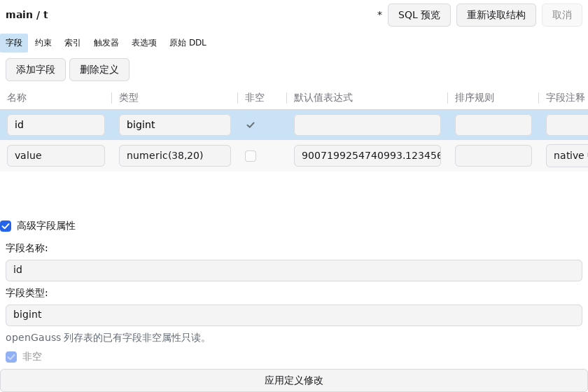
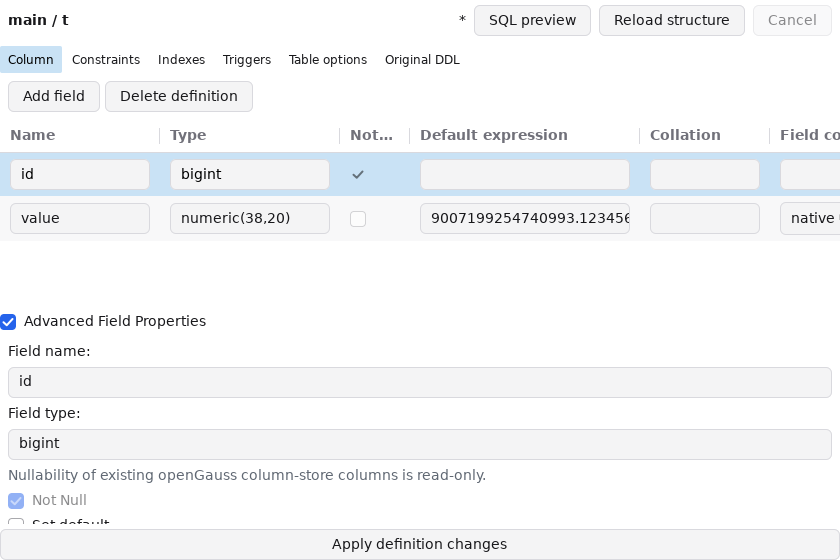

# openGauss 原生表设计 — 开发记录，2026-11-07

本项仍在开发，尚未注册表设计 `CanApply` / `Apply` 或开启产品的
`DesignTables` 能力。原生规划、完整值证明及私有事务执行器已经实现，
已验证的私有基础设施按独立阶段提交；完整引用/回调目录并发和工作台
流程验收完成后再交付公开表设计整项。
[完整对齐清单](database-middleware-alignment-2026-11-07.md)
中的表设计状态仍为未完成。

## 已有实现与证据

- `schemaddl` 新增独立 openGauss 表、字段、对象属性及深复制；原始
  `OpenGaussCatalog` 保留未知属性、目录身份、权限、存储和分区。
- 同一原生目录查询补充完整 DDL、非空、显式排序规则和 schema CREATE
  权限。设计读取把目录蓝图转换为有稳定字段/约束身份的声明，不创建
  PostgreSQL 版本或 PostgreSQL 目录模型。
- 独立规划支持新建、单独表/字段改名、字段增删、类型/默认值/非空及
  注释修改、约束和索引/程序定义变更。元数据修改保留约束/对象身份，
  不为更改注释而 DROP/CREATE；所有删除使用 RESTRICT。已有列顺序、
  owner、持久性、表空间和存储参数变化需要另行验证。
- 声明解析前读取原生类型、函数、操作符及转换目录；自定义类型、用户
  函数及未支持的声明被拒绝。原生 `+` 的参数反转 SQL 转发器按下面的
  原生签名和终端实现核验；32 条原生 SQL 转换及其嵌套调用按本文末尾
  的固定目录与函数体核验，其它 SQL 实现仍受限制，并发范围尚待补齐。
- 独立空声明通过回滚专用 savepoint 规范化类型别名、表达式与约束；
  私有表/索引/序列在执行真正 ALTER 前撤销。规则正文不作为表达式探针。
- 保留值使用同一原生 record_send 多重集摘要；类型修改后反向转换到
  原始声明类型，再比较完整值、NULL 与重复次数，每行最多 16 MiB。
  新字段和新生成值采用下面的独立完整值证明。

真实 verify-full TLS、openGauss 6.0.0 PG 兼容模式验证覆盖：

1. 原生序列、非空、生成字段、注释、约束/索引与完整 DDL 的读取。
2. 行存、列存和 range 分区表原生 ALTER；存储参数保持。
3. 原生 CREATE、序列/主键/索引/CHECK 及精确数值生成列。
4. 用户 IMMUTABLE 函数和自定义类型在声明解析前拒绝，副作用序列没有被调用。
5. 独立声明规范化 decimal → numeric 后全部回滚，原表目录和拥有序列不变。
6. 2,001 字符文本、精确大数、NULL 和重复行；无损转换相等，服务器
   接受的 varchar 截断与 numeric 舍入被摘要识别，回滚恢复完整原值。

列存测试确认 openGauss 6.0 不支持修改已有字段的非空属性；规划在 DDL
前明确拒绝，该检查保留在真实测试中。列存的类型、默认值和新增字段
变更仍按实际服务器结果分别验证。

`go test ./internal/db/schemaddl ./internal/services/engines` 及聚焦原生
设计测试通过；已有原生连接/SQL/视图/删除/复制服务测试也已验证。
使用同一真实 TLS fixture 的 `go test -race`、`-run '^TestOpenGauss'`
在 schemaddl 和 engines 均通过（1.386 / 81.987 秒），相关包 `go vet`
通过。独立声明入口补充了请求深复制，其最新验证在阶段日志中单独记录。
本项阶段日志在忽略目录 `build/opengauss/table-design/`。运行原生
fixture 仍使用 `python3 tools/verify_opengauss_fixture.py`；最终 Go/MyGo、
全包生命周期、三平台构建和 UI 证据在整项完成前记录。

## 原生目录图核验补充

本轮已补齐独立声明和完整目录图的核验基础，仍未注册实际 Apply 或
开放设计器，也未将本项记为交付完成：

- CU 描述表、delta 表、其嵌套 TOAST、内部索引和行/数组类型按捕获的
  原生目录关系递归绑定。显式关系指针先于类型和索引推导处理，不能由
  目录遍历顺序或数值 OID 的分配顺序决定稳定身份；反转目录记录的真实
  fixture 测试覆盖行存、列存、分区和新建表。
- 列存 ALTER ADD 的 delta 字段采用无压缩，并传播新增默认值；直接
  CREATE 的 delta 描述符缺少这两个 ALTER 状态。预期从独立解析的主表
  字段和原生规则推导，默认值的目录记录及依赖也独立绑定到 delta 字段。
  不从待验证结果复制这些状态。
- 普通表首次新增变长字段时，由独立声明推导新 TOAST 结构；已存在的
  存储关系继续保留。分区根表不套用普通 CREATE 的根 TOAST，继续核验
  捕获的 pg_partition 存储记录。
- 类型变化的约束/索引通过原始字段依赖、conkey/indkey 及约束拥有索引
  的关系选取，只采用独立声明的类型、opclass、排序规则和表达式语义。
  原始未知属性、注释和权限继续保留；原已拥有序列的所有权关系不会被
  私有 CREATE 探针遗漏的关系替代。
- 保留对象核验数值身份；有明确类型变更依据的内部存储/索引重建与
  明确更改的默认值分开处理。测试协调替换保留默认值的 OID 和依赖，
  并重算有效 fingerprint，仍必须因身份改变失败。
- 结果必须属于原 profile/generation/catalog/schema 和预期表名；数据库、
  命名空间、认证角色、schema CREATE、管理权限及 DDL hook 的捕获边界
  逐项比较，不能以其它目录的相同数值 OID 借用原始身份。
- 在每个受测目录记录中注入未知高精度属性并重算 fingerprint，均应被
  拒绝。该检查覆盖保留的活动对象、内部存储及聚合记录；合成的展示
  记录和明确删除字段的墓碑不被声称为保留对象。

原生规则参考 openGauss-server `6.0.0` 的
[ATExecAddColumn](https://github.com/opengauss-mirror/openGauss-server/blob/6.0.0/src/gausskernel/optimizer/commands/tablecmds.cpp#L13317)。
本次获取的 `tablecmds.cpp` SHA256 为
`393abf35b96c145ab47f7833634b63eadaba879ac3625edf08d1f2eec1a60db9`；
源文件留在忽略目录 `temp/opengauss/`，没有将服务器源码引入产品。
独立字段改名的空表探针先解析原字段名的声明，再对私有表执行同一字段的
单独改名，以获得约束/索引的原生改名呈现；不改写原表或插入探针行。

真实 verify-full TLS fixture 的设计测试新增表/主键字段改名、删除字段、
首次新增 TOAST 和 bigint 主键转 numeric，以及上述目录篡改、协调身份
替换和记录顺序检查。最终阶段结果见
`build/opengauss/table-design/native-graph-order-verification.log`；后续的
私有执行器与完整值证明的新增阶段见下文；目录引用并发和工作台验收
仍是交付前的必要工作。

首次扩展后的 race 检查在 300 秒上限失败：逐记录的纯内存篡改检查
使两个随后才运行的 SQL 精确值读取超过各自 20 秒上下文，整组最终触及
测试超时；该次日志没有数据竞争报告。已将真实 SQL 验收放在纯内存
篡改检查之前，并在保留所有检查的前提下将整组上限改为 900 秒重跑。
失败日志为 `native-graph-race-verification.log`，最终重跑结果单独记录在
`native-graph-final-race-verification.log`，不以失败轮次推断功能验证通过。

## 完整值证明与私有执行阶段

新增实现仍不构成公开 Apply 或整项交付：

- 原生 `+` 包含九个合法 SQL 参数反转重载。预检查逐个核对操作符和
  函数 OID、参数/返回类型、语言、易变性、配置、集合及权限状态，只
  接受 `select $2 + $1` 或其括号形式，再核对反向参数的精确 C/internal
  终端。没有用服务器解析任意表达式来猜测重载，也没有套用 PostgreSQL
  `prokind` / `prosqlbody`。
- 显式声明/调用的类型转换维持原来的实现检查；从所有检查过的操作符
  输入/输出追踪隐式转换目录，用户转换和未知目的类型在解析前被拒绝。
  `pg_am` 的十七个原生回调、默认/显式 opclass、opfamily、支持函数、
  操作符及排序 family 的目录闭包，以及排序规则和固定 search_path
  也在空声明创建之前检查。实际绑定的全部隐式调度和并发稳定性仍有
  后续范围，不能由目录中的 `pg_catalog` 名字推断全部能力完成。
- 回滚专用的独立 heap 不带约束、索引、触发器或规则。保留的普通值
  按稳定字段 ID 显式转换后输入；新的可重复默认值和新的拥有序列在
  该独立表中产生。普通列元组、新序列列多重集及 Last/Called 状态分别
  核对；生成列再从已验证的实际普通/序列输入独立重算完整元组。
  没有把原表的已存储生成值当作生成表达式的证明。
- 新增普通字段默认值的可重复性从实际原生表达式树检查；`random()`、
  `statement_timestamp()` 等不能获得旧行的可重复证明。新 serial
  单独验证，原表拥有的序列不会因声明或值探针而被调用。
- openGauss 6.0 PG 模式同时禁止 ADD serial 和 ADD nextval 默认值。
  规划展开为新建独立序列、添加可空数值字段、绑定拥有关系、设置默认、
  显式填充和检查非空。序列名结合原修订、字段 ID 和名称，避免下一次
  编辑复用新字段 ID 时碰到旧序列；不使用 IF NOT EXISTS、重置或复用
  原序列。此填充是 UPDATE，因此已有用户触发器、规则和行策略会在
  执行前被拒绝。
- 原生不允许零列表。全部字段替换先释放复用名称并添加新字段，再
  RESTRICT 删除原字段；删除的生成字段先于它们的输入。保留生成字段
  的输入类型变化通过原生 pg_class 属性槽的依赖在规划时拒绝。
- 普通行存新增 STORED 生成字段会进入 `ExecRewriteRowTable`，其
  `finish_heap_swap` 按链接替换内部 TOAST。只为该已规划路径允许内部
  TOAST 身份变化，原表与用户对象仍保留身份和全部未知属性。类型重写
  后不再需要 TOAST 时，结构移除由独立声明推导；单纯删除字段不获得
  此权限。原生 relhaspkey 是延迟清除的正向提示位，约束和索引仍按真实
  目录对象核验，不能用此位代替主键存在性。
- 私有执行器深复制请求，先校验原目标/代次/声明，取得原表 ACCESS
  EXCLUSIVE 锁后用 READ COMMITTED 新语句重新读取完整修订，再接入
  独立声明、目录图、保留值、新值/生成值和原序列状态证明。明确删除
  字段所拥有的旧序列还需按原 OID 证明不存在。
- 取消等待驱动确认。COMMIT 已尝试但回执丢失、回滚失败或内部探针
  清理不确定时，结果为 uncertain，撤销捕获的原会话且不返回可替换
  草稿的 Actual。测试让真实服务器完成提交后丢弃回执，并证明原请求
  不能在该已撤销会话重放。

本阶段真实 verify-full TLS 测试包含 3,003 字符中文、4 KiB 二进制、
超出 float64 精度的 numeric、NULL/空值、行存/列存/分区、序列关联的
生成列、空表 CREATE、全部字段替换、截断/舍入回滚、用户隐式转换和
触发器拒绝、等待锁期间的外部 DDL/表替换、取消/撤销及提交回执丢失。
阶段日志位于 `build/opengauss/table-design/`；最终扩展后的 race 和
全仓库 Go/MyGo 检查结果在相应日志终结后记录。

当前代码的 `go test ./...`、`go vet ./...`、`go tool mygo vet` 和
CGO=0 Linux/Windows/macOS amd64 构建已经通过。对应检查日志为
`all-go-tests-corrected.log`、`all-go-vet-corrected.log`、
`mygo-vet-corrected.log` 及三个 `build-{linux,windows,darwin}-corrected.log`；
首轮真实扩展 race 日志为 `native-apply-final-race-verification.log`：
schemaddl、dbruntime 和 shell 通过，engines 在 386.055 秒终结失败，
失败原因为原生 `>=` 重载含 OID 3272 的 `pg_catalog.anyset`，它的
typtype 为 `s`，未被原来的 polymorphic 签名检查识别。该轮没有观察到
DATA RACE 报告，但不算通过。修正只放行固定 OID/名称/namespace/kind
及 I/O 标识的原生操作符占位签名；显式 anyset/SET 字段继续拒绝。
真实 CREATE 与拒绝字段的聚焦重跑已经通过，见
`native-anyset-correction.log`。完整修正 race 另记为
`native-apply-corrected-race-verification.log`，已成功终结：schemaddl
1.349 秒、engines 470.781 秒、dbruntime 3.318 秒、shell 245.636 秒。
完整工作台生命周期 race 也已成功终结，日志为
`workspace-lifecycle-race.log`，包含全部 AGENTS.md 指定生命周期包。
其中 shell 542.597 秒、dataworkspace 259.743 秒、objectworkspace
35.512 秒；没有数据竞争报告。完整生命周期轮次在追加 anyset/自引用/
独立引用锁测试前启动，这些后加内容由修正原生 race 和独立引用锁
race、最新全仓库普通测试分别覆盖，不混同两轮的代码/测试范围。

本轮先后遇到原生 ADD serial/nextval、零列、TOAST 重建/移除、延迟
主键提示位和生成输入类型限制。对应失败没有当作通过：保留序列依赖
的 `+` 生成表达式和完整值检查，补齐原生执行顺序/目录规则后重跑。
舍入测试在独立 fixture 中去掉既有生成依赖，以实际验证舍入回滚；
保留依赖的请求另外验证在执行前拒绝。

## 执行范围与引用锁的追加验证

真实私有 Apply 追加表/主键字段的含引号改名、带索引的 bigint → numeric、
表/字段注释及默认值/非空、CHECK/索引新增和生成字段删除。全部通过，
保留原表身份和精确原值，见 `native-execution-paths-verification.log`。
该日志也证明：在已执行原生 ALTER 后，由第二个物理连接 setval 原序列
会触发目录/数据修改回滚，且不会把外部写入的序列值重置；在实际 ALTER
回执后取消，也会等待驱动确认并恢复原目录。

外键范围检查追加新建自引用路径。原来的外部引用集合有意省略自引用，
不能用于“拒绝全部外键”的门控；现在 native 入口使用包含自引用的集合，
PostgreSQL 既有外部锁集合不变。纯解析和真实自引用拒绝已通过，见
`native-reference-scope-verification.log`。

原生引用锁的独立真实测试使用一次性受限角色、独立 verify-full TLS
物理连接和列级 REFERENCES 权限。测试确认：

- 普通 SHARE ROW EXCLUSIVE LOCK 需要额外权限，只有 REFERENCES 时拒绝。
- 永久私有 anchor 表通过 ADD FOREIGN KEY NOT VALID 获得父表的
  ShareRowExclusiveLock；anchor 的既有无效值没有被扫描，convalidated
  保持 false。
- anchor 在声明探针 savepoint 之前创建。回滚嵌套声明探针、甚至删除
  anchor 都不释放事务级父表锁；第二个物理连接的真实 ALTER 等待到
  原事务回滚，随后才完成并提交。
- 临时角色和对象仅在显式拥有的 fixture 中创建并清理。受限角色直接
  认证，密码只走私有 fixture 输入和驱动配置，不发到 SET ROLE SQL。

最终聚焦证据为 `native-reference-anchor-tls-role-verification.log`。
同一受限 TLS 角色的 race 聚焦验证也通过（3.931 秒），日志为
`native-reference-anchor-race-verification.log`。此前启动的完整修正
race 没有包含这个后加的独立锁测试，二者均已终结，范围分别记录。
先前两轮分别暴露原生 NOLOGIN 也要求密码和 SET ROLE 要求密码，失败
日志保留为 `native-reference-anchor-verification.log` 和
`native-reference-anchor-corrected-verification.log`。锁原语的成功尚未
接入 Apply；独立父表目录、实际绑定比较/转换回调、权限和并发修订的
完整证明仍需完成，外键入口继续关闭。

锁规则参考原生
[ATAddForeignKeyConstraint](https://github.com/opengauss-mirror/openGauss-server/blob/6.0.0/src/gausskernel/optimizer/commands/tablecmds.cpp#L15243)：
父表按 ShareRowExclusiveLock 打开，NOT VALID 不安排旧值验证，
heap_close(..., NoLock) 保留锁到事务结束。不能把嵌套 savepoint 之后
创建并回滚的临时声明误当作持有该锁的证据。

补充源码参考仍仅留在忽略目录，不进入产品依赖：

- [cluster.cpp / finish_heap_swap](https://github.com/opengauss-mirror/openGauss-server/blob/6.0.0/src/gausskernel/optimizer/commands/cluster.cpp#L3468)，
  SHA256 `ebfcb4610713615e572e5cbd0544a7c2518f7de1756f4d36df5dc12c5a8a5273`。
- [index.cpp / index_update_stats](https://github.com/opengauss-mirror/openGauss-server/blob/6.0.0/src/common/backend/catalog/index.cpp#L2981)，
  SHA256 `568979419ca45b84341a12efce0792fa5de1153f5fc0c021a14c8067d0df8a88`。

## 交付前仍需完成

- 补齐实际绑定的隐式函数/类型调度和目录稳定性；已声明的规划路径
  逐项核对。外部父表引用的锁和实际提交前核验已接入私有执行器，见
  下文；self 和 incoming 引用的私有执行验证见后续阶段，行策略和
  新增/改写规则仍需完成。
- 扩展私有执行器验证到其它受支持的原生修改、序列竞争、执行中取消、
  故障注入和目录引用并发，不由当前成功 fixture 推断全部范围完成。
- 通过中立 runtime 注册 Apply，接通共享设计字段、约束/索引、原生选项、
  SQL 预览、明确确认、未保存离开保护和原连接导航/标签刷新。
- 验证目录与数据故障注入、工作台流程、回归、race、Go/MyGo、三平台
  构建和可检查的截图证据；更新能力清单后提交整项。

其它 openGauss 账户管理、备份恢复、维护和其它产品/跨产品工具仍在
完整目标中，不能由本项的原生规划测试推断为完成。

## 外部引用锁与实际执行核验

外部父表引用已经接入私有事务 Apply，不再只在独立探针里检查。
公开 `SchemaDesign` 的 Apply/CanApply 和 `DesignTables` 仍未开启，
本项也尚未提交；原生外部引用证明不能替代工作台流程与其它剩余范围。

- 对原声明和目标声明涉及的外部父表按 schema/name 排序逐个锁定。
  锁表只有字段类型/排序规则及指向选定父表的 NOT VALID 外键，没有
  默认值、生成表达式、用户程序、索引或输入行。普通/大 serial 只保留
  数值类型，不创建或消费原表/父表序列。
- 锁表的 CREATE 和 RESTRICT DROP 均在独立声明 savepoint 之外执行。
  捕获独立父表目录，核对实际绑定回调、FK/父表触发器及完整目录变化，
  显式 DROP 后证明没有遗留对象和依赖，再通过 pg_locks 核对原事务的
  ShareRowExclusiveLock。锁不会随随后声明探针的 savepoint 回滚释放。
- 保存前再次比较锁定父表的完整原始目录；锁等待期间提交的目录修改
  会导致冲突。父表写入/DDL 等待事务锁，直到原事务确认提交或回滚。
  父表 owner/administrator 权限和 SELECT 不是这里的权限替代条件；
  实际 REFERENCES 权限由原生 FK 创建验证。
- 执行后比较独立声明和实际父表的 FK、两个内部 action 触发器及其
  依赖变化。仅捕获的 child/constraint/trigger 身份获得稳定名称，父表
  与父索引 OID 保持原生身份；未知字段、精确大数及依赖属性保留。
  从前后父表目录移除已验证的原/目标 FK 效果，再比较所有保留记录，
  不把一次探针的临时副作用当作任意父表修改许可。
- 未修改的 FK 和 action 触发器保持原 OID。允许类型重绑定由实际
  原生字段的 atttypid/atttypmod/attcollation 变化选取；仅改变 bigint/int8
  之类的拼写不能允许替换保留对象。类型重绑定还须通过独立语义核验。
- 真实 verify-full TLS fixture 已证明新增单列、重排的可延迟复合键、
  保留/删除外键、修改 CASCADE 动作，以及无效旧值的完整回滚。
  只有 REFERENCES(id)、没有父表 SELECT 的独立认证受限角色可以保存；
  私有父表序列不需要 SELECT。锁等待期间的外部父表注释提交会拒绝保存。
- 真实事务测试证明声明探针回滚后锁仍持有，竞争父表 DDL 在事务确认
  回滚后才能完成。逐父表目录记录及依赖属性注入未知高精度值，并重算
  有效 fingerprint，提交前核验仍拒绝；请求和原始输入快照没有被修改。

初轮原生验证日志为 `native-reference-apply-verification.log`（engines
39.259 秒）和 `native-reference-apply-permission-lock-verification.log`
（8.289 秒）。补入逐记录/依赖篡改验证后的聚焦原生 race 已成功终结，
见 `native-reference-apply-race-verification.log`（schemaddl 1.070 秒，
engines 94.227 秒），没有数据竞争报告。该轮未包含随后新增的混合
integer/numeric 引用键、取消/撤销和基于原生类型的身份保留检查；
最新轮次单独记录在 `native-reference-apply-final-race-verification.log`。
该轮已成功终结：schemaddl 1.064 秒、engines 108.697 秒，包含混合
integer/numeric 键、取消/撤销、受限角色、锁等待、savepoint 回滚和未知
父表属性/依赖检查，没有数据竞争报告。独立身份保留的纯 Go race
回归也已通过。

随后新增已有外键字段 bigint → integer 的真实执行验证，首轮在
`native-reference-key-type-verification.log` 失败并完整回滚：原生类型
变化会重新绑定 equality operators 并重建 child 的 RI check triggers，
原先的保留对象核验把这两个触发器当作必须保留的身份。
修正从捕获的 FK key/dependency 选取重绑定约束及其内部触发器；只有
这类约束的三个 equality-operator 数组使用独立 CREATE 的预期值。
未知字段、其它触发器及父表身份没有获得重建许可。
`native-reference-key-type-corrected-verification.log` 已通过（6.921 秒），
同一路径和 bigint/int8 拼写不能借用替换许可的回归也已通过 race，见
`native-reference-key-type-race-verification.log`（schemaddl 1.100 秒、
engines 14.066 秒）。这两个聚焦轮次在上述完整外部引用 race 后新增，
分别记录代码和验证范围，未把失败轮次当作通过。

交接时已在运行的先前完整原生 race 也已确认终结成功，日志为
`native-reference-final-race-verification.log`：schemaddl 1.433 秒、engines
473.590 秒、dbruntime 3.354 秒、shell 221.619 秒。它在实际外部引用
Apply 改动前启动，证明独立引用/回滚和已有功能，不证明新增执行路径。
新增执行路径后的全仓库普通 `CGO_ENABLED=0 go test ./...` 已通过，
见 `all-go-reference-apply-tests.log`；相关包 go vet 已通过，见
`reference-apply-go-vet.log`。最终工作台、完整生命周期和构建仍需在
整项交付前按最终代码范围验收。
最后一次原生 FK 类型重绑定修正后的焦点包普通测试及 go vet 也已通过，
见 `reference-final-focused-go-tests.log` 与 `reference-final-go-vet.log`。

## 自引用原生执行与传入引用基线

自引用已经加入私有 Apply：原表与独立声明均校验实际选中的键类型、
equality operators、索引 opclass 和内部 RI 函数。自引用属于原表的完整
声明图，不为它创建外部父表锁表。单独表名改名的私有声明从原表名重绑；
自引用父键的 confkey 按稳定字段身份归一化，不假定物理字段号连续。

真实 TLS fixture 的 13 个自引用用例通过：新增、保留、删除、子键/父键
类型变化、表名/子字段/父字段改名、子字段/父字段删除槽、重排复合键、
新建空表和无效旧值回滚。请求快照和保留数据不变，没有外部锁表遗留；
公开 Apply 仍关闭。日志为 `native-self-reference-verification.log`
（52.778 秒）和 `native-self-reference-race-verification.log`
（102.298 秒），均已成功终结，没有数据竞争报告。

传入引用前一阶段完成了独立目录基线、空声明与原生锁/权限证据，
当时私有 Apply 尚拒绝 incoming 引用。后续实际事务证明见下一节；
公开 `CanApply` / `Apply` 和 `DesignTables` 继续关闭。

- 原生父表类型变化会锁定子表 AccessExclusiveLock，并保留到外层事务
  确认结束。竞争子表 DDL 等待该事务回滚后才能完成。
- 父表 owner 不自动获得子表 REFERENCES。原生重建外键对父子两侧都
  调用 checkFkeyPermissions；子表 SELECT 不能替代该权限。仅授予对应
  子字段 REFERENCES、没有子表 SELECT 或表级 REFERENCES，即可完成
  原生父键类型变化，不要求子表管理权限。
- 前两轮权限假设测试失败于 `permission denied for relation other`，
  日志为 `native-incoming-lock-verification.log` 与
  `native-incoming-lock-select-verification.log`。修正后
  `native-incoming-lock-reference-verification.log` 通过（1.410 秒）；
  未将失败的 SELECT 假设保留为产品权限规则。
- incoming 基线按父表目录里的原生 OID 独立读取子表完整 raw catalog，
  不读取子表序列状态、生成可执行 dump 或取得子表管理权限。父子两份
  FK 记录须完整相等；双方字段号分别关联实际子字段及稳定父字段 ID。
  基线深复制，保留未知属性、精确大数、ACL、注释和依赖，绑定原始快照
  与目标声明；不能借用其它请求或省略子表的未知目录修改。
- 原生 6.0 的系统列 oid 不出现在 row_to_json 中，以单独捕获的 entry
  OID 为准；JSON 明确含有 oid 时仍校验它。普通外键的目录匹配值是
  `u`，SQL MATCH SIMPLE 也生成该值；不接受 PostgreSQL 的 `s` 作为
  原生匹配证据，MATCH FULL 为 `f`，PARTIAL 仍拒绝。
- 独立私有父表建立后，再创建仅有选定键类型/排序规则及原始外键属性
  的空子表。子表默认值、生成表达式、用户程序、序列和输入数据没有
  被复制；父键改名按稳定 ID 重绑。实际选中的类型、比较算子和索引类
  再次检查；类型格式化的 CASE 先拒绝非原生类型，避免在这一元数据
  查询里先调用自定义 typmod output。系统目录回调并发的完整证明仍
  属于前述待完成项。
- 私有父子声明一起回滚并确认 release 后，再独立比较每个原始子表
  目录。成功的真实用例覆盖父键类型修改、单独表名/父字段改名、子字段
  删除槽、重排复合键及 MATCH FULL、多个子表/外键、NOT VALID，以及
  没有子表 SELECT、REFERENCES 或管理权限的独立认证角色。该元数据
  角色测试不授予实际 ALTER 权限。源子表 nextval 默认值的序列没有被
  调用，探针表没有遗留；UUID 父键与 bigint 子键的外键在原生声明阶段
  拒绝，并恢复目录。
- 首轮探针测试暴露系统列 oid 和测试 fixture 的延迟触发器事务问题；
  第二轮修正后暴露普通匹配值 `u`。随后一轮发现服务器支持 bigint/text
  键转换，不能以该组合断言外键不兼容；改用原生拒绝的 UUID/bigint
  组合，并明确检查 foreign key 错误。三个失败日志分别为
  `native-incoming-probe-verification.log`、
  `native-incoming-probe-corrected-verification.log` 和
  `native-incoming-probe-match-verification.log`。
  最终锁/权限与九类探针共同通过，日志为
  `native-incoming-probe-final-verification.log`（33.272 秒）。
- 子表 COMMENT 可以在父表 AccessExclusiveLock 期间提交，而父表
  fingerprint 保持不变；独立子表基线仍识别冲突。子表 DROP FOREIGN KEY
  必须等待父表事务结束，提交后旧基线被拒绝。并发证据见
  `native-incoming-concurrency-verification.log`（2.520 秒）。

新增纯 Go 测试验证精确未知值、输入/输出深复制、跨请求与目录不一致
拒绝、仅键类型的私有声明及改名字段绑定。schemaddl、engines、dbruntime、
objectworkspace、connections 的普通 `CGO_ENABLED=0 go test` 和 `go vet`
在本轮原生探针成功版本通过；新增并发 fixture 不在该次普通检查的运行
范围中，随后最终检查按新范围单独记录。

包含新增并发 fixture 的最终焦点包普通测试与 go vet 也已终结成功，
见 `incoming-final-focused-go-verification.log`。本轮纯 Go incoming 基线、
真实 incoming 锁/权限/探针/并发及全部 13 个自引用用例的 race 共同通过，
见 `native-incoming-self-final-race-verification.log`：schemaddl 1.249 秒，
engines 158.457 秒，没有数据竞争报告。该轮只证明上述原生执行/探针
范围，不证明尚未实现的 incoming 实际提交、系统目录回调并发或 UI。

原生权限参考
[ATAddForeignKeyConstraint](https://github.com/opengauss-mirror/openGauss-server/blob/6.0.0/src/gausskernel/optimizer/commands/tablecmds.cpp#L15378)
与 checkFkeyPermissions（同文件 16301 行）。原生匹配枚举参考
[parsenodes_common.h](https://github.com/opengauss-mirror/openGauss-server/blob/6.0.0/src/include/nodes/parsenodes_common.h)，
SHA256 `5364d6c860560e6a8a2ddb3f0dbd11259159650021927ba714ea121d2697f4f1`。
这些源码只保存在忽略的 temp/opengauss 研究目录。

上述阶段的下一步是传入 FK/父子 RI 触发器、依赖身份和实际提交证明，
现已按下一节接入私有执行器。空声明仍不能替代原生执行权限或真实提交
验证。行策略/新增规则、其它回调并发和完整生命周期/UI 验收继续保留
在交付范围中。

## 传入引用的私有事务与循环引用组合

私有 Apply 已移除 incoming 的整体拒绝，继续拒绝行策略和新增/改写
规则动作。公开设计器和产品能力仍未开启，不将私有基础阶段提交
记为表设计整项完成。

- 父表的 incoming FK 与子表的 constraint 完整原生记录须相等。稳定
  身份来自捕获的原始 FK OID、子表 schema/name、真实物理字段号与
  父字段 ID，涵盖删除字段留下的槽位及重排复合键。名字表深复制，
  不能覆盖其它外部引用的已有身份。
- 私有父子声明全部建立后冻结双方完整目录、修订和绑定。实际子侧
  FK 比较算子与独立声明比较；只有选定父键的物理类型/typmod/维度/
  排序规则确实变化才允许原生重建。未变化的 FK 和检查触发器必须
  保留原 OID，继续核对 RI 原生例程、父索引及所有未知属性。
- 已继续存在的依赖边按原生 pg_depend/pg_shdepend 键保留未知属性，
  新增/删除的类型边由独立声明决定。选定 FK/检查触发器的实际效果
  证明后，仅移除这些已证明效果，再比较子表其余完整 raw fingerprint。
  提交前再次读取每个原始子表，核对实际回调与所需事务级 AXX 锁。
- 原生 `ALTER TYPE int8` 即使与 bigint 物理类型相同，也会重建 incoming
  FK。有效计划比较独立捕获的物理描述符，省略冗余 ALTER 并保留请求
  中其它修改。类型别名及类型别名同时改注释均保持原 FK/触发器身份。
- REFERENCES-only 角色执行重建时，原生 pg_object 的索引及 TOAST
  索引 creator 会变成该执行角色。只对已有明确重建依据、原 OID 非零
  且实际 OID 不同的对象采用独立声明 creator；保留对象继续使用原身份
  和所有原始属性，不从实际结果复制预期 creator。
- 循环引用的子表也承受 outgoing FK 的父侧效果。组合验证先证明
  incoming 的独立效果，在实际目录副本中恢复且仅恢复这些原始记录/
  边，再由普通外部引用证明检查 outgoing 效果与全部保留上下文。
  提交前对最后一次读取的同一子表执行完整组合证明，覆盖原声明有而
  目标声明移除的 outgoing FK，不能凭先前读取或仅效果校验放行。
- 原生键类型 ALTER 会丢失重建 FK 的注释。恢复计划只重建缺失的原
  注释，不覆盖不同的已有注释，也不能为保留 FK 的 OID 替换授权。
  先证明选定效果只有可恢复注释差异，再执行原生 COMMENT，重新读取
  实际子表并做完整证明。REFERENCES 不授予 COMMENT 权限；拒绝时
  整个父键 ALTER 回滚，原父子目录保留。取得原生 COMMENT 权限后
  显式重试可精确保留引号、反斜杠及中文注释。

本阶段真实 verify-full TLS 提交通过类型变化、类型别名、表注释、
单独表/父键改名、父子删除槽位、跨 schema 子表、重排复合键、多个
子表/FK、子表 nextval 默认值及带无效旧值的 NOT VALID。循环引用验证
包含只改 incoming 键、同时改两端键、移除 outgoing FK；组合路径的
未知 raw 属性和依赖属性注入同样必须拒绝。请求不变，保留父表行与
原始序列状态；子表默认值序列没有被调用。完整子表二进制多重集检查
在后加的完整值重跑日志中单独记录。

主要阶段日志在 `build/opengauss/table-design/`：

- `native-incoming-private-apply-verification.log`：原八类父子事务提交
  （76.468 秒）。
- `native-incoming-private-apply-adversarial-verification.log`：类型与元数据
  的全 raw 记录/依赖精确未知属性拒绝（20.252 秒）。
- `native-incoming-private-apply-permission-storage-creator-verification.log`：
  无 REFERENCES 回滚与仅列级 REFERENCES 显式重试（15.923 秒）。
- `native-incoming-cycle-composed-transition-verification.log`：第一类循环
  引用组合（13.131 秒）。
- `native-incoming-combined-cycle-verification.log`：同时改两端键、移除
  outgoing FK、别名与注释组合（43.719 秒）。
- `native-incoming-comment-restoration-verification.log`：原生注释恢复及
  真正私有提交（10.721 秒）。
- `native-incoming-comment-permission-context-verification.log`：COMMENT
  权限拒绝的完整回滚与取得原生权限后的精确注释重试（21.324 秒）。
- `native-incoming-namespace-default-notvalid-verification.log`：子槽位、
  跨 schema、默认值不执行及 NOT VALID 提交（39.395 秒）。

失败证据继续保留：`native-incoming-cycle-transition-verification.log`
暴露同一子表上两端效果未组合；
`native-incoming-constraint-comment-verification.log` 证明服务器重建
会丢失原注释。二者都由完整回滚后的原生证明修正，没有归一化掉
注释或其它保留 raw 属性。第一轮 COMMENT 权限追加测试在重新捕获
子表时漏设固定事务 GUC，触发声明验证拒绝，见
`native-incoming-comment-permission-verification.log`；修正测试的
事务上下文后通过，未降低产品的 GUC 要求。

CGO=0 全仓库 `go test ./...`、`go vet ./...`、`go tool mygo vet`
与 Linux/Windows/macOS amd64 构建均已终结通过，日志分别为
`incoming-foundation-all-go-tests.log`、`incoming-foundation-all-go-vet.log`、
`incoming-foundation-mygo-vet.log` 及三个
`incoming-foundation-build-{linux,windows,darwin}.log`。

独立取消用例在原生父键 ALTER 确实完成后取消：另一个物理连接的子表
COMMENT 被真实 AXX 锁阻塞，回滚确认后才成功。原父表完整修订、子 FK/
检查触发器 OID 与完整原记录、原 FK 注释和子行恢复；回滚不撤销随后
独立提交的子表注释。该用例与九类 outgoing 私有 Apply、仅 REFERENCES
角色、独立引用锁及 canonical 引用探针的 race 已通过，见
`native-incoming-full-values-lifecycle-race-verification.log`（136.883 秒）。
该轮 -run 的嵌套选择没有运行 parent-graph 子用例，不能据此声称覆盖
后加的完整子表值检查；完整范围由后续不含该嵌套选择的轮次证明。

新增传入引用的完整父子事务、权限/注释拒绝、循环组合、独立子表并发、
引用锁与 13 类自引用，以及纯 incoming/reference 测试的 race 已成功
终结，见 `native-incoming-composed-final-race-verification.log`：
schemaddl 1.695 秒，engines 613.335 秒，没有数据竞争报告。

后加的完整二进制子表多重集比较，对全部 17 类 parent-graph 用例均在
race 下通过（393.55 秒），包括循环两端同时改变、移除反向外键和
原生注释恢复/冲突拒绝。包含该完整值检查、执行后取消、全部上述
outgoing 回归与独立锁/权限/canonical 探针的最终轮次也已成功终结，
见 `native-incoming-full-values-lifecycle-corrected-race-verification.log`：
engines 529.970 秒，没有数据竞争报告。

原生模型/规划、独立声明与完整值证明、私有事务执行、self/outgoing/
incoming 引用及上述回滚/取消验证作为私有基础阶段独立提交。公开
Apply/CanApply 与 DesignTables 仍关闭；其它引用/回调目录并发、故障
与工作台验收仍未完成，不由上述私有基础提交推断为公开表设计或整体
对齐完成。

## 原生表单与独立规划阶段

共享 objectworkspace 设计文档现已增加 openGauss 表单与独立规划分支。
本阶段仍不注册公开 `CanApply` / `Apply`，不声明 `DesignTables`；测试
通过注入操作绑定验证表单，不能据此声称真实工作台保存流程已经交付。
公开运行时仍保留原有读取、复制及删除能力。

- 仅共享 PostgreSQL/openGauss 重叠的字段与普通约束/索引声明语法；
  原生目录、稳定字段/对象身份、属性、规划及产品能力仍彼此独立。
  openGauss 不显示 PostgreSQL identity、VIRTUAL 生成列、访问方法或
  SQLite rowid 选项；输入其它产品的 identity 声明仍在应用字段前拒绝。
- 新建表模板、后续添加字段/约束/索引/触发器均初始化原生属性；索引与
  触发器绑定实际 schema 和选择的目标表名，触发器使用原生
  `EXECUTE PROCEDURE`。普通 btree、CHECK 和外键使用图形表单；含
  存储、分区、表达式或其它高级属性的定义保持完整 SQL 编辑。
- 字段改名保持原声明、精确数值默认值、字段号（包括删除留下的槽位）
  和注释；字段信息面板同步未提交的名称、类型、默认值及注释。
- 表/字段/约束/索引/触发器注释保留 SQL NULL 与空字符串的区别；仅查看
  表单不会把 NULL 改成空注释。显式存在开关和文本编辑纳入脏状态与
  草稿签名，预览后修改不能借用旧执行请求。
- 触发器保留并编辑 O/D/R/A 启用状态。元数据预览只产生 COMMENT 或
  对应的 ENABLE/DISABLE SQL；原字段、约束和程序 OID 不为此重建。
- 已有表 owner、持久性、表空间及存储参数显示并保留；新表可编辑对应
  存储设置。已有列存字段非空属性由 UI 和原生规划共同使用同一规则，
  内联提交也不能绕过只读限制，新字段仍可声明非空。
- 独立探针重绑定约束/索引时深复制原生注释和对象属性，避免工作线程
  修改原始请求；取消要等待注入执行器回执，结果停留在原 profile。
  uncertain 回执保留原快照及草稿，并禁止重放。

新增纯 Go 和 MyGo 测试覆盖上述字段身份、精度、注释存在性、原生模板、
普通/高级定义、存储控件、取消/停放回执及三种窗口尺寸。中英文
1280×800、840×560、530×430 均保留应用按钮；高级字段和注释区域通过
滚动访问。以下截图来自测试注入的原生目录蓝图和 MyGo headless 渲染，
不是公开设计器或真实桌面保存的证明：

该阶段的检查日志位于 `build/opengauss/table-design/forms-*.log`：

- CGO=0 全仓库普通测试及 Go vet，MyGo vet 与 i18n check（2017 条消息）
  通过；`forms-objectworkspace-final.log` 和
  `forms-objectworkspace-final-vet.log` 另覆盖最后补充的停放回执确认。
- `forms-native-ui-final-race.log`：最终原生表单、注释、存储和取消/停放
  测试通过 race（13.013 秒），并生成上述三种尺寸的中英文截图。
- `forms-workspace-race-retry.log`：AGENTS.md 指定的全部生命周期包和
  新增 schemaddl 包通过完整 race；shell 536.582 秒、dataworkspace
  229.117 秒、objectworkspace 44.530 秒，没有数据竞争报告。
- `forms-native-tls-race-final.log`：真实 openGauss 6.0.0 verify-full TLS
  目录读取、行存/列存/分区独立 ALTER 声明、原生 CREATE 声明及规范化
  回滚的四个测试组通过 race（121.538 秒）。本轮范围不包含公开保存、
  完整引用并发或真实工作台操作。
- `forms-build-{linux,windows,darwin}.log`：Linux amd64、Windows amd64
  和 macOS arm64 的 CGO=0 编译通过；不把编译描述为三平台原生执行。

首次工作区 race 以 SIGTERM（143）终止，未产生完整结果，保留
`forms-workspace-race.log`；降低编译并行度后的完整轮次使用
`forms-workspace-race-retry.log`。旧 TLS fixture 在运行时已清理容器与
证书，首轮连接配置检查失败，见 `forms-native-tls-race.log`；确认旧
进程、容器及目录均已终止后创建新的唯一 fixture，最终四组真实测试
才取得上述成功证据。本阶段自建的新容器和临时凭据随后由所属脚本
清理，不借用或删除用户数据库。

完整公开设计器仍须完成其它引用/回调目录并发、故障与真实工作台
生命周期验收；表设计整项及数据库/中间件整体对齐状态继续未完成。

## 原生 SQL 转换预检阶段

openGauss 6.0.0 的 `pg_cast` 有 32 条 SQL 实现的原生转换。此前显式
转换沿用只接受 C/internal 的检查，从而拒绝这些原生实现；隐式闭包
检查允许原生 SQL 语言，却没有检查其函数体。本阶段在声明解析前对
显式转换和可达的隐式 SQL 转换实施同一组核验。

- 固定核对 cast 的 OID、输入/输出类型、函数、context 和 method。
  已知 SQL cast 即使被改成 internal 语言，仍进入原生 SQL 实现核验，
  不因改变语言而跳过检查。未知实现继续拒绝。
- 核对 32 个转换函数及辅助 `to_number(text)` 的原生 namespace、名称、
  参数/返回类型、SQL 语言、volatility、strict、配置和调用属性。
  函数体只规范化空白与未引用单词大小写；参数编号、字面量原文、引用、
  限定名和标点均保留，注释、多语句、无效括号与过大正文被拒绝。
  比较正文时不交给服务器解析或执行，不通过常量折叠推断可信度。
- 递归核验固定终端的 internal 语言、名称、签名、返回类型、`prosrc`
  和 volatility；SQL 实现、任意 C 库或替换的 internal 符号不能代替
  已观察到的终端。
- 核验 `abstime -> timestamp -> time`、`nvarchar2 -> text`、
  `varchar -> text` 和 `int4 -> oid` 等嵌套转换。`timestamp_out(abstime)`
  还检查其非精确匹配所依赖的原生重载集合；cstring 到字符类型的
  转换核对没有替代 cast，以及原生类型输入/输出与对应终端。

真实 verify-full TLS、PG 兼容模式的 openGauss 6.0.0 验证包含：

1. 全部 32 条实际 SQL cast 及辅助函数、嵌套转换与终端属性核对。
2. nvarchar2 转 numeric 保留
   `9007199254740993.12345678901234567890`；varchar 转 interval 的
   `SECOND(2)` 将 `04.56789` 舍入为 `04.57`；timestamp 转 smalldatetime
   将 `12:34:56` 舍入为 `12:35:00`；circle 转 polygon 保留原生 12 顶点。
   独立声明先回滚，实际 CREATE 的完整目录与独立声明比较，并再次回滚
   确认新表不存在、原始表的修订未变。
3. 在原物理连接事务保持打开时，由本轮所属 fixture 管理员提交九类
   替换：外层/嵌套 SQL 正文、strict、参数类型、语言、终端符号、类型
   输入函数、cast context 和 cast 函数。下一次声明预检和独立 CREATE
   入口均拒绝，副作用序列未调用。每个修改注册兜底恢复，并核对恢复后
   的完整目录行与修改前相等。测试不修改用户服务器。

这些结果证明下一次预检能够识别已提交的变化；多次读取不是锁，不证明
预检到解析/执行之间不会发生替换，也不保证其它版本的原生实现相同。
6.0.0 源码 `LockTableAclCheck` 还确认，普通用户对系统目录执行 SHARE
锁需要额外 UPDATE/DELETE/TRUNCATE 权限，因此不把目录 `LOCK TABLE`
作为普遍可用的回调屏障。实际绑定、完整并发与工作台验收仍待完成，
公开 `CanApply` / `Apply` 与 `DesignTables` 继续关闭。

转换预检阶段也观察到，在已有表上同时添加这些默认值字段时，原生 ALTER 会
新增 TOAST 身份；当时的保留目录身份校验拒绝该变化，并撤销事务。
该阶段没有放宽身份校验；后续默认值重写证明见下节。

验证终结结果：全仓库 CGO=0 普通测试、Go vet、MyGo vet 和 i18n check
（2017 条消息）通过；最终改动的 schemaddl/engines 普通测试与 Go vet
再次通过，相关两包 race 通过（engines 71.044 秒）。CGO=0 的 Linux
amd64、Windows amd64 和 macOS arm64 编译通过。
`build/opengauss/table-design/sql-casts-native-final-race.log` 保留行存/列存/
分区 ALTER、原生序列/生成字段 CREATE、用户回调拒绝及独立声明回滚的
成功结果，也保留新增字段触发 TOAST 身份拒绝的失败结果，因此该轮整体
退出失败。随后新增转换值验收使用新表 CREATE；最终三组真实 TLS race
完整通过（46.988 秒），见 `sql-casts-native-create-final-race.log`。
未因失败放宽已有表身份校验，也未重复执行没有代码变化的其它成功组。
本轮所属临时实例与私有凭据在验证后由创建它们的 fixture 脚本清理。

## 新增默认值的原生重写证明

普通行存表新增默认值字段现在用独立原生 ADD COLUMN 观察是否重写堆。
原生 [6.0.0 tablecmds.cpp](https://github.com/opengauss-mirror/openGauss-server/blob/6.0.0/src/gausskernel/optimizer/commands/tablecmds.cpp)
的 `shouldUpdateAllTuples` 根据类型、表达式及求值后的存储长度选择
即时默认值或重写；`ExecRewriteRowTable` 调用 `finish_heap_swap` 按链接
替换 TOAST。源码说明了分支，实际服务器决定本次声明走哪个分支。

- 在已经通过回调预检的独立空声明上，逐个新增同类型/默认值的随机命名
  字段，记录同一私有 relation 的 `relfilenode` 是否变化；前后都确认
  零行。每次 ADD 撤销专用 savepoint，整个独立声明也在修改原表前回滚。
  观察入口拒绝原表身份和非私有声明，没有原始数据进入重写观察。
- 证据绑定完整原始快照（含 profile/命名空间/generation）、目标声明、
  独立目录指纹与每个新字段。验证时核对字段签名、私有 relation 身份和
  非零文件身份；不同声明、会话或目录不能复用。短默认值的负观察不授予
  TOAST 替换权限。回滚或释放失败沿用不确定状态与物理连接撤销。
- 原表与用户索引、约束、默认值及序列仍保留原始身份。只有已观察到的
  普通默认值重写可以替换内部 TOAST 树身份；完整目录记录、未知属性、
  creator 和依赖继续和原始/独立声明比较。列存和分区不套用此普通堆路径。
- 值证明中的实际 `adbin` 可以保留原生 SQL cast 身份。这些固定 SQL
  实现再次核对完整签名、正文和嵌套实现，然后参与独立完整值投影；其它
  SQL 实现继续拒绝。完整值摘要、重复次数、NULL 与原始序列状态继续决定
  提交，新增默认值不会代替数据核验。

真实 verify-full TLS、openGauss 6.0.0 PG 模式新增验证包含：

1. 短文本、123/124 字节 ASCII 边界、长中文默认值、text/nvarchar2 的
   显式 NULL、nvarchar2 到精确 numeric、circle 到 12 顶点 polygon。
   123 字节文本保持 TOAST 身份，124 字节和长文本重写，显式 NULL 均
   保持身份。每次真实事务核对独立目录与完整新值。
2. 原始 17,920 字节文本与 8,192 字节二进制、精确 numeric、重复行和
   NULL 字段。所属 fixture 管理员读取 TOAST chunk 表，确认前后确有
   外部存储；重写后原 TOAST 关系消失，原表与用户对象仍保留身份。
3. 无重写证据时拒绝内部身份变化；改变声明、generation 或独立目录的
   证据被拒绝。每个场景还逐条篡改完整目录属性及保留默认值身份，验证
   拒绝且没有改写原始/独立/结果快照。
4. 在原有表上共同新增 numeric、interval、smalldatetime 和 polygon
   转换默认值，真实私有 Apply 提交；精度、原生舍入、几何顶点及原始长
   文本均正确。新增长默认值与有损 varchar 修改组合撤销整个事务，恢复
   原始值、目录修订和 TOAST 身份。

本阶段解决转换预检阶段记录的普通表默认值 TOAST 拒绝，并未开启公开
表设计保存；完整实际调度/目录并发和工作台生命周期验收仍待完成。

最终验证：CGO=0 全仓库普通测试、Go vet、MyGo vet 和 i18n check
（2017 条消息）通过；schemaddl/engines race 通过，engines 63.955 秒。
Linux amd64、Windows amd64、macOS arm64 的 CGO=0 编译通过。
`build/opengauss/table-design/toast-native-final-race.log` 的新增默认值八类
完整目录/值/TOAST 组通过（336.01 秒），混合转换、有损回滚、图身份、
原生转换、取消与提交回执丢失组也通过。整组随后触及 Go 的默认 10 分钟
总超时，不能将该进程描述为完整成功。尚未终结的共享值证明组独立运行
后全部通过（38.246 秒），见 `toast-value-proof-final-race.log`；没有重跑
已经成功且没有代码变化的其它组。未报告数据竞争。

首轮测试曾误把 BIGSERIAL 当作可空字段，随后改为保留非空 ID、验证
其它字段的 NULL；对 nvarchar2 显式 NULL 的重写预期也由实际服务器
结果校正为保留身份。几何默认值的真实私有 Apply 曾在值证明中因 SQL
语言被拒绝，修正为只接受已核验的原生转发器，最终混合提交验证通过。
本阶段 fixture 的容器、证书与私有凭据在验证后由所属脚本清理。

## 隐式类型与数组元素闭包阶段

声明前的原生预检原先沿隐式转换检查目标 namespace 和转换函数，但没有
将所有可达目标交给字段类型检查。即使表单只声明 text，openGauss 6.0.0
的隐式转换仍可到达 int16；其输入、输出和 typmod 等回调此前未全部检查。

- 将隐式 cast 边和原生数组的 typelem 边合并，计算从声明、表达式操作数
  和返回值出发的固定闭包。每个可达普通类型都检查原生 namespace、类型
  类别、输入/输出、接收/发送、typmod 输入/输出与分析回调；输入和输出
  不能缺失。数组元素还会引入自己的转换边，不止检查第一层数组。
- 所有可达隐式转换函数都进入相同的回调验证缓存；原生 SQL cast 仍逐项
  核对固定目录、函数体和嵌套绑定，不由 low OID 或函数语言单独授权。
  原有 4096 个类型和 16384 条转换的限制保留。
- 原生 anyset 只作为固定的隐式转换签名处理，核对完整已声明的类型边界
  和输入/输出回调。它没有获得字段声明权限，表单或直接请求仍不能借此
  创建 SET/任意伪类型字段。

真实 verify-full TLS、openGauss 6.0.0 PG 模式的回归先证明旧实现的七类
漏洞：将未写入声明的 int16 输入、输出、接收、发送、typmod 输入、typmod
输出和分析回调替换为本轮所属用户函数后，旧预检全部错误通过，见
`build/opengauss/table-design/implicit-types-before-fix.log`。修正后的预检
与独立 CREATE 入口均拒绝替换，副作用序列未调用，恢复后的完整类型
目录记录与原始相等，独立声明回滚后不存在。最终回归还包含输入/输出
回调被清零的拒绝。

新增原生数组用例通过私有 Apply 创建 integer[]、numeric(40,20)[]、text[]，
保留原生数组类型与 typmod；随后实际写入/读取确认
`9007199254740993.12345678901234567890`、中文、NULL 元素和空字符串。
同一请求增加 anyset 字段仍被拒绝。

闭包预检仍不是并发锁。补充的
[functioncmds.cpp](https://github.com/opengauss-mirror/openGauss-server/blob/6.0.0/src/gausskernel/optimizer/commands/functioncmds.cpp)
和 [pg_proc.cpp](https://github.com/opengauss-mirror/openGauss-server/blob/6.0.0/src/common/backend/catalog/pg_proc.cpp)
源码分别记录 SHA256
`9153ac1085c47a492b6885134b162ec24e5e4a0c59575c3b7ac569b889a85714` 与
`30d8b556ff409cc0c4f78559ad3662fbf972f54b83eedc3581e3ac9ce1b7a76b`。
ProcedureCreate 中用于替换特定用户 C 库的对象锁不能推断为所有原生
回调或直接系统目录更新的屏障。源码仅保留在忽略研究目录，完整实际
绑定、目录并发、故障与真实工作台验收继续待完成；公开 CanApply/Apply
与 DesignTables 仍关闭。

验证终结结果保留在 `build/opengauss/table-design/implicit-*.log`，每个
检查对应 `.result.json` 的命令、退出码和耗时：

- 闭包主体的 15 组真实 TLS race 回归通过（engines 455.762 秒），见
  `implicit-native-race.log`：包括行存/列存/分区、新表、完整值/默认值/
  原生 SQL 转换、九类外部引用及仅 REFERENCES 权限、取消与提交回执丢失。
- 输入/输出缺失保护补充后，最终九类类型回调替换/缺失拒绝与原生数组
  用例再次共同通过 race（32.616 秒），见 `implicit-final-native-race.log`。
- 最终 CGO=0 全仓库普通测试、Go vet、MyGo vet、i18n check 通过；
  schemaddl/engines 的普通包 race 通过，没有报告数据竞争。
- Linux amd64、Windows amd64 和 macOS arm64 的 CGO=0 编译通过，
  不将编译描述为三平台原生执行。

本轮所属容器、证书和私有凭据在验证后由 fixture 创建脚本清理，并核对
容器与私有目录均不存在；汇总见 `implicit-verification-summary.json`。

## 原生索引访问方法绑定阶段

原有预检只检查访问方法/回调的 low OID、namespace 和通用调用属性，
无法识别把 B-tree 的 insert/options 换成原生 Hash 回调，或直接修改
原生回调的实现符号和签名。本阶段核对从源码导出的固定调度表，而非将
当前服务器报告的内容当作可信模板。

- 核对方法 OID、完整 `pg_am` 定义及 17 个数值回调槽；策略/support 数量、
  key type、所有布尔属性、未知目录属性和不同回调绑定均不能被忽略。
- 批量核对固定回调的 namespace、名称、`prosrc`、参数 OID、返回类型、
  internal 语言、原生 volatility、strict 与参数数量；拒绝外部库、
  默认/variadic 参数、其它参数模式、聚合/window/set-returning、
  security-definer 或局部配置。缺失回调和重复身份也不能通过。
- 验证清单覆盖实际 6.0.0 服务器的 btree、hash、gist、gin、spgist、
  psort、cbtree、ubtree、cgin，共 106 个不同回调。运行服务器的 `pg_am`
  有 32 列；下载的源头包含额外尾列 `amdelete` 和 vector 方法，这些
  扩展没有被当作本轮实际版本的能力开启。
- 纯 schemaddl 规则根据原生存储选定实际方法：列存默认 psort，显式
  btree/gin 映射 cbtree/cgin，唯一约束使用 cbtree；Ustore 默认 ubtree，
  显式 btree 被拒绝。运行时同时读取 `enable_ustore` 和
  `enable_default_ustore_table`，显式 `storage_type=astore` 覆盖默认值。
  约束/内部索引也进入预检，普通 B-tree/Hash 的值证明路径继续检查。
  不支持的存储组合在服务器解析声明前拒绝；未知/重复存储参数与列存的
  `storage_type` 冲突同样拒绝。原始声明及 PostgreSQL 规则没有被改写。

源码均来自 `opengauss-mirror/openGauss-server` 的 `6.0.0` 引用，
只保存在忽略的 `temp/opengauss/` 研究目录：

| 源码 | SHA256 |
| --- | --- |
| `src/include/catalog/pg_am.h` | `d8e0f77d82c47a126500fd0a4e615dfd29f94e47c8c0fca1610c63c000e4a59e` |
| `src/common/backend/catalog/builtin_funcs.ini` | `cfa5d84b62eeab513b71950c7e5e122a201c338a3fc0b1637d252fcc28e2dc02` |
| `src/common/backend/parser/parse_utilcmd.cpp` | `373faec35e5c4ff68e822fa8e9a72ae4baf553a9a99f6a60a86644ca4315d7c8` |
| `src/gausskernel/optimizer/commands/indexcmds.cpp` | `dded8e236839554a63cf8ed9d0e8bc285d2ab4e110d519865d94093dd2878c30` |
| `src/gausskernel/optimizer/commands/tablecmds.cpp` | `393abf35b96c145ab47f7833634b63eadaba879ac3625edf08d1f2eec1a60db9` |

真实 verify-full TLS、openGauss 6.0.0 PG 模式的验证范围为：

1. 旧预检对 insert/options 绑定、support/key type、实现符号、参数/返回
   类型、strict、volatility、语言、外部库、默认参数和 variadic 的 13 类
   修改全部错误放行，见 `am-before-fix.log`。修正后下一次声明预检和
   独立 CREATE 入口均拒绝；修改由本轮所属 fixture 管理员提交，每次
   注册兜底恢复，并核对恢复后的完整目录记录与原始相等。
2. 全部 9 种实际方法与 106 个原生回调核对；未知方法属性明确拒绝。
   普通行存用 btree/hash/gist/gin 共同创建索引，私有 Apply 完整提交，
   原生目录证明索引 valid/ready/usable，插入并读取中文、整数数组、
   NULL 数组元素和 point。
3. 六种存储调度替换被拒绝：列存默认 psort、btree 别名、唯一约束、
   gin 别名、显式 Ustore 和打开默认 Ustore。七种原生存储选择另在
   savepoint 内实际创建索引、检查方法并插入/读取，再撤销并核对原始
   修订不变。该组证明原生选择与预检一致，不代表列存/Ustore 的完整
   私有 Apply 已全部验收；cgin 只证明调度绑定预检，没有宣称原生管理
   完成。
4. 原生服务器与预检均拒绝行存 SP-GiST、行存 ubtree、列存 hash 和
   Ustore btree。初轮测试误把 SP-GiST 当作行存支持的索引，实际服务器
   撤销事务；随后保留明确拒绝用例，并按实际支持的四种方法验证提交。
   存储参数还曾误用 `heap`，实际合法值是 `astore`；失败保留在
   `am-final-native-race.log`，最终测试使用实际原生参数，并增加每个
   子场景的独立 savepoint 撤销，避免一个失败连带其它场景。

这些检查没有建立系统目录并发屏障。普通 fixture 账户尝试
`pgxc_lock_for_backup()` 和 `pgxc_lock_for_sp_database(...)` 时，实际
服务器均要求 system admin 权限；因此没有将备份锁作为普通连接可用的
屏障。namespace 的部分原生 DDL 锁也不等于任意 rename/目录更新的
保护。下一次预检拒绝已提交的替换，不能证明预检到执行之间不会变化。
其它类型/表达式/操作符类/排序规则的完整绑定、目录并发、故障和真实
工作台生命周期仍待完成；公开 `CanApply` / `Apply` 和 `DesignTables`
继续关闭，数据库/中间件整体目标仍未完成。

最终新增六组真实 TLS race 全部通过（engines 113.242 秒），见
`build/opengauss/table-design/am-native-final-race.log`；每个检查的命令、
退出码与耗时保留在对应 `.result.json`。CGO=0 全仓库普通测试、Go vet、
MyGo vet 和 i18n check（2017 条消息）通过；schemaddl/engines 普通包
race 通过；Linux amd64、Windows amd64、macOS arm64 的 CGO=0 编译
通过，不将编译描述为三平台原生执行。

已有真实回归还发现“替换全部字段”的私有 Apply 在完整目录核验阶段
返回结构冲突并撤销事务。使用只存在于 `temp/opengauss/am-diagnostics/`
的 Go overlay 恢复上一提交 `99c4db3` 的原有调度实现，同一 fixture 中
再次出现相同失败；当前实现的独立诊断也在同一阶段失败，分别见
`am-replacement-parent-diagnostic.log` 与
`am-replacement-current-diagnostic.log`。overlay 仅给现有错误添加阶段
定位，诊断代码没有进入生产源文件。进一步的
`am-replacement-verifier-diagnostic.log` 定位到目录身份变化后缺少独立
`creator` 原型的拒绝分支。该既有目录核验缺口没有通过放宽
身份检查来绕过，继续留作下一项修复，不能将整个私有 Apply 描述为已
全面通过。

已有 15 组真实 TLS race 回归完整终结（engines 626.618 秒），其中
14 组通过：行存/列存/分区 ALTER、序列/生成字段/索引 CREATE、完整目录
损坏拒绝、原生数组/SQL 转换、独立声明回滚、外部引用及仅 REFERENCES
权限、取消与提交回执丢失等。全部字段替换组的 CREATE 子场景通过，
replacement 子场景仍因上述既有缺口失败，所以该进程退出码是 1，不能
报告为整组通过，见 `am-regression-native-race.log`。没有报告数据竞争。

本轮所属容器、证书与私有凭据由创建它们的 fixture 脚本清理，已核对
容器、私有目录与所属进程均不存在。完整检查、既有失败及清理状态汇总
于 `build/opengauss/table-design/am-verification-summary.json`。
