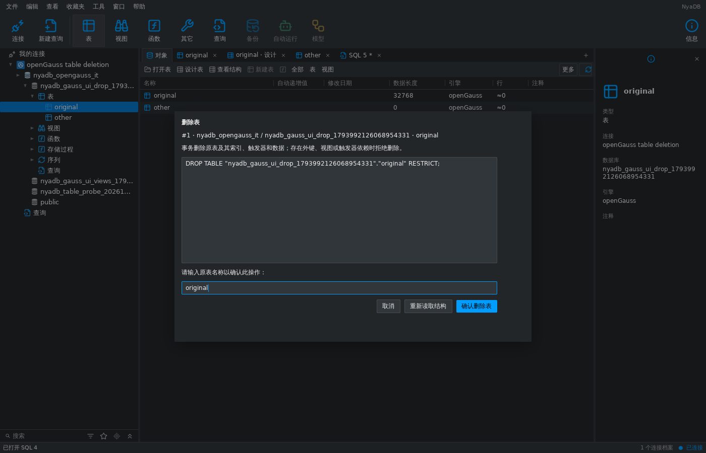

# openGauss 原生事务删除表 — 2026-11-07

本项接通已有 objectworkspace 删除表窗口，提供原生结构快照、限定身份
SQL 预览、输入原表名称确认、事务 RESTRICT 删除，以及原表导航/标签页
清理。openGauss 仍为 `implemented_with_gaps`；表复制、设计、重命名和
清空，以及其它产品能力保留在[完整清单](database-middleware-alignment-2026-11-07.md)。

## 用户流程与能力边界

- 导航和对象列表的删除表菜单可用。读取结构和 SQL 预览均不删除数据；
  原表名称匹配且确认后才执行。取消等待驱动回执，失败后需显式重新读取
  结构才能再次确认。
- 执行使用原 profile/catalog/schema/session generation；成功后移除该表
  数据和结构文档并刷新对象缓存。不相关表页和未保存的 SQL 文本保留。
- 支持原生永久/无日志普通表，包括行存、列存及原生分区根表。
  继承关系、typed table、临时表、外部表、视图及系统 schema 被拒绝。
  结构读取检查所有者、继承所有者权限的角色或服务器管理员权限；普通
  GRANT ALL 不等同于所有者权限。
- 删除使用 `DROP TABLE qualified_name RESTRICT`，包含原表数据、
  索引、规则、触发器、所属序列和存储对象。外部外键和视图依赖会阻止
  删除并回滚；不使用 CASCADE 或 IF EXISTS。所属序列的当前值不是
  结构版本，也不提供其它序列的管理或备份。
- 产品 Objects 能力只开放有实际绑定的操作。表复制和 Apply/CanApply
  绑定仍为空，DesignTables/Accounts/Backup/Restore/Maintenance 仍关闭。

## 原生快照与生命周期

新增独立 `schemaddl.OpenGaussCatalog`，在 Snapshot 中使用 omitempty
扩展并深拷贝所有原生 JSON 字节。它不伪造 PostgreSQL 的版本/目录，也
不将部分记录转换为可编辑或可执行的 DDL。已有 PG/SQLite 持久化形状
在此扩展为空时保持兼容。

一条只读 repeatable-read 目录查询捕获数据库、schema、角色和关系 OID，
以及自动/内部关系依赖闭包的列、默认值、行类型、索引、约束、规则、
触发器、`pg_object`、原生 `pg_partition`/`pg_rlspolicy`、注释、权限依赖、
继承、安全标签和 publication 关联。单条目录结果最多 16 MiB，单条
记录最多 1 MiB，记录最多 10000 个。不读取或执行 `pg_get_tabledef` 的
注释 SQL；真实服务器输出的单引号注释不能作为可靠可执行转储。

真实 openGauss 6.0.0 不支持这里的 LATERAL 形式，且对 UNION CTE
调用 row_to_json 会丢失声明的列别名；实现通过原生标量子查询和明确的
json_build_object 键捕获记录。零值 reltype 不进入数组行类型查询，避免
将所有 typelem=0 的全库类型错误纳入目标。

指纹规范化 JSON 键和记录顺序，使用 UseNumber 保留超过 float64 精度
的整数。仅排除关系/分区的物理文件、行统计和冻结事务字段，以及
pg_object 的 mtime/changecsn。OID、创建身份、ACL、注释、定义、原生
选项及未知字段仍参与结构版本。

删除事务使用 READ COMMITTED，在原限定名称上持有 AccessExclusiveLock
后用新语句重新读取并比较原始版本。锁等待期间的 COMMENT 或 DROP/
同名重建不能成为新执行基线。启用 DDL event trigger 的环境被拒绝。
删除后确认原名称不存在，数据库/schema/角色身份和 schema 记录未变，
再分组确认捕获的关系、行类型和分区 OID 已消失，最后等待 COMMIT 回执。

BEGIN 与设置分开执行，设置失败仍回滚。取消、会话撤销和锁等待均等待
驱动确认；回滚无法确认或 COMMIT 回执丢失则返回 uncertain，丢弃物理
连接并关闭捕获的原会话，不返回已验证结果，也不自动重放删除。
运行时继续翻译公开与原始 generation，拒绝旧绑定，核对返回的原目标
及不存在状态；晚到结果仍属于捕获的原连接。

## 验证

真实服务器：openGauss 6.0.0 PG compatibility，verify-full TLS。
可复现入口是 `tools/verify_opengauss_fixture.py` 的原生集成测试。

原生测试覆盖行存/列存/分区表删除、所属对象、生成列与大精度数据、
包含单引号的表/列注释、规则/触发器、外键和视图 RESTRICT 回滚、
GRANT 与所有者权限、引用名称、修改快照、过期 generation、锁等待中
的外部变更和同名重建、取消/会话关闭，以及真实提交已执行后仅丢失
COMMIT 回执的注入。运行时测试覆盖公开代次转换、连接替换后旧删除
绑定拒绝、新绑定的删除回执与能力开关。

真实 shell 流程覆盖删除菜单、读取及限定 SQL 预览、错误名称不执行、
确认后的原数据/结构页清理、原导航缓存刷新，以及无关文档/SQL 草稿
保留。截图为连接真实服务器的 MyGo 无桌面测试捕获，不作为 Navicat
或原生桌面对比证据。

Go 1.27.3：完整 Go 测试、Go/MyGo vet、2007 条翻译检查及系统 Python
80 项工具测试通过。CGO=0 的 Linux amd64、Windows amd64、macOS arm64
构建通过。AGENTS.md 聚焦包列表（另含 schemaddl）均通过 race 检查，
真实 TLS 的 engines/dbruntime/shell 全部 openGauss 集成及最终删除窗口
回归也通过 race 检查。初次完整 shell race 被默认 10 分钟总时限中止，
当时正在运行的单个测试仅 1 秒；随后单独以 `-timeout=20m` 重跑完整
shell 并通过。临时服务器及其私有环境/证书已按所属身份清理。

## 保留缺口

本项只交付原生删除表。表复制需要独立处理 FK、序列配置及进度、注释、
列统计、触发器/规则、分区和列存等 native LIKE 不完整保留的元数据，
不能直接执行或改名 pg_get_tabledef 输出。可视化表设计、其它表操作、
账户、备份恢复、维护及所有剩余参考产品继续待实现。其它 openGauss
版本和非 PG compatibility 模式仍需独立验证。
