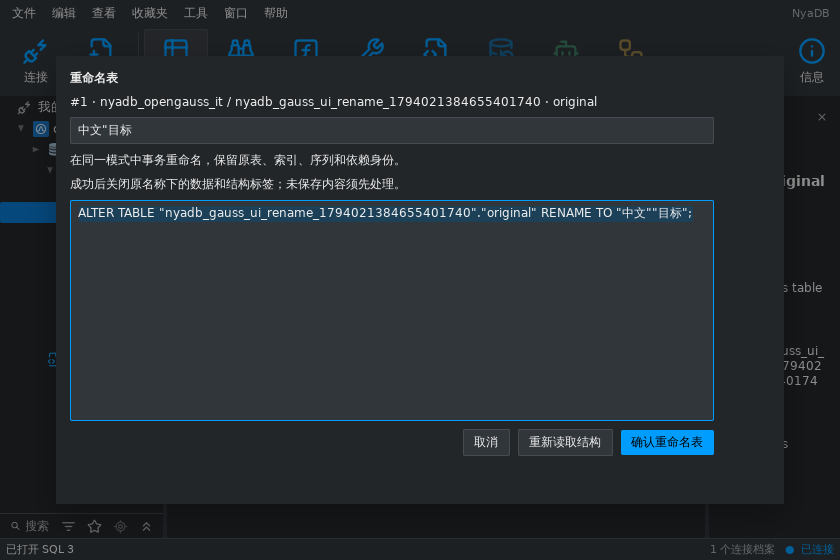
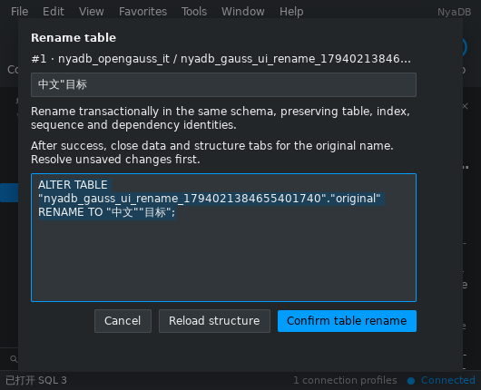

# openGauss 原生表重命名 — 2026-11-07

## 行为与实现

openGauss 表菜单的“重命名”和对象列表内联名称修改现在打开独立预览。
显式读取原表后显示完整限定的 `ALTER TABLE … RENAME TO …`，确认前
不会执行 SQL。目标只属于原 catalog/schema，不覆盖已有表或类型。
表设计的公开保存能力仍关闭；重命名通过中立的可选 Rename 契约独立接通。

取得原表 ACCESS EXCLUSIVE 锁后重新核对原目录修订，捕获模式内已有
类型名称，在同一事务中执行和核验。原表 relation OID、行类型及数组
类型 OID、分区/索引/序列身份、原生属性和依赖记录保留。只允许原表名、
对应类型名和分区根名字变化；已存在的数组类型名称按原生数字后缀避让，
长名称按 UTF-8 字节边界截断。实际结果不能反过来提供预期类型名称。

完整原生记录包含未知属性，整数按原始 JSON 数字保留。目录指纹继续
忽略既有统计值/修改时间；重命名另行比较每个 relation/partition 的
relfilenode，避免把文件替换当成单纯改名。deparse 展示行不是可执行
声明或原生目录证明，不以展示文本代替身份校验。

执行器没有复制/读取行值、执行默认值或重建触发器/规则正文的阶段，
也不创建独立声明。重命名保留引用同一 OID 的视图和外键。原 SQL 文件
和用户写入的程序正文保持自身语义，名称字符串不会被客户端改写。

## 工作台与生命周期

objectworkspace 捕获原 profile、公开/runtime 代次与上下文代次、原表和
目标名称；请求与原生字节深拷贝，私有结果通道只由 UI 线程消费。
dbruntime 只在适配器边界翻译代次，并核对完整目标身份及返回表名。

确认时 shell 处理原表的数据草稿、事务和表设计离开决定。取消离开决定
恢复原预览并撤销旧 continuation；保存数据后才重命名。成功仅失效原
profile/schema 缓存、更新所选树节点，并关闭原名称下的数据/结构标签。
关闭非活动标签保留活动文档 ID；SQL 文本及无关标签保留。

取消操作等待执行器确认，不允许提前换成其它表操作。失败后保留目标
名称和反馈，显式重新读取后才能再次执行。提交回执丢失或回滚无法确认
返回 uncertain 并关闭捕获的原会话；旧代次回执不能关闭新会话或新弹窗。
后台完成回执仍按原连接交付；终端 CloseAll 撤销请求及回调。

## 验证

使用一次性 openGauss 6.0.0 PG 兼容模式服务器及 verify-full TLS。
服务 fixture 覆盖行存、unlogged、列存、range 分区、带引号的目标名、
中文 63 字节名称、数组类型多次重名、默认值/触发器副作用序列未调用、
规则和注释、自引用/传入外键及依赖视图。结果保持原数值精度与原 OID；
逐项注入未知原生属性证明核验拒绝变化。冲突覆盖预览后目录变化、表/
类型占名、错误范围和旧代次；取消/提交/回滚回执丢失都有真实执行回归。

运行时与工作台回归覆盖代次翻译、旧操作撤销、完整目标回执检查、
深拷贝、取消等待、离开决定、旧菜单、后台/关闭完成和新弹窗替换。
真实 shell fixture 通过导航菜单打开预览，取消数据离开决定后再次保存
草稿并重命名，核对精确数据、原标签清理、SQL 保留及对象缓存刷新。

可复现入口：

```sh
python3 tools/verify_opengauss_fixture.py
NYADB_OPENGAUSS_RACE=1 python3 tools/verify_opengauss_fixture.py
```





测试日志及中英文 840×560 / 530×430 预览位于忽略目录
`build/opengauss/table-design/rename-*` 和 `build/opengauss/`。
截图由连接真实服务器的 MyGo 无桌面测试捕获，未作原生桌面或 Navicat
运行差分证明。

最终源码通过 `CGO_ENABLED=0 go test ./...`、`CGO_ENABLED=0 go vet ./...`、
MyGo vet、i18n check（2,025 条消息）、Python 全部 80 项工具测试，以及
Linux amd64、Windows amd64、macOS arm64 的 CGO=0 构建。AGENTS.md 的
完整聚焦包列表加 schemaddl 全部通过 race；其中 shell 为 564.212 秒。
另行运行真实 TLS fixture 下的重命名服务、公开运行层及工作台 race
验证通过。一次性服务器和私有环境文件已清理；其它产品的未启用
服务器 fixture 按条件跳过，不计入本项真实服务器验证。

## 保留边界

仅公开普通持久/unlogged 表的原生重命名。typed/foreign/temp/system
表、blockchain/timeseries 选项、无管理权限、启用的 DDL event hook 或
超过快照/类型名称限额的范围会拒绝。其它存储和分区形态未经本项证明。
完整表设计、清空、其它对象/账户管理、备份恢复和维护继续保留在
[完整对齐清单](database-middleware-alignment-2026-11-07.md)。
