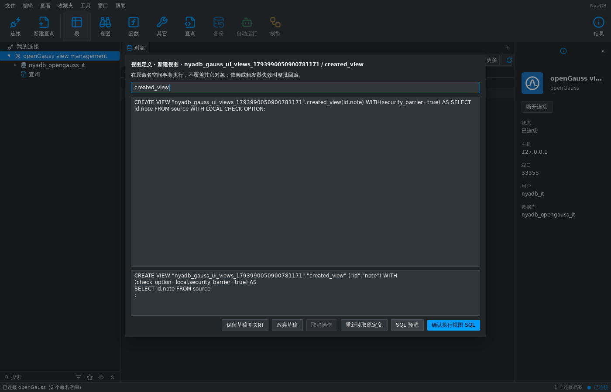
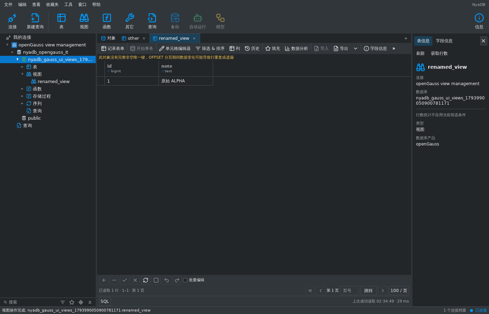

# openGauss 普通视图管理 — 2026-11-07

本项在独立 openGauss 产品中接通普通视图的创建、完整定义编辑、重命名及
RESTRICT 删除。继续复用 objectworkspace 的唯一视图操作状态、SQL 预览、
确认、草稿和异步回执，不增加产品专用 UI 状态。整体对齐状态仍为
`implemented_with_gaps`；表设计、其它对象/账户管理、备份恢复、维护和
跨数据库工具保留在[完整清单](database-middleware-alignment-2026-11-07.md)。

## 可用流程与范围

- 对象工具栏的新建视图及导航菜单的编辑完整定义、重命名、删除入口可用。
  预览只生成 SQL；确认才在原 profile/catalog/schema/session generation
  执行。删除还需输入原视图名称。
- 原生 `CREATE VIEW`/`CREATE OR REPLACE VIEW` 保留显式列名、
  `security_barrier=true|false` 和 `check_option=local|cascaded`。
  `WITH [LOCAL|CASCADED] CHECK OPTION` 规范化为对应选项；支持一个末尾
  分号及随后注释。多条语句、重复/未知选项和跨 schema 请求被拒绝。
- 视图定义最多 1 MiB，目录结果最多 16 MiB，属性最多 10000 个。名称和
  schema 使用原生标识符校验与引用，包含 AS/换行的引用名称不会被选项
  插入破坏。选项独立深拷贝，PG/SQLite 明确拒绝这些原生扩展。
- 现有视图需所有者、继承所有者权限的角色或服务器管理员权限；创建还需
  schema CREATE 权限。只有 SELECT 权限的视图仍可通过共享网格只读浏览，
  不能获取管理快照。系统 schema、物化视图及启用 DDL event trigger 的
  环境不开放此管理入口。
- 替换定义使用原生 OR REPLACE，保留现有列的类型与属性、ACL、所有者、
  视图/列注释、触发器、规则身份、行类型、创建记录及外部入向依赖。
  允许在末尾追加列、修改查询及支持的选项；重命名保留查询及依赖。
  DROP 使用 RESTRICT，依赖阻止删除时回滚，绝不自动 CASCADE。
- 修改成功刷新原视图的数据和结构文档；重命名/删除移除原限定身份文档。
  不相关表页、源表数据和 SQL 草稿保留。编辑视图名称清空创建快照时仍
  保留产品方言，避免返回 SQLite 解析器。

## 原生目录、锁与回执

openGauss 6.0.0 PG compatibility 不提供 PostgreSQL 的 `to_jsonb(record)`、
`to_regclass(text)`，且拒绝对视图执行 `LOCK TABLE`。适配器使用
`row_to_json`、原生 regclass 转换及一条有界目录查询，捕获数据库/namespace/
角色/关系 OID、列、类型、规则、触发器、注释、依赖和 `pg_object` 创建记录。
读取使用只读 repeatable-read 事务及 `search_path=pg_catalog`。

管理事务先比对原始快照，再执行指向已捕获所有者的同所有者
`ALTER VIEW ... OWNER TO ...`，取得事务期 AccessExclusiveLock，随后重新
读取并比对原始快照。等待期间被外部修改或重新创建的视图不能成为新的
执行基线。原生实现更新 `pg_object.mtime/changecsn`，这两个操作记录字段
从指纹和保留校验中排除；creator/ctime/createcsn/valid、关系 OID、定义、
ACL、注释等仍被校验。原生源代码依据是 openGauss-server 6.0.0 的
[tablecmds.cpp](https://github.com/opengauss-mirror/openGauss-server/blob/6.0.0/src/gausskernel/optimizer/commands/tablecmds.cpp)
中的 `AlterTableGetLockLevel` 和 `ATExecChangeOwner`，并有真实服务器测试。

共享数据读取通过 `SELECT * FROM qualified_relation LIMIT 0` 获取原生支持的
只读关系锁，然后在同一事务读取元数据和有界数据。它不需要视图所有权，
也不读取任何行；修复了原有读路径中视图被 LOCK TABLE 拒绝的问题。

BEGIN 与事务设置分开执行，设置失败仍进入回滚。取消等待驱动确认；
回滚无法确认或 COMMIT 回执丢失时返回 uncertain，丢弃物理连接并关闭
捕获的原会话。不会把不确定提交标为已验证，也不自动重放 SQL。
旧 generation 被拒绝，晚到结果仍保留原 profile/namespace/generation 身份。

## 验证与界面证据

真实服务器为 openGauss 6.0.0 PG compatibility，社区镜像及来源见
[核心报告](opengauss-2026-11-07.md)。可复现入口：

```sh
NYADB_OPENGAUSS_RACE=1 python3 tools/verify_opengauss_fixture.py
```

verify-full TLS 原生集成覆盖：视图 CRUD、选项保留与修改、追加列、注释/
ACL/依赖保留、坏查询回滚、外部变更冲突、占用名称、无 CREATE 权限下
的所有者删除、SELECT-only 拒绝管理、旧代次、真实锁等待取消，以及
真实 COMMIT 已执行后仅丢失回执的注入测试。锁等待中外部 COMMENT 和
DROP/同名重建分别被拒绝。纯规则测试检查元数据丢失、无效目录、语句
注入、引用名称、选项克隆及跨引擎拒绝。

真实 shell 测试从菜单执行创建、编辑、重命名和删除，核对预览无副作用、
保存后原数据/结构页刷新、限定身份清理、不相关文档和 SQL 文本保留。
以下是连接真实 TLS 服务器的 MyGo **无桌面测试捕获**，证明此流程与
布局；不作为 Navicat 或原生桌面对比证据。





Go 1.27.3：完整 Go 测试、Go/MyGo vet、i18n 检查和系统 Python 80 项
工具测试通过；CGO=0 的 Linux amd64、Windows amd64、macOS arm64 构建
通过。AGENTS.md 的完整聚焦包列表（另含 schemaddl）及真实 TLS 的
engines/dbruntime/shell 均通过 `-race`；完整 shell 回归耗时约 539 秒，
真实视图菜单流程的 race 渲染耗时约 63 秒。所有所属 fixture 已清理。

## 保留缺口

本项提供完整 SQL 定义的普通视图管理，没有可视化查询构建器、物化视图
管理、所有者/ACL 编辑或未知选项支持。原生目录和锁语义只在 6.0.0 单独
验收，其它支持版本仍需验证。openGauss 表设计、账户、其它对象操作、
备份恢复和维护继续待交付；GaussDB 等其它产品仍是独立接入目标。
