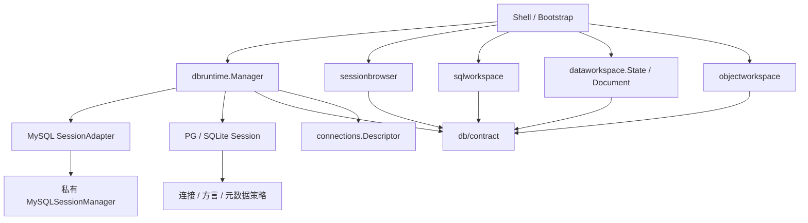

# 三引擎统一运行层与工作区

2026-11-01：MySQL、PostgreSQL、SQLite 的生产会话统一由 `internal/services/dbruntime.Manager` 发布和撤销；SQL、数据、结构分别由已有 `sqlworkspace`、`dataworkspace.State/Document`、`objectworkspace` 管理。独立 `EngineState/EngineDocument`、引擎数据标签及其消费/离开守卫已移除。连接存储和 bootstrap-facing 接口保持兼容。

## 依赖与能力

`connections.Descriptor` 是按产品 Kind 查询的不可变值，提供客户端家族、默认端口、表单类型、方言和产品能力，不持有凭据或运行状态。未知产品默认关闭所有能力。有效能力取产品与适配器能力交集，并检查对应查询、元数据及数据功能是否提供操作；对象的可编辑性继续由实际结构、键和视图限制决定。

`contract.Session` 仅包含 ProfileID、Generation、Capabilities、Close。查询及元数据分别通过 `QueryProvider`、`MetadataProvider` 提供；读取、编辑、事务、导出、分析、导入通过独立的 DataReads/DataEdits/DataTransactions/DataExports/DataAnalysisOperations/DataImports provider 提供。运行层将可用功能组合成按原会话绑定的 `DataRuntime`，不存在的函数保持为空，后端入口返回 `ErrUnsupported`。旧聚合接口仅保留给兼容入口和注入夹具。

MySQL 设计、对象、用户及备份仍使用既有专属模型，经独立的 TableAdministration/ObjectAdministration/AccountAdministration/BackupAdministration 接口组合和运行层包装注入。PG/SQLite 不提供这些能力，本次没有扩展新功能。公共字段/页/编辑/结构/执行模型位于 contract；原 MySQL 模型及错误使用别名保持调用兼容。纯 MySQL 导入审查与值规则位于无驱动依赖的 `db/mysqlspec`。

## 会话、generation 与物理资源

Manager 管理全局单调公开 generation、每个 profile 的连接意图、原句柄发布、查找、断开及终止。provider.Open 返回绑定原 ProfileID 的独立句柄。MySQL 每次连接尝试创建私有原生 manager；PG/SQLite 的会话直接拥有独立池。MySQL 的隧道、初始化 SQL、保活、SQL 租约配额和锁由适配器中的原生 manager 保留。

过期/取消后的成功只能关闭它捕获的句柄。旧句柄关闭、旧管理操作和旧导入 generation 不得按 ProfileID 重新路由到新会话。运行层把公开 generation 转成适配器内部 generation，包含异步管理操作的上下文和流式导入请求。管理、结构、数据和 SQL 的工作函数在 UI 线程捕获原句柄。

SQL 租约支持无网络预留、异步预连接、执行、流式结果、显式替换和释放；MySQL 还提供原有文件执行。每个租约绑定原会话和文档，PG/SQLite 各 SQL 文档持有独立物理连接。关闭丢弃物理连接，避免临时表、search_path 或事务泄漏。断开保留 SQL 文本，恢复必须显式连接原 profile，不重放语句。连接丢失或撤销要求明确恢复。

数据事务通过不透明 token 跨请求保留，运行层验证其原会话所有权；开始请求完成后的取消不会结束事务。各适配器在一个保存请求失败时撤销该请求的 savepoint，保留先前暂存。提交/保存取消等待执行器确认，连接异常不能被描述为确定回滚。

## 命名空间与模型

| 引擎 | Catalog | Schema | 文件路径 |
| --- | --- | --- | --- |
| MySQL | 实际数据库 | 空 | 无 |
| PostgreSQL | 连接固定 database | 实际 schema | 无 |
| SQLite | main | main | 仅连接配置 |

对象身份包含 ProfileID/Catalog/Schema/Kind/Name；命名空间缓存与文档按完整身份查询，导航名称只用于展示。刷新成功同步身份及缓存，失败保留旧缓存；同名对象在不同 schema 下不会合并。结构页保存全部原文定义，PG 的约束/索引、SQLite 的索引/触发器原文继续可查看。

Cell 保留 NULL、文本 NULL、空串、空 BLOB、精确整数/decimal、JSON、日期、布尔、原始字节和截断标记；SQLite 依据驱动实际返回值保留动态类型。空非 nil 二进制载荷在 JSON 中显式保留。DataValue 带类型与独立 NULL/DEFAULT 标记。PG/SQLite 的显式 DEFAULT 仍返回不支持，不把它转成普通值；省略插入字段仍使用服务器默认值。类型化整数、浮点、布尔、decimal 和 JSON 在执行前验证。

RowSnapshot 的两种模式由适配器验证：MySQL 的 fingerprints 保存原始键、字段 SHA-256 指纹与元数据签名；PG/SQLite 的 values 保存完整原始类型化行和键。工作区深复制原始键、字节、类型化单元格、指纹、行快照、游标、编辑映射和保存/核验回执。

## 唯一数据文档

三种引擎使用相同网格、选区、列布局、信息面板、分页、草稿、编辑模态框、离开守卫和后台请求状态。PG/SQLite 的类型选择、显式事务、提交后核验及完整 JSONL 导出迁入同一实现。

MySQL 保留 keyset、字段分块、计数、分析和全部成熟导入导出模式。PG/SQLite 保留 offset、排序及 `= != < > <= >= LIKE IS NULL IS NOT NULL` 筛选语义；不提供的 contains/not_contains/not_like/keyset/分析/导入/计数/分块功能被隐藏或明确拒绝。二进制预览不作为文本值筛选。

仅可靠完整非空键允许编辑；生成字段、视图及无可靠键对象保持只读。写入回执记录 Applied、保存后身份、CommitConfirmed、CommitUncertain、Incomplete 与核验信息。显式事务中重复修改及键变化按逻辑原行归并；不确定提交或不完整核验保留草稿/证据并阻止重放，只允许明确的只读核验。保存错误中止网格随选区触发的自动保存，避免同一失败请求反复发送。SQLite 的原行比较同时校验存储类型与二进制文本比较，大小写不敏感列也能拒绝原始值变动。

私有缓冲通道仅由 UI 线程消费。停放读取/写入按原规则等待激活；非活动文档的关闭保存守卫可以消费该文档回执而不激活它。generation 不匹配结束读取 loading 并保留缓存；写入仍依据回执处理不确定性。页面、计数和字段请求独立取消；字段分块上限 1024 字符/字节，完整编辑上限 1 MiB。关闭释放注册、请求、缓存与回调；关闭非活动标签保持活动 ID。

## 持久化兼容

- MySQL：`mysql_data_layout:` + base64url(JSON `[profileID,database,table]`)，保留原有完整版本 1 格式。
- PG/SQLite：`engine_data_layout:` + base64url(JSON ObjectRef)，保留 `{version,order,widths}` 版本 1 格式。
- 通用网格的 PG/SQLite 表配置另用 `engine_data_profiles:`，不覆盖旧布局值。
- 本次不迁移 Profile/凭据存储；密码仍由独立 vault 提供。

验证命令、三引擎截图及证据范围见 [统一验证记录](unified-database-verification.md)。
